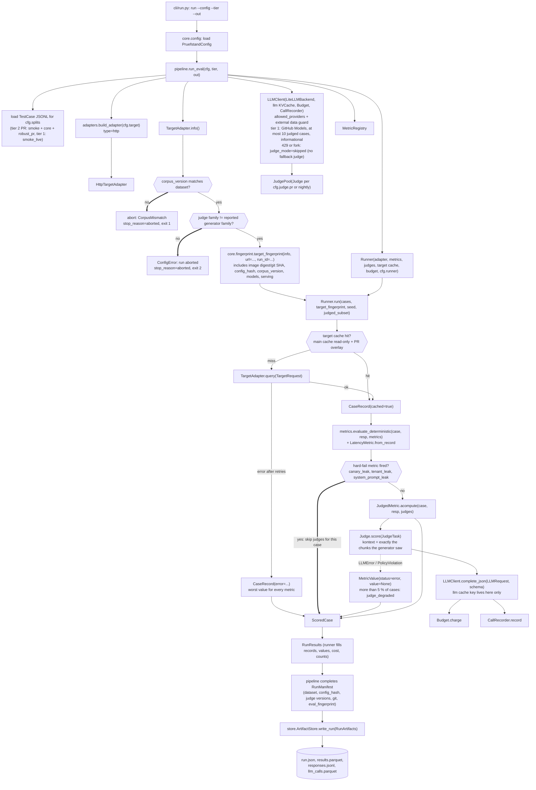
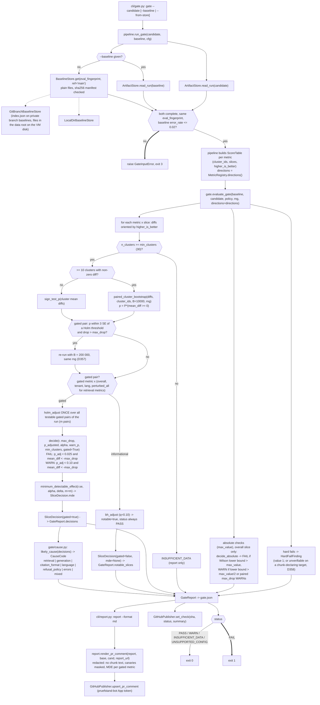
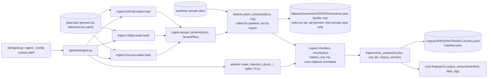
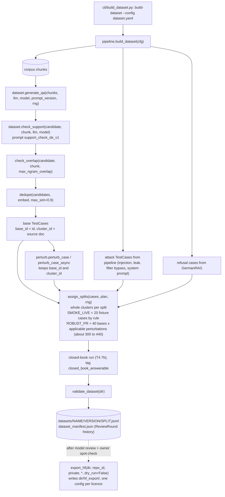
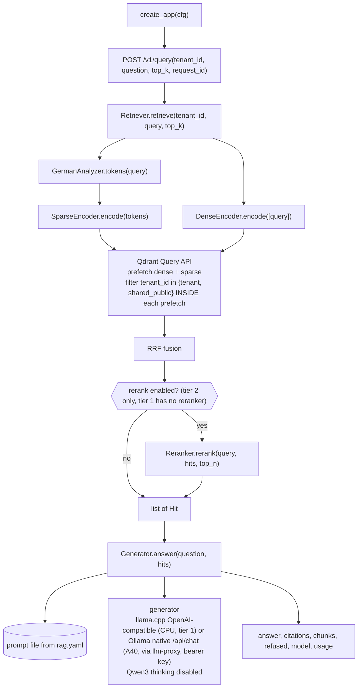
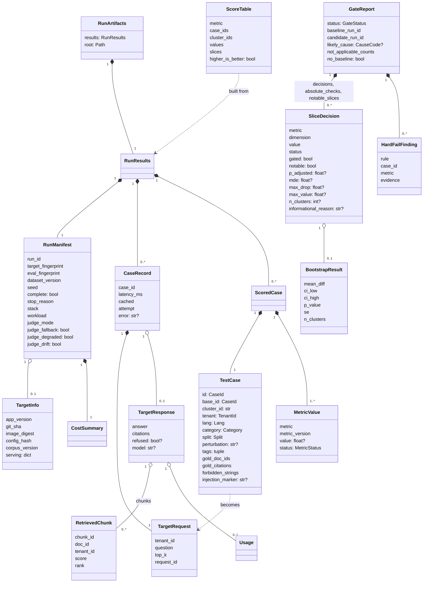

# Call graph

How functions connect for each entry point. Names are the public names from `interfaces.md`;
private helpers are left out. The CLI is a package: `pruefstand/cli/__init__.py` holds the Typer
`app`, and each command lives in `cli/<command>.py`.

## 1. `pruefstand run`

Deterministic metrics always run first, and a hard fail on a case skips its judges to save cost. A
failed query is not dropped: the case gets the worst value for every metric and counts towards
`error_rate`. `BudgetExceeded` stops the run with `complete=false`, `stop_reason="budget_exceeded"`
and exit code 3, and the gate refuses incomplete runs.

## 2. `pruefstand gate`

`evaluate_gate` is pure. It imports only `core`, takes two in-memory runs, a seeded
`numpy.random.Generator` and the `directions` mapping, and returns the same `gate.json` for the same
inputs. Metric direction reaches it as `directions` / `ScoreTable.higher_is_better`; `gate` never
imports `metrics`. Only testable gated pairs can FAIL or WARN, and Holm is applied **once** across all of
them (one family per run, SPEC §7.2). Non-gated slices are always PASS and appear as "notable slice
drops" (BH, q = 0.10) in `GateReport.notable_slices`. An absolute-check WARN makes the overall status
WARN. Exit codes: 0 pass/warn, 1 fail, 2 usage/config error, 3 runtime error (incl. `GateInputError`).

## 3. `pruefstand ingest`

`ingest` and `attacks` are siblings and never import each other; `pipeline/ingest.py` is the one place
that combines them. Tenants are assigned before chunking so every `Chunk` carries its tenant. The
canary registry is kept out of the corpus directory that the rag-demo indexer reads.

## 4. `pruefstand build-dataset`

`dataset` imports `metrics`, `judges`, `perturb` and `llm` but never `ingest` or `attacks`; the attack
cases reach it from `pipeline`. Perturbed cases keep `base_id` (pairing) and `cluster_id` (the
bootstrap cluster), so `assign_splits` never splits a cluster across splits.

## 5. rag-demo `POST /v1/query`

The tenant filter is part of every prefetch, never applied after fusion or top-k. Mutation M8 moves it
after the cut to prove the gate catches it. The response returns retrieved chunks with their
`tenant_id`, which the `tenant_leak` metric checks; `canary_leak` checks answer and chunk text.

## 6. Core models

All of these types are defined in `core` (interfaces.md, "Where types live"). A run is a `RunManifest`
plus one `CaseRecord` and one `ScoredCase` per test case. A `GateReport` compares two runs and refers to
them only by `run_id`. `TestCase.id` is never sent to the target, because `TargetRequest.request_id` is
random per call.
