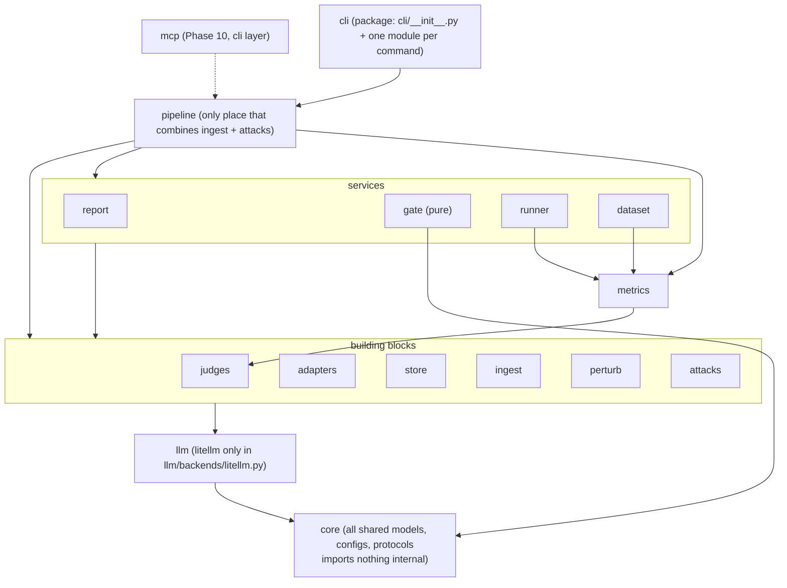
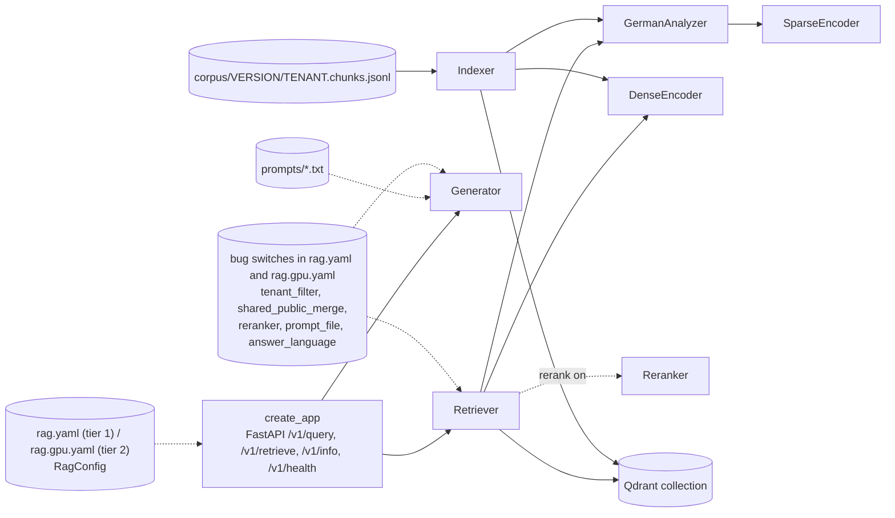
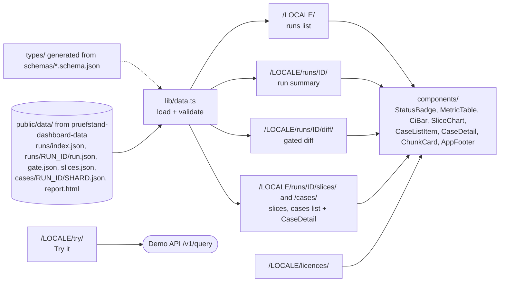

# Components

## 1. Layers of the `pruefstand` package

The diagram is the layer order from `CLAUDE.md` §4: a module may import any module in a **lower**
row, never one in a higher row, and never a sibling in the **same** row. `pipeline` is the only module
that wires `ingest` and `attacks` together (canary planting, injection docs). `gate` imports only `core`
(plus numpy/scipy): metric direction reaches it as `directions` / `ScoreTable.higher_is_better`, filled by
`pipeline` from `MetricRegistry.directions()`. All shared types live in `core` (interfaces.md, "Where types live").

### import-linter contracts (created in T0.1, extended per module task)

Copied verbatim from ADR-0016 (which wins on any difference):

| Contract | Type | Rule |
| --- | --- | --- |
| layers | layers | `cli > pipeline > (report \| gate \| runner \| dataset) > metrics > (judges \| adapters \| store \| ingest \| perturb \| attacks) > llm > core` |
| gate-pure | forbidden | `pruefstand.gate` must not import `llm, adapters, store, runner, judges, metrics, httpx, litellm` |
| llm-gateway | forbidden | only `pruefstand.llm.backends.litellm` may import `litellm`, `openai`, `anthropic` |
| deterministic-no-llm | forbidden | `pruefstand.metrics.deterministic` must not import `pruefstand.llm`, `pruefstand.judges` |
| sut-independent | forbidden | `rag_demo` must not import `pruefstand` |
| core-leaf | forbidden | `pruefstand.core` imports no other `pruefstand.*` module |
| siblings-independent | independence | modules in the same row never import each other; shared types live in `core` (interfaces.md "Where types live") |

## 2. Module catalogue

| Module | Responsibility | Public API (see interfaces.md) | Depends on | Used by |
| --- | --- | --- | --- | --- |
| `core` | All shared models, configs and protocols; ids, errors, hashing, fingerprints, citation parser, logging | `TestCase`, `Target*`, `RunManifest`, `RunResults`, `GateReport`, `Chunk`, `PruefstandConfig`, `GatePolicy`, protocols, `stable_hash(*parts)`, `core.fingerprint`, `core.citations` (`extract_citations`, `normalise`) | stdlib, pydantic, structlog | everything |
| `llm` | Single gateway to every LLM (real providers only: Ollama on the A40s (`ollama/`), llama.cpp, GitHub Models); `llm` cache (judge, datagen, perturbation calls), retries, budget, provider allowlist + external-provider data guard, call logging, prompts, cassette recording | `LLMClient`, `LiteLLMBackend` (`llm/backends/litellm.py`), `Budget`, `CallRecorder`, `PromptRegistry`, `PromptTemplate` | core, litellm | judges, perturb, dataset, pipeline |
| `adapters` | Call any RAG system the same way (Target API v1 over HTTP) | `TargetAdapter`, `HttpTargetAdapter`, `build_adapter` | core, httpx | runner, pipeline |
| `metrics` | Deterministic metrics (incl. `error_rate`, `tenant_leak`) + judged metrics | `MetricRegistry`, `evaluate_deterministic`, metric classes | core, judges (judged only) | runner, dataset, pipeline |
| `judges` | German judge prompts, verdict parsing, calibration stats | `Judge`, `JudgePool`, `JudgeTask`, `JudgeVerdict`, `cohens_kappa`, `spearman`, `calibration_table` | core, llm | metrics, experiments |
| `store` | Artefacts, baselines, caches, DuckDB index | `ArtifactStore`, `BaselineStore`, `LocalDirBaselineStore`, `GitBranchBaselineStore`, `KVCache`, `DiskKVCache`, `RunIndex` | core, diskcache, duckdb, pyarrow | runner, pipeline |
| `ingest` | Download parsing, chunking, tenant assignment, corpus writing | `Loader`, `Chunker`, `GiiXmlLoader`, `OldpLoader`, `EurLexLoader`, `ParagraphChunker`, `DecisionSectionChunker`, `ArticleChunker`, `FixedTokenChunker`, `assign_tenants`, `write_corpus` | core, lxml, datasets | pipeline |
| `perturb` | German metamorphic perturbations | `Perturbation`, `LLMPerturbation`, `PerturbResult`, `perturb_case` | core, llm | dataset |
| `attacks` | Canaries, injection docs, leak/bypass/system-prompt probes | `Canary`, `CanaryRegistry`, `plant_canaries`, `make_injection_docs`, `make_leak_probes`, `make_filter_bypass_probes`, `make_system_prompt_probes` | core | pipeline |
| `runner` | Run cases against a target concurrently and score them | `Runner` (target cache owner) | core, adapters, metrics, judges, store | pipeline |
| `gate` | Paired cluster bootstrap, Holm/BH, Wilson absolute checks, MDE, decisions, hard fails, likely cause | `paired_cluster_bootstrap`, `holm_adjust`, `bh_adjust`, `wilson_interval`, `sign_test_p`, `power_estimate`, `minimum_detectable_effect`, `decide`, `evaluate_gate`, `likely_cause` (`gate/cause.py`) | core, numpy, scipy | pipeline |
| `report` | PR comment, HTML, JSON, evidence record, GitHub publishing | `render_pr_comment`, `render_html`, `build_evidence_record`, `GitHubPublisher` | core, jinja2, httpx | pipeline |
| `dataset` | QA generation, filters, splits, validation, HF export | `generate_qa`, `check_support` (LLMClient + `support_check_de_v1`), `check_overlap`, `dedupe`, `assign_splits`, `validate_dataset`, `export_hf`, `DatasetManifest` | core, llm, metrics, judges, perturb | pipeline |
| `pipeline` | Use cases wiring everything | `run_eval`, `run_gate`, `build_dataset` | all lower layers | cli |
| `cli` | Typer commands, exit codes | `pruefstand run/gate/report/baseline/build-dataset/ingest/validate/schema/power`, `export-dashboard` (T8.1), `mcp` (T10.1), `drift` (T10.4) | pipeline | users, GitHub Action |

## 3. rag-demo (system under test)

Every behaviour that a mutation (RQ3) toggles lives in the rag-demo config (`rag.yaml` tier 1, `rag.gpu.yaml` tier 2, which the tier-2 gate and the T6.5 reranker demo use, X3.15): hybrid on/off, compound split,
rerank, top-k, chunking, prompt file, generator model, plus the **real bug switches** used by tier-1 CI
to prove FAIL paths (ADR-0008): `tenant_filter: inside | post_topk`, `shared_public_merge:
filtered | unfiltered`, `reranker: on | off`, `injection_guard: on | off`, `system_prompt_guard: on | off`, `top_k`, prompt variants, `answer_language: auto | en`. v0 (T1.13)
runs on CPU (BM25 + small dense model, llama.cpp generator); T3.x adds hybrid, the CPU reranker (VM) and the Ollama generator on the A40s. The package reads corpus files through its own
reader validated by `schemas/chunk.schema.json` and never imports `pruefstand`.

| Component | Responsibility |
| --- | --- |
| `create_app` | Implements Target HTTP API v1; computes `config_hash`; exposes `/v1/info` incl. `serving` with **static fields only** (engine, engine_version, quantization, GPU model, model file sha256, X3.13) and `/v1/health` with runtime counters (stripped `<think>` blocks, truncated passages) |
| `RagConfig` | Typed `rag.yaml` (tier 1, CPU) / `rag.gpu.yaml` (tier 2: Ollama via `LLM_PROXY_URL`, `RERANK_URL`; X3.15) |
| `GermanAnalyzer` | NFC, lowercase, optional ß folding, Snowball German stemming, optional compound split |
| `SparseEncoder` | Hashed vocabulary + term weights; IDF applied by Qdrant |
| `DenseEncoder` | small multilingual CPU model (v0, tier 1) or `bge-m3` via Ollama `/api/embed` on the generator card (tier 2, through `llm-proxy`); e5-family models get `query: ` / `passage: ` prefixes and truncation with a logged count (D121) |
| `models.py` | Only home of rag-demo models: `RagConfig`, `SparseVector`, `Hit`, `GenOutput` |
| `Indexer` | Reads chunk files, encodes, upserts into one collection with a `tenant_id` payload index |
| `Retriever` | Dense + sparse prefetch, **tenant filter inside each prefetch**, RRF fusion, optional rerank |
| `Reranker` | `BAAI/bge-reranker-v2-m3` in `rerank-cpu` on the VM CPU, TEI-compatible `POST /rerank`, top 10 with passages truncated to 256 tokens, batched (Y4.2; no auth, `gate-net` only, Y2.2) (tier 2 only; tier 1 runs `reranker: off`, D121, D198) |
| `Generator` | Renders prompt file, calls llama.cpp on CPU (OpenAI-compatible, tier 1) or Ollama on the A40s through `llm-proxy` with the **native** `/api/chat` (`"think": false`, Y3.1; the proxy enforces only `num_ctx`, `keep_alive` and the model allow-list, and sampling options pass through within the catalogue `option_bounds`, D252/N2, DEV13-07; the prompt budget `num_ctx − num_predict` is counted with the generator's own baked tokenizer, D307) and the bearer key `PRUEFSTAND_CANDIDATE_API_KEY` (Y2.1; Qwen3 thinking disabled, D95), formats citations, sets the `refused` flag (informational: the gate decides refusal, D116) |

## 4. Dashboard

The dashboard is a static export: all data comes from published artefact JSON (the public
dashboard-data repo, D108) validated against the generated TypeScript types; the only runtime call is
the "Try it" page to the demo API. Routes carry a locale prefix (`LOCALE` = `de`, the default, or `en`,
D137) and every page has the licence attribution footer. Routes and component names follow
`docs/design/ui-spec.md` §2.1 and §5, which win on any difference. It renders
numbers exactly as stored in `gate.json`/`run.json` and performs no metric computation.
