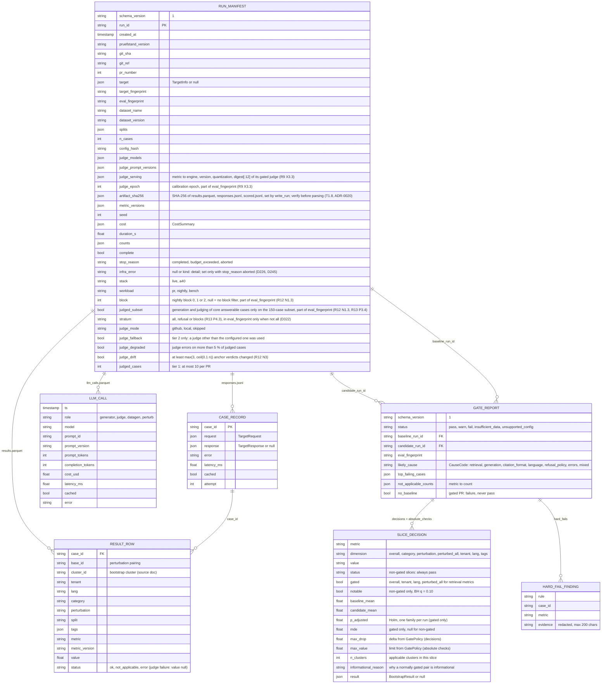
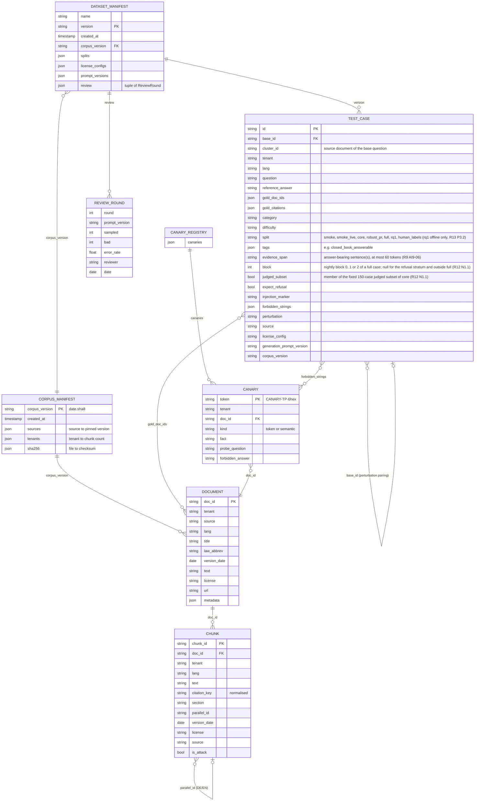

# Data model

Files are the source of truth (ADR-0003). DuckDB (`RunIndex`) is a rebuildable, read-only index
over them. Field names below are the persisted names from `interfaces.md`.

## 1. Run artefacts



`results.parquet` is long format (one row per case × metric), so slicing and pairing are a join on
`case_id`. A case that errored keeps its rows with the worst value per metric (it is never dropped)
and counts towards `error_rate`. Hard-fail evidence is redacted to 200 characters so canaries never spread
beyond the artefact that found them.

## 2. RunIndex (DuckDB)

Rebuilt by `RunIndex.refresh()` from `runs/*/`. Never written by any other code path.

| Table | Columns (type) | Key |
| --- | --- | --- |
| `runs` | `run_id VARCHAR`, `created_at TIMESTAMP`, `git_sha VARCHAR`, `git_ref VARCHAR`, `pr_number INTEGER`, `target_fingerprint VARCHAR`, `eval_fingerprint VARCHAR`, `dataset_name VARCHAR`, `dataset_version VARCHAR`, `n_cases INTEGER`, `seed INTEGER`, `stack VARCHAR`, `workload VARCHAR`, `judge_mode VARCHAR`, `cost_usd DOUBLE`, `prompt_tokens BIGINT`, `completion_tokens BIGINT`, `gpu_seconds DOUBLE`, `duration_s DOUBLE`, `complete BOOLEAN`, `stop_reason VARCHAR`, `infra_error VARCHAR` (NULL unless aborted by an infra failure, D245), `path VARCHAR` | `run_id` |
| `results` | `run_id VARCHAR`, `case_id VARCHAR`, `base_id VARCHAR`, `cluster_id VARCHAR`, `tags VARCHAR[]`, `tenant VARCHAR`, `lang VARCHAR`, `category VARCHAR`, `perturbation VARCHAR`, `split VARCHAR`, `metric VARCHAR`, `metric_version VARCHAR`, `value DOUBLE`, `status VARCHAR` | `(run_id, case_id, metric)` |
| `llm_calls` | `run_id VARCHAR`, `ts TIMESTAMP`, `role VARCHAR`, `model VARCHAR`, `prompt_id VARCHAR`, `prompt_version VARCHAR`, `prompt_tokens INTEGER`, `completion_tokens INTEGER`, `cost_usd DOUBLE`, `latency_ms DOUBLE`, `cached BOOLEAN`, `error VARCHAR` | – |
| `gate_decisions` | `candidate_run_id VARCHAR`, `baseline_run_id VARCHAR`, `overall_status VARCHAR`, `metric VARCHAR`, `dimension VARCHAR`, `value VARCHAR`, `status VARCHAR`, `gated BOOLEAN`, `notable BOOLEAN`, `p_adjusted DOUBLE`, `mde DOUBLE`, `baseline_mean DOUBLE`, `candidate_mean DOUBLE`, `mean_diff DOUBLE`, `ci_low DOUBLE`, `ci_high DOUBLE`, `p_value DOUBLE`, `n_cases INTEGER`, `n_clusters INTEGER` | `(candidate_run_id, metric, dimension, value)` |

## 3. Corpus and dataset



A test case's `base_id` points to its unperturbed source and pairs perturbations with their base;
`cluster_id` (the source document) is the unit the bootstrap resamples. The
`CanaryRegistry` is the link between planted documents and `forbidden_strings` in leak probes; it
is test data only and never shipped inside the rag-demo image.

## 4. Caches (`DiskKVCache`)

| Namespace | Owner | Key | Value | Invalidated by |
| --- | --- | --- | --- | --- |
| `target` | `Runner` | `stable_hash(target_fingerprint, case.id, case.question, case.tenant)` | serialised `TargetResponse` | any change to image digest/git SHA, `rag.yaml`, corpus version, models or serving stack (all inside `target_fingerprint`) |
| `llm` | `LLMClient` only (judge, datagen, perturbation calls) | `stable_hash(model, provider-reported version, prompt_id, prompt_version, rendered messages, temperature, max_tokens, seed, response_format)`; the rendered messages contain **all** inputs: question, answer, context chunk ids and text hashes, reference (D113) | serialised `LLMResponse` | new model or provider version, new prompt version, any change in inputs or decoding parameters; `judge_drift` invalidates that judge's entries |

Write rules (ADR-0006): only `main` and nightly jobs write the shared caches. PR jobs read the main
cache through a **PR-scoped overlay** that takes their writes and is deleted when the job ends, so a PR
can never poison later runs. Opaque third-party targets without `/v1/info` get
`target_fingerprint = stable_hash(url, run_id)`, i.e. no reuse across runs. Caches only save time:
deleting them changes cost, never results (beyond LLM nondeterminism, which the noise study measures).

## 5. Qdrant collection (rag-demo)

| Item | Value |
| --- | --- |
| Collection | `chunks__<corpus_version>__<analyzer_hash8>__<embed_model_slug>` (index fingerprint, T3.4); alias `chunks_active` switched atomically after a full build; a PR that changes the embedding model or chunking gets a PR-scoped `pr_<N>_<shortsha>` collection, deleted after the job |
| Dense vector | name `dense`, size = embedding dimension (1024 for `bge-m3` via Ollama on the A40s; the tier-1 CPU model's own size), distance `Cosine`; e5-family models embed with `query: ` / `passage: ` prefixes (D121) |
| Sparse vector | name `sparse`, modifier `idf` (BM25-style term weights from `SparseEncoder`) |
| Point id | UUIDv5 of `chunk_id` |
| Payload | `chunk_id`, `doc_id`, `tenant_id`, `lang`, `citation_key`, `section`, `source`, `version_date`, `is_attack`, `text` |
| Payload indexes | `tenant_id` keyword with `is_tenant=true`; `lang`, `doc_id` keyword; `is_attack` bool |
| Query | Query API: prefetch `dense` + prefetch `sparse`, each with `filter: tenant_id in [tenant, "shared_public"]`, fusion `rrf` |

`is_tenant=true` tells Qdrant to co-locate each tenant's points, which makes the in-query filter
both fast and the natural place for the tenant boundary.

## 6. File layout

```text
corpus/<corpus_version>/            read by the rag-demo indexer
  manifest.json
  <tenant_id>.chunks.jsonl          kanzlei_mueller, versicherung_nord, stadtwerke_sued, shared_public
                                    (one Chunk per line sorted by doc_id, chunk_id; tenant ids match [a-z][a-z0-9_]{0,62}; T2.5, D431-D438)
corpus/<corpus_version>/canaries.public.json   public canaries of the slice registry (read by the dashboard export)
datasets/canaries/<corpus_version>/
  canaries.json                     public CanaryRegistry (outside the corpus dir the app reads)
datasets/canaries/retired.json      rotated-out public canaries (T4.6, D93)
.private/canaries/heldout.json      held-out set: git-ignored locally, stored only in the private repo
datasets/<name>/<version>/
  dataset_manifest.json
  smoke.jsonl  smoke_live.jsonl  core.jsonl  robust_pr.jsonl  full.jsonl  rq1.jsonl  human_labels.jsonl
datasets/<name>/<version>/hf_export/  dry-run HF layout <license_config>/<split>.jsonl + README.md (git-ignored; T4.1, D484)
datasets/fixtures/                  hand-written + synthetic_v1 cases committed for CI
data/sources.yaml  data/manifests/  data/raw/ (git-ignored)
runs/<run_id>/                      local; on the executor VM: $PRUEFSTAND_HOME/runs/<run_id>/ (VM disk)
  run.json  results.parquet  responses.jsonl  scored.jsonl  llm_calls.parquet  gate.json  report.html
data root $PRUEFSTAND_DATA_ROOT/baselines/ (= /mnt/pruefstand/baselines, plain dir on the VM disk, ADR-0019; baseline FILES, X2.7, D209;
  written only by baseline-promote.yml, write-then-rename):
  <eval_fingerprint>/<ref>/run.json                            ref = main | nightly-b0..b2 | release-b0..b2 (current baseline; R12 N1.4, R13 D305 block-wise release anchor)
  <eval_fingerprint>/<ref>/results.parquet
  <eval_fingerprint>/<ref>/responses.jsonl.zst                 only in <ref>/, never in history/
  <eval_fingerprint>/<ref>/scored.jsonl.zst                    only in <ref>/ (T6.1, D441): the lossless ScoredCase lines (full TestCase bodies:
                                                               as sensitive as responses.jsonl.zst, never exported)
  <eval_fingerprint>/<ref>/manifest.json                       sha256 per file, checked on read (no signatures, ADR-0004)
  <eval_fingerprint>/history/<run_id>/                         run.json, results.parquet, manifest.json (last 20 kept)
private repo pruefstand-gate, branch baselines (protected, no force-push; INDEX ONLY, X2.7):
  baselines/index.json              per (fingerprint, ref): ordered run ids (newest = current), manifest sha256, created_at, git_sha
private repo pruefstand-gate, branch executor-state:
  state/processed.jsonl             one line per dispatched gated run: pr, head_sha, dispatch_run_id, result, run_id, at (D102; a record, not a trigger, R13 P1.2)
  state/nightly_counter             one integer, block = counter mod 3, incremented only after a completed nightly (R13 P4.4, D299)
data root $PRUEFSTAND_DATA_ROOT/backups/<date>/ (inside the TrueNAS zvol snapshots, ADR-0019):
  pruefstand-gate.bundle.tar.age    weekly: git bundle --all of the private repo + tar of baselines/, age-encrypted as a whole (X2.6)
data root $PRUEFSTAND_DATA_ROOT/backups/laptop-receipt.json  {bundle, sha256, copied_at}, written over ssh into the VM as the owner user after each weekly copy (Y5.5, A13-M10)
public repo pruefstand-dashboard-data, branch main (sanitised, D108, layout per interfaces.md "Exported layout"):
  runs/index.json                   DashboardRunIndex (RunIndexEntry rows)
  runs/<run_id>/run.json  gate.json  slices.json  report.html
  cases/<run_id>/<shard>.json       DashboardCases, at most 500 cases per shard
  manifest.json                     sha256 per file, verified by deploy.yml
                                    (whole tree rewritten by push_dashboard_data on every push: newest 200 runs, cases + report.html for the newest 20; push fails above 1 GB repo size, R13 P5.1, D300)
public repo pruefstand-dashboard-data, branch heartbeat (single commit, force-pushed every 15 min during jobs, Y5.1):
  heartbeat.json                    timestamp, current/last job (D109), tunnel_ok, ollama_gpu0_ok, ollama_gpu1_ok, data_root_ok (each with
                                    <field>_false_since), last_nightly_at, last_nightly_status (ok, failed, aborted: window_exceeded, skipped: maintenance,
                                    skipped: runner busy, skipped: preflight REASON), maintenance, drift_no_release_baseline, runner_version,
                                    laptop_backup_age_days (R12 A12-M2, N4.3, R13 D311);
                                    read by executor-health.yml
.cache/pruefstand/                  DiskKVCache (target/, llm/; PR overlay under pr-<N>/); executor: $PRUEFSTAND_HOME/pruefstand-cache/ (VM disk)
.pruefstand/index.duckdb            RunIndex
```

Public artefacts and the dashboard only get sanitised copies (run.json, gate.json, results without
answer or chunk text) through the dashboard-data repo. Full responses stay in the VM run dirs and the
baseline files in the data root; the held-out canaries stay in the private repo and its encrypted backups, and the
canary registry is never mounted into a candidate container (X2.5).

Tier-1 baselines are GitHub Actions artefacts of the public repo (X1.4): `live-baseline` (written only
by `push: main` runs of the 20-case `smoke_live` PR shape; the only one PRs compare to) and
`live-baseline-nightly` (nightly 40-case runs), 90 days each.

## 7. Retention and backup

| Data | Where | Retention | Backup |
| --- | --- | --- | --- |
| Raw corpora / model weights | local / data root (`data/`, `corpus/`); model weights only in the cluster's model store `/data/dheena/Models` (ADR-0019) | never in git; re-downloadable from pinned manifests | none needed (pinned downloads) |
| Corpus + dataset versions | local, HF (dataset) | keep every released version; drafts deleted after release | HF + git tags |
| PR run dirs (incl. `responses.jsonl`) | VM `$PRUEFSTAND_HOME/runs/` | 14 days (nightly `runs-prune`) | none |
| PR / promote artefacts (`run.json`, `gate.json`, `comment.md`) | private-repo Actions artefacts | 14 days (`retention-days: 14`, D110) | none |
| Nightly run dirs | VM `$PRUEFSTAND_HOME/runs/` + sanitised copy in the dashboard-data repo | last 90 runs (`runs-prune`, count-based) | dashboard copy only |
| Baselines (X2.7) | files in the data root `$PRUEFSTAND_DATA_ROOT/baselines/` (VM disk); private branch `baselines` holds only `index.json` | current baseline per fingerprint and ref (`main`, `nightly-b<k>`, `release-b<k>`); last 20 `history/` entries per fingerprint (monthly `baseline-prune` in `baseline-promote.yml`, D110); fingerprints unused for 90 days deleted; release anchors (`release-b<k>`) kept; no branch rollover (ADR-0004). Measured per-promotion sizes (T6.3): _pending_ | weekly encrypted bundle (X2.6) + TrueNAS zvol snapshots (daily, keep 14) |
| Tier-1 baselines (X1.4) | public Actions artefacts `live-baseline`, `live-baseline-nightly` | 90 days | none (re-created by the next `main` push / nightly) |
| Processed-work state and nightly block counter | private branch `executor-state` | kept (small) | weekly encrypted bundle |
| Dashboard data + heartbeat | public repo `pruefstand-dashboard-data` (`main`; heartbeat on branch `heartbeat`) | `push_dashboard_data` (T6.1) rewrites the **whole** tree on every push: newest 200 runs in `runs/index.json`, case shards + `report.html` only for the newest 20, everything older deleted (R13 P5.1, D300); the push **fails above 1 GB** repo size (checked before pushing), so the data repo stays bounded; heartbeat force-pushed as one commit (no history growth) | re-exportable from run dirs and baselines |
| Backups (X2.6) | data root `$PRUEFSTAND_DATA_ROOT/backups/<date>/pruefstand-gate.bundle.tar.age` + owner's laptop | 8 in the data root; a **mandatory** weekly laptop copy, confirmed by `backups/laptop-receipt.json` and checked by `backup-check` (> 8 days → issue `backup-stale`, Y5.5) | the whole bundle is `age`-encrypted; the private key exists only on the owner's laptop |
| Caches | VM disk (`$PRUEFSTAND_HOME/pruefstand-cache/`) | shared cache evicted at 5 GB (LRU); PR overlays deleted after each job | none (caches only save time) |
| RunIndex | derived | rebuild any time | none |
| Canary registries | public set with the dataset version; held-out set in the private repo only, never mounted into a candidate container (X2.5) | never in the demo image, the HF dataset or public logs | held-out: inside the weekly encrypted bundle (X2.6), in the data root and on the owner's laptop |
