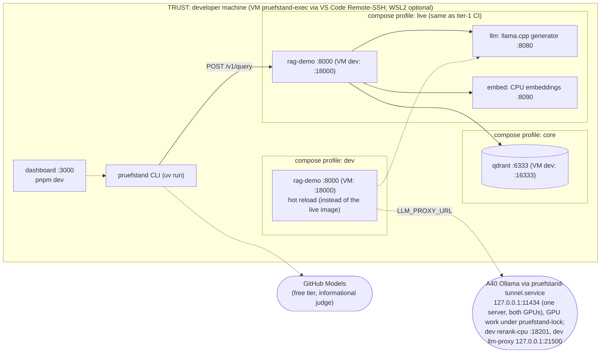
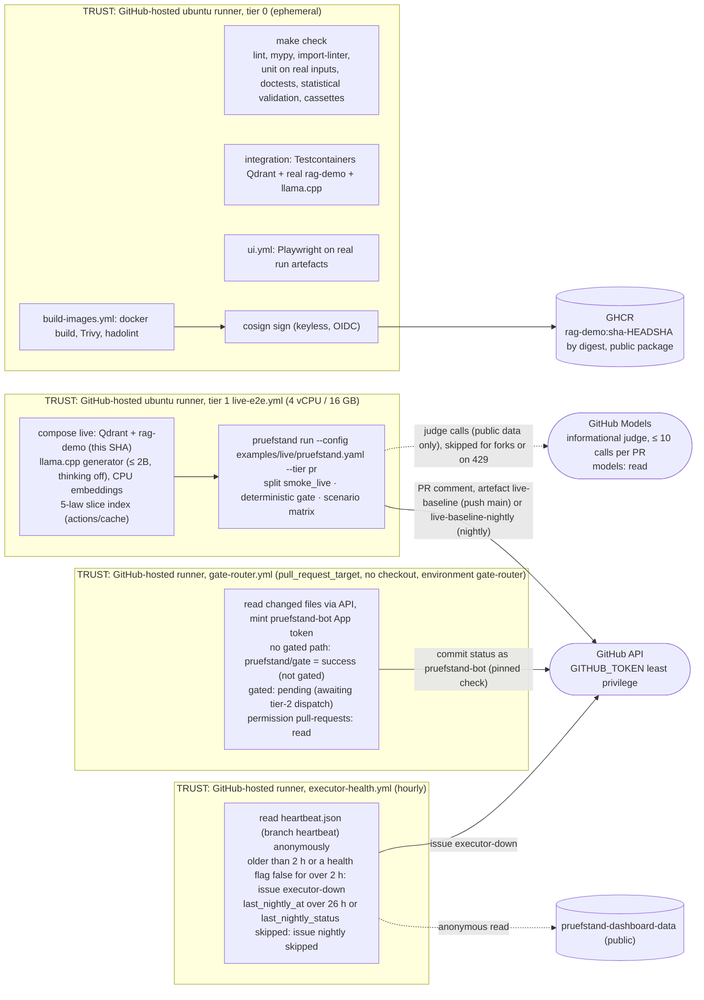
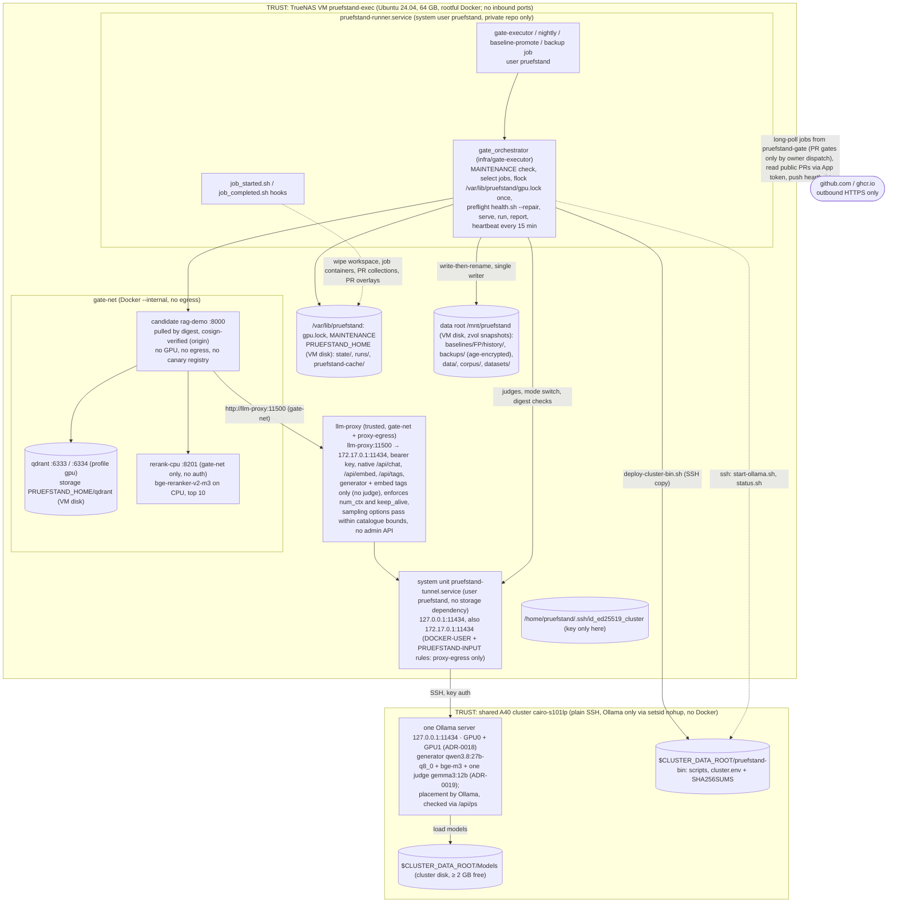
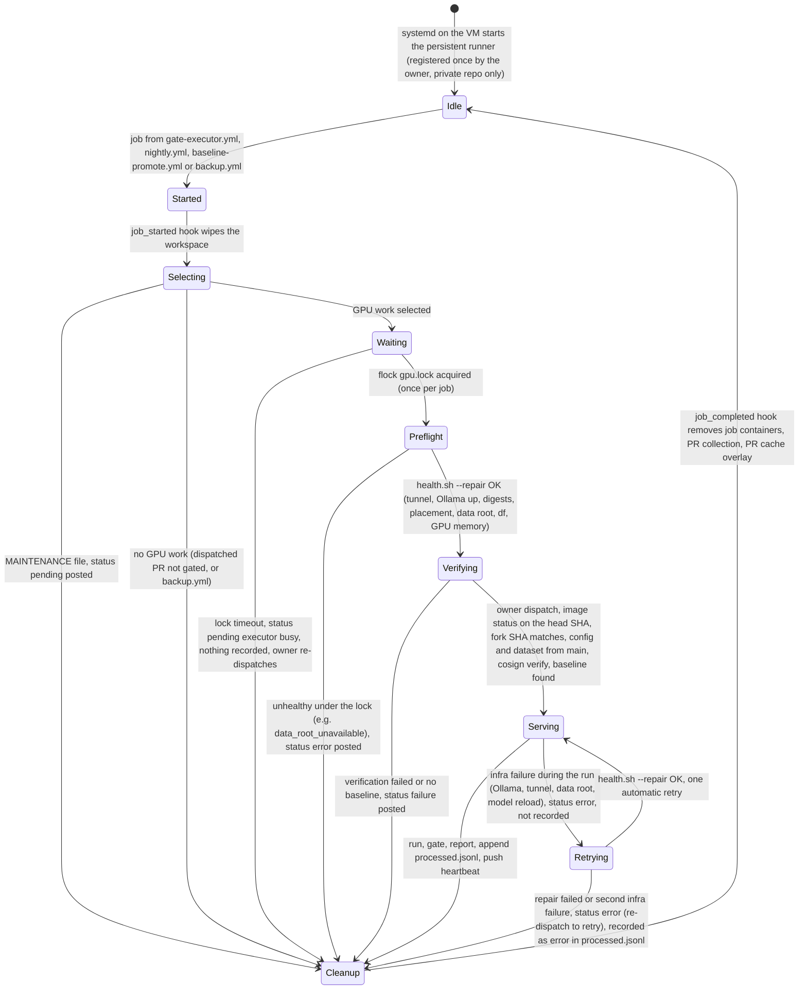

# Deployment

Eight environments, each with an explicit trust boundary. The CI/CD pipelines themselves are described
in `docs/engineering/ci-cd.md`, GPU sizing in `docs/engineering/gpu-cluster.md` (the single source for
GPU placement and VRAM numbers), host ports in `docs/engineering/docker.md` §3 (the single port table)
and operations in `docs/ops/runbook.md`. This page only summarises them.

| Environment | Runs | Trust |
| --- | --- | --- |
| Local dev (primary: the VM `pruefstand-exec` via VS Code Remote-SSH, owner login user; WSL2 optional) | compose `core` / `live` / `gpu` with profile `dev` and `PORT_OFFSET=10000` on the VM (Y1.4); tier-2 models through the `pruefstand-tunnel.service` tunnel (port 11434, ADR-0018), GPU work only via `pruefstand-lock` | developer; root-equivalent on the VM through group `docker` (accepted, `security.md` C18) |
| Hosted CI tier 0 (public repo) | lint, types, unit tests on real inputs, doctests, statistical validation, cassettes, integration (real Qdrant, rag-demo, llama.cpp), image build + signing | untrusted code, no secrets for forks, never reaches the cluster |
| Hosted CI tier 1 live (public repo) | `live-e2e.yml`: real Qdrant + rag-demo + llama.cpp generator + CPU embeddings, split `smoke_live`, deterministic gate, informational judge via GitHub Models (`GITHUB_TOKEN` `models: read`, ≤ 10 calls per PR), real PR comment; `executor-health.yml` hourly; `gate-router.yml` (`pull_request_target`, no checkout, environment `gate-router`) posts `pruefstand/gate` with the `pruefstand-bot` App token: success "not gated" for PRs without gated paths, `pending` "gated: awaiting tier-2 dispatch" otherwise (round 13 P1.1) | only `GITHUB_TOKEN`, except the App key in environment `gate-router` (deployment branch `main`, used only by `gate-router.yml`); forks get no judge (`judge_mode=skipped`); public data only; `gate-router.yml` runs no PR code |
| Private executor repo `pruefstand-gate` | gate (owner `workflow_dispatch` only, round 13 P1.2), nightly, baseline (polls public `main`) and backup workflows; holds the baseline `index.json` (branch `baselines`), processed-work state and `state/nightly_counter`, and held-out canaries | trusted, owner only; the VM token has no access |
| Executor VM `pruefstand-exec` (TrueNAS) | system user `pruefstand` (Y1): persistent executor runner, orchestrator, Qdrant, `rerank-cpu`, `llm-proxy` (`gate-net` + `proxy-egress`, `http://llm-proxy:11500`, D242), candidate rag-demo (no GPU, no egress, no canary registry), `/var/lib/pruefstand/gpu.lock` + state + run dirs + caches on the VM disk, `pruefstand-tunnel.service` (no storage dependency), `pruefstand-runner.service` (no mount dependency; data root = plain directory, ADR-0019), `pruefstand-firewall.service` (rules in Docker's `DOCKER-USER` chain, N4.2), VM → cluster SSH key; optional demo on the `--internal` `demo-net` (+ `cloudflared` on `demo-egress`) behind a Cloudflare Tunnel | runs only private-repo workflows; the candidate is isolated on `gate-net`, the demo on `demo-net` with RFC 1918 and VM addresses dropped (P2.2) |
| A40 cluster `cairo-s101lp` (shared) | only **one** Ollama server for both GPUs on loopback `:11434` (ADR-0018; the existing server is reused, else started with `setsid nohup`) | no code, data or state of ours beyond the scripts in `$CLUSTER_DATA_ROOT/pruefstand-bin` (copied over SSH) and the models in `$CLUSTER_DATA_ROOT/Models` (ADR-0019); other local users can reach loopback Ollama (accepted risk, `security.md` C14) |
| Data root (VM disk, ADR-0019) | `/mnt/pruefstand`, a plain directory on the VM's zvol: baselines, backups (+ laptop receipt), data, corpus, datasets; TrueNAS periodic snapshots of the zvol | single writer per path; no locks or state |
| Dashboard-data repo `pruefstand-dashboard-data` (public) | sanitised run data, `runs/index.json`, sha256 manifest on `main`; `heartbeat.json` on branch `heartbeat` (single force-pushed commit) | written only by the executor (repo-scoped PAT); read anonymously |
| Public web | dashboard on **GitHub Pages** (Y7.1); optional demo API + llama.cpp generator on the VM (4 vCPU / 8 GB limits) behind a free **Cloudflare Tunnel** (Y7.5) | public internet |
| Registries | GHCR images (public `rag-demo` package), PyPI, Hugging Face, optional `pruefstand-action` repo | published artefacts |

## 1. Local development

`make test` (tier 0) needs only Python. `docker compose --profile live up -d` (on the VM after `make ports-env`, so the
dev ports are literal in `.env`; compose cannot apply `PORT_OFFSET` itself, A12-M4) starts the `live` profile,
the same real CPU stack tier 1 runs in CI (llama.cpp generator, CPU embeddings, Qdrant, rag-demo), so
every developer run uses real models. On the VM (the primary development machine, Z7) the owner's stacks
run with compose profile `dev` and `PORT_OFFSET=10000` (Qdrant 16333/16334, rerank 18201, rag-demo 18000;
`docker.md` §3), so they never collide with the executor stack on the default ports (Y1.4). For the tier-2
models the dev rag-demo reaches the generator through the dev `llm-proxy`, and GPU work runs only under
`pruefstand-lock` (the same `/var/lib/pruefstand/gpu.lock` the executor takes). Done-when checks against
internal-only services use `docker compose exec` or the dev ports (Y6.5). From WSL (optional) a personal
`ssh -N -L 11434:localhost:11434 cairo-s101lp` works. Endpoint URLs come from
`.env`, never from committed files.

## 2. Hosted CI runners (public repo)

Hosted runners never reach the VM or the A40 cluster and hold no SSH key or other executor credential. Fork PRs run here with a
read-only token and no secrets; in tier 1 they get no `models` permission, so their judged metrics are
skipped and the deterministic gate decides as usual. `build-images.yml` holds no secrets and signs
images keylessly; PR images are built from the PR **head SHA**, not the merge commit (X2.4). The
executor verifies that signature against the build workflow identity before running an image; the
signature proves origin only, so the candidate still runs fully isolated (§3). `gate-router.yml` is the
only `pull_request_target` workflow: it never checks out or runs PR code and only posts `pruefstand/gate` with the
`pruefstand-bot` App token from environment `gate-router` ("not gated", or `pending` for gated PRs; X2.2, P1.1),
so docs-only PRs never wait for the executor. The ruleset pins the check to that App, so a status that a
branch workflow posts with `GITHUB_TOKEN` cannot satisfy it.

## 3. Executor VM and A40 cluster (round 10 topology)

The runner, orchestrator, Qdrant, `rerank-cpu`, `llm-proxy` and the candidate all run on the VM as the
system user `pruefstand` (Y1); the cluster runs only **one** Ollama server for both GPUs (ADR-0018: the
existing server is reused; only if none runs is it started detached with `setsid nohup`, Y5.4; no Docker, no
linger), started by the owner's `~/start-ollama.sh`, with `OLLAMA_MODELS=$CLUSTER_DATA_ROOT/Models` on the cluster's own
small disk (ADR-0019) and `OLLAMA_HOST=127.0.0.1:11434`. The VM
reaches it through the system unit `pruefstand-tunnel.service`, logging in with a key that only `pruefstand`
holds. In day and night mode the server holds the generator, `bge-m3` and the one judge `gemma3:12b` (ADR-0019); Ollama places them, and since
generator and judge do not fit one card together they sit on different cards (`health.sh` reports the card and
fails when a model is not fully in VRAM). Generator and judge never share a model family. At night the
same models stay resident, so generation and judging overlap (nightly ≤ 8 h, 22:00–06:00 Europe/Berlin, Y4.3; one
orchestrator job, started only when the hosted guard's output `run` is `true` (P2.1), with a hard 06:00 deadline
of the fired night checked at start and before each phase, N4.3; a job killed before its
`finally` may leave an extra model resident, and the next preflight's `--repair` normalises the server to exactly
the day set, A12-M12). There is no datagen mode: public-text datagen uses GitHub Models, private docs the local
judge model; model swaps run under `MAINTENANCE` by the swap rule (ADR-0019). Mode switches are Ollama API loads/unloads (with the
catalogue `options`) by the orchestrator under `/var/lib/pruefstand/gpu.lock` with
`PRUEFSTAND_LOCK_HELD=1` (X2.1, D200, D211); the preflight starts the Ollama server over SSH only if none answers and checks resident model digests and `size_vram == size`
(D208). The candidate gets no GPU and reaches GPU models only through `llm-proxy` (D206, D242: a normal
container on `gate-net` and `proxy-egress`, reached as `http://llm-proxy:11500`; it reaches the tunnel at
`172.17.0.1:11434`, which the VM firewall opens only to the `proxy-egress` subnet through rules in Docker's
`DOCKER-USER` chain (container-to-container and egress) and in the dedicated `PRUEFSTAND-INPUT` chain hooked
from `INPUT` (container → `172.17.0.1` hits `INPUT`, not `DOCKER-USER`), both applied by the oneshot
`pruefstand-firewall.service` after `docker.service` and never by flushing the full ruleset, N4.2, D285); `llm-proxy` enforces only `num_ctx`/`keep_alive` and passes sampling
options through within the catalogue `option_bounds`, 403 outside them (N2); judges run on the same server, so
its model allow-list (generator + embedding tags only) keeps every judge unreachable from the candidate (ADR-0018). An infra failure during a run gives `error` and one retry, never `failure` (Y5.2); after a
second infra failure the job is recorded with result `error` and waits for a new owner dispatch (A12-M1, P1.2). The data root
is a plain directory on the VM disk (no mount unit, ADR-0019); the preflight reports an unusable one as
`infra_error="data_root_unavailable"`. The held-out canary registry is never mounted into
the candidate (X2.5). Only catalogue models (`infra/gpu/models.yaml`) can be served; swapping the
generator for a PR unloads and loads on the one server inside that job. Locks, state, Qdrant and run dirs stay on
the VM disk; baselines and backups go to the data root (no locks there). No port is exposed to the internet.
Host ports: `docker.md` §3.

| Service | Machine | Host port (`127.0.0.1`) | `gate-net` | GPU | Runs as | Healthcheck |
| --- | --- | --- | --- | --- | --- | --- |
| Ollama (one server, ADR-0018: generator + `bge-m3` + judge `gemma3:12b`, ADR-0019) | cluster | 11434 (loopback, via tunnel on the VM) | generator + embed tags only, through `llm-proxy`; judges never | 0 + 1 (placed by Ollama) | existing server, else `setsid nohup ~/start-ollama.sh` | `GET /api/tags`, `/api/ps` (`size_vram == size`) |
| `llm-proxy` | VM | none (dev stack: `21500`) | yes, plus `proxy-egress` (`LLM_PROXY_URL=http://llm-proxy:11500`; upstream `172.17.0.1:11434`, D242) | – | container (T6.2a) | `GET /health` |
| `rerank-cpu` | VM | – (no host port in the executor stack, Y2.2) | 8201 (`RERANK_URL=http://rerank-cpu:8201`, D247) | – | container (T3.1a) | `GET /health` |
| Qdrant | VM | 6333 / 6334 | 6333 | – | `qdrant/qdrant` | `GET /readyz` |
| candidate rag-demo | VM | – | 8000 | – | `ghcr.io/dheena18/rag-demo@sha256:…` | `GET /v1/health` |

Executor ports are the defaults above; the owner's dev stack uses `PORT_OFFSET=10000` (`docker.md` §3).

**Rejected placements (round 10):** runner, Docker, Qdrant or vLLM/TEI on the cluster (no Docker, no
linger, disk full); Ollama on a cluster network port (no authentication; loopback is an accepted
shared-host risk instead, `security.md` C14); locks or state in the data root; models or the data root on the NAS (rejected by ADR-0019: rclone ~6 MB/s, no NFS from the VM). Round 11:
per-user locks, keys and tunnel units (two lock files exclude nothing), rootless Docker for the executor
(`llm-proxy` cannot reach the host tunnel), Ollama in `tmux` (dies with the session under
`KillUserProcesses=yes`), `llm-proxy` with `network_mode: host` reached through a host-gateway entry
(superseded by D242: every container with that entry could reach other host ports).

## 4. Executor runner life cycle

The order is fixed (X2.1): `MAINTENANCE` check and job selection first, then the lock, then the
preflight, so a legitimate lock holder (manual experiment, model swap, calibration) makes jobs
wait instead of reporting "unhealthy"; `backup.yml` and dispatches of non-gated PRs never touch the GPU or the
lock. While waiting on the lock **and while a job runs**, the orchestrator refreshes the heartbeat every
15 min (Y5.1). An infra failure during a run is never a candidate `failure` (Y5.2).

The runner is persistent: it is registered once and stays registered, and the job-started and
job-completed hooks give every job a clean workspace, so nothing from one PR survives into the next.
The runner is attached only to the private repo, which runs only its own workflows; PR gates start only from
the owner's dispatch there (P1.2), so a public PR cannot add a job that targets it, coding agents cannot start
one, and the public repo holds no credential that reaches it (ADR-0005).

## 5. Public dashboard and optional demo

```mermaid
flowchart LR
    v(["Visitor"])
    exec(["private executor (VM pruefstand-exec, user pruefstand)"])
    dd[("pruefstand-dashboard-data (public repo)<br/>main: sanitised export + sha256 manifest<br/>branch heartbeat: heartbeat.json")]
    ghpub(["deploy.yml, dashboard-only (push main, daily, data_sha dispatch)<br/>data fetched at a pinned SHA, manifest-verified, dashboard-site build"])
    dready(["demo-ready.yml (workflow_run of release.yml, optional)<br/>artefact by run id, cosign verify, leak probes,<br/>release-demo-ready uploads release asset demo-ready.json"])
    rel[("GitHub release assets demo-ready.json + image-digests.json, public GHCR image")]
    docs(["docs.yml deploy (single Pages writer)<br/>dashboard-site at /pruefstand/, mkdocs at /pruefstand/docs/"])
    subgraph PUB["TRUST: public internet"]
        subgraph PAGES["GitHub Pages (static)"]
            dash["dashboard static export<br/>/de and /en, sanitised data, CSP meta"]
        end
        cf["Cloudflare edge (free tunnel, TLS)"]
    end
    subgraph DEMOVM["TRUST: VM pruefstand-exec, internal Docker network demo-net (optional, Y7.5)"]
        cfd["cloudflared (outbound only, no host port, also on demo-egress)<br/>RFC 1918 and VM addresses dropped (P2.2)"]
        api["demo API = rag-demo image (demo-ready digest)<br/>in-process rate limit + daily budget, kill switch, fixed tenants"]
        qd[("qdrant (demo corpus)")]
        emb["CPU embeddings (no reranker)"]
        gen["llama.cpp generator (CPU)<br/>tier-1 model"]
    end

    exec -->|"push with repo-scoped PAT"| dd
    dd -->|"fetch + verify (anonymous)"| ghpub
    ghpub -->|"workflow_run success (dashboard-site from workflow_run.id)"| docs
    docs -->|"actions/deploy-pages, build-id.txt"| dash
    dready -->|"gh release upload"| rel
    v --> dash
    dash -->|"Try it"| cf
    cfd -->|"outbound tunnel"| cf
    cfd --> api
    api --> qd
    api --> emb
    api --> gen
    rel -.->|"one releases/latest call + browser_download_url, no token"| exec
    exec -.->|"demo-nightly.yml: demo-deploy (public GHCR image by digest, cosign verify, restart), pin or kill switch by dispatch mode → demo-e2e"| api
```

The dashboard is static on **GitHub Pages** (Y7.1, ADR-0012): `docs.yml` is the single Pages writer and
publishes the dashboard at the site root `/pruefstand/` together with the docs at `/pruefstand/docs/`
(D243); `deploy.yml` is dashboard-only (UI13-06): it fetches and verifies the data and builds the dashboard
artefact `dashboard-site` (last 200 runs in the index, case shards for the last 20, N5.1); `docs.yml` runs on
`workflow_run` of a successful `deploy.yml`, checks the run's provenance, takes `dashboard-site` from
`github.event.workflow_run.id` (no dispatch, no run-id search, N5.2), writes `build-id.txt` =
`<head_sha>-<deploy_run_id>` (the post-deploy smoke waits for it, P5.5) and fails above 800 MB. A code-caused
dashboard regression is rolled back with a revert PR, a data-caused one with `deploy.yml -f data_sha=…`. Dashboard data travels only through the public, sanitised dashboard-data
repo (no answer or chunk text from private runs). The optional demo (Y7.5) runs on the VM on its own
`--internal` Docker network `demo-net` and is reachable only through an outbound Cloudflare Tunnel (`cloudflared`
container on `demo-net` and the egress network `demo-egress`, the only demo container with internet; `DOCKER-USER`
drops `demo-egress` (`10.233.0.0/24`) → RFC 1918, `PRUEFSTAND-INPUT` drops both subnets → the VM's own addresses;
`demo-net` = `10.232.0.0/24`, `cloudflared` = `10.232.0.2`, P2.2; token in `/home/pruefstand/demo.env`):
no inbound port, no LAN, TrueNAS or cluster access, no host port beyond
loopback (`127.0.0.1:8090`/`8091` for smoke and e2e), no link to `gate-net`, `llm-proxy`, the tunnel, the data root or the GPU lock (`security.md`
D4). It is the same rag-demo image with demo settings: fixed tenant list, no canary registry, and the
in-process rate limit and daily budget enforced before every LLM call (429 for rate limit, 503 when the
budget is spent or the kill switch is on, both with a JSON body `{code, message, retry_after_s}`). The
generator is a small llama.cpp model on the VM CPU (4 vCPU / 8 GB limits): no external API and no cost
(ADR-0012). A release is demo-ready only when `demo-ready.yml`'s leak probes pass and its job `release-demo-ready`
uploads the release asset `demo-ready.json`. The private nightly job `demo-deploy` makes one anonymous
`releases/latest` call, downloads `demo-ready.json` and `image-digests.json` via `browser_download_url` (no
artefact download and no token, N5.3, P5.3) and deploys only that digest of the public GHCR image; dispatch
modes `pin`/`unpin` (demo rollback) and `disable`/`enable` (kill switch) change it by hand. `demo-e2e` then runs
the try-it e2e on the VM against this one instance (D244), test groups sequentially; each of the 8 combinations
first calls `POST /v1/_test/reset` **from inside the container** (`docker compose exec rag-demo-e2e curl -X POST
localhost:8000/v1/_test/reset`), which exists only with `DEMO_TEST_RESET=1` on the e2e instance and accepts only
a loopback peer (N5.4, P5.4).
