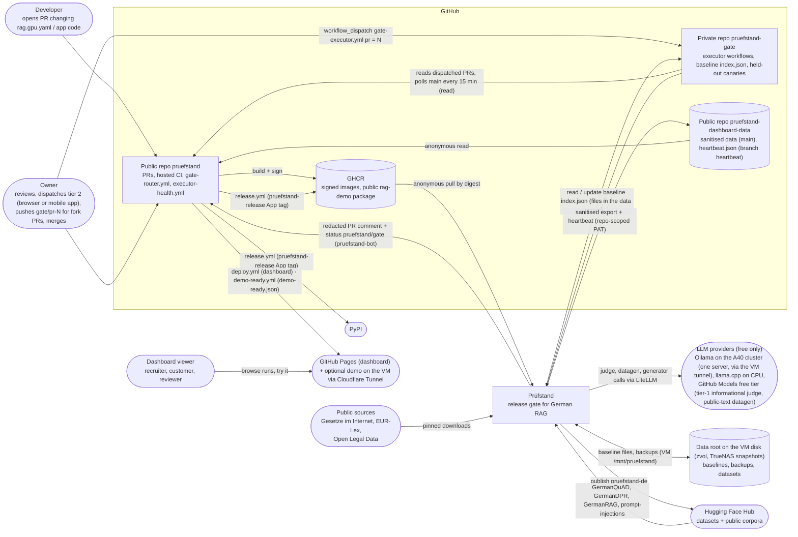
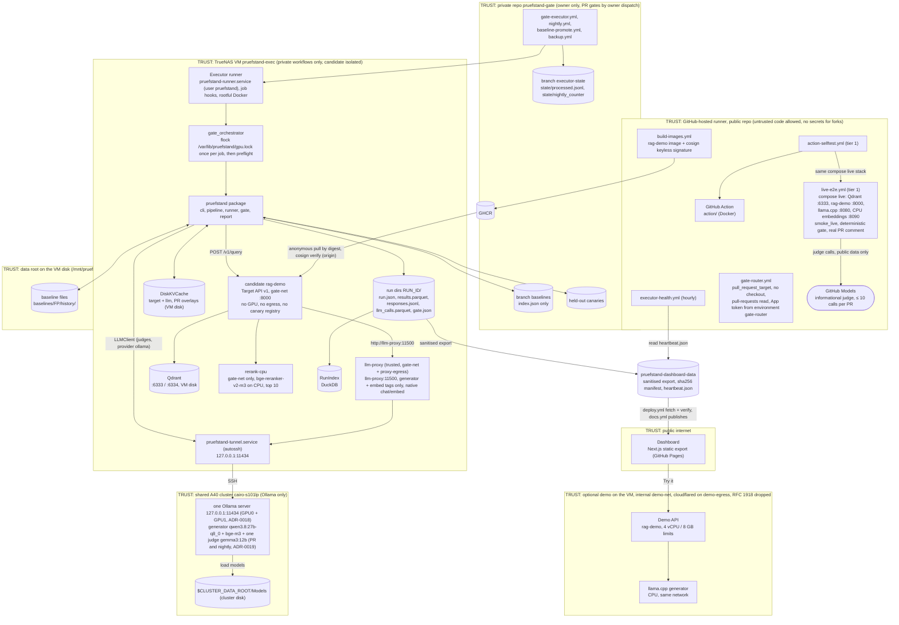

# Overview

## 1. System context

Prüfstand sits between a pull request and the merge button. The public repo builds and signs images
and holds no secret that reaches the executor; the private executor repo runs gated PRs only when the owner
dispatches them (round 13 P1.2; coding agents cannot), polls `main` for baselines, executes them on
its persistent runner on the TrueNAS VM `pruefstand-exec` (GPU models: one Ollama server for both A40s,
ADR-0018, reached through the `pruefstand-tunnel.service` tunnel; executor user `pruefstand`), keeps the baseline index and the held-out canaries
(baseline files and backups live in the data root on the VM disk, ADR-0019), and posts a redacted result back to the PR. PRs that
touch no gated path get their "not gated" status from the public `gate-router.yml` on a hosted runner
(no checkout; it posts with the `pruefstand-bot` App token from environment `gate-router`, and marks gated PRs
`pending` until the owner dispatches tier 2), so they never wait for the executor; the ruleset pins
`pruefstand/gate` to that App (P1.1). Sanitised
results and the executor heartbeat go to a separate public data repo, which `deploy.yml` and
`executor-health.yml` read without a token. People outside the team see only the dashboard (GitHub
Pages) and the optional rate-limited demo (on the VM behind a Cloudflare Tunnel, isolated from the gate).

## 2. Containers

The same `pruefstand` package runs in every tier, always against real models (ADR-0008). On hosted
runners (tier 1) it drives the real rag-demo with a llama.cpp generator on CPU and gates on
deterministic checks, with GitHub Models as an informational judge; on the executor VM (tier 2) it
drives the candidate rag-demo, whose generator and embeddings are Ollama on the generator card (through `llm-proxy`),
judges with the Ollama judge on the judge card and applies the statistical gate. The dashboard reads sanitised
artefacts from the dashboard-data repo and never computes metrics; it is published on GitHub Pages. The
optional demo API runs on the VM on its own `--internal` network `demo-net` (only `cloudflared` is also on
`demo-egress`; RFC 1918 and VM addresses dropped, P2.2), reachable only through a Cloudflare Tunnel, and never
touches the gate network, the LAN, the TrueNAS host, the GPU lock or the cluster. Ports: `docs/engineering/docker.md` §3.

## 3. Container responsibilities

| Container | Responsibility | Tech | Talks to |
| --- | --- | --- | --- |
| `pruefstand` package | Run eval, score, gate, report | Python 3.12, Pydantic, NumPy, Typer | rag-demo (HTTP), LLMs (LiteLLM), stores |
| GitHub Action | Packages the CLI for PR workflows (`uses: dheena18/pruefstand/action@vX`; optional `pruefstand-action` Marketplace mirror) | Docker action | GitHub API |
| Image build | Builds and signs rag-demo per SHA; the GHCR package is public | Docker, cosign keyless | GHCR |
| Private executor repo | Trusted gate (owner dispatch only, P1.2), nightly, baseline (polls `main`) and backup workflows, baseline `index.json`, processed-work state and `state/nightly_counter`, held-out canaries | GitHub Actions (self-hosted runner attached only here) | Public repo via the `pruefstand-bot` App (read PRs, write status/comment); dashboard-data repo via a repo-scoped PAT |
| Executor runner | Persistent system service `pruefstand-runner.service` (user `pruefstand`) on the VM `pruefstand-exec`, job-start/-complete cleanup hooks; runs Qdrant, `rerank-cpu`, `llm-proxy` and the candidate as containers; the candidate gets no GPU and no egress | actions-runner, Docker | private repo, GHCR, VM services, Ollama via the tunnel |
| `gate_orchestrator` | Selects jobs, takes `/var/lib/pruefstand/gpu.lock` once per job, runs the preflight under it (starts the Ollama server over SSH only if none runs, checks digests and GPU placement), switches Ollama modes, runs and reports, refreshes the heartbeat every 15 min, turns infra failures into `error` + one retry (T6.2a) | Python (`infra/gate-executor/orchestrator`) | GitHub API, Ollama via the tunnel, cluster `bin/` scripts over SSH |
| rag-demo | System under test, multi-tenant German RAG | FastAPI, Qdrant client, httpx | Qdrant; tier 1: llama.cpp + TEI (CPU); tier 2: `llm-proxy` (Ollama, generator lane) + `rerank-cpu` |
| Qdrant | Dense + sparse vectors, tenant payload filter, PR-scoped collections | Qdrant | – |
| Ollama server (cluster, one for both GPUs, ADR-0018) | Tier-2 LLM + embedding serving: generator + `bge-m3` and the one judge `gemma3:12b` on the two cards (placed by Ollama, checked via `/api/ps`; catalogue models only, pinned by digest; ADR-0019) | Ollama (existing server reused, else the owner's `~/start-ollama.sh` with `setsid nohup`), models on the cluster disk `$CLUSTER_DATA_ROOT/Models` | – (reached only through the VM tunnel) |
| `llm-proxy` | Candidate's only route to Ollama: normal container on `gate-net` + `proxy-egress` (`http://llm-proxy:11500`, upstream `172.17.0.1:11434` firewalled to `proxy-egress`), bearer key, generator + embed tags only (no judge), native `/api/chat`, `/api/embed`, `/api/tags`, catalogue tags; enforces `num_ctx`/`keep_alive`, sampling options pass within the catalogue `option_bounds` (403 outside, R12 N2); no admin API (D206, D242, D220) | Python (T6.2a) | the Ollama server via the tunnel |
| `rerank-cpu` | `bge-reranker-v2-m3` on the VM CPU, TEI-compatible `/rerank` (tier 2) | sentence-transformers (T3.1a) | – |
| TEI (CPU) | CPU embeddings (tier 1, demo) | text-embeddings-inference | – |
| Artefact store | Source of truth for runs | Files (JSON, Parquet) | – |
| RunIndex | Analytical queries across runs | DuckDB | Artefact store |
| Dashboard-data repo | Public, sanitised run data, `runs/index.json`, sha256 manifest (`main`); `heartbeat.json` (branch `heartbeat`) | git (public repo) | `deploy.yml`, `executor-health.yml` (anonymous) |
| Gate router | `gate-router.yml`: posts `pruefstand/gate` with the `pruefstand-bot` App token (environment `gate-router`, deployment branch `main`): success "not gated" for PRs without gated paths or with release-exempt lines only, `pending` "gated: awaiting tier-2 dispatch" otherwise; no checkout (X2.2, P1.1) | GitHub Actions (hosted, `pull_request_target`) | public repo API (changed files, statuses) |
| Dashboard | Browse runs, diffs, slices, cases | Next.js, TS strict, Tailwind, Recharts | Sanitised artefacts, demo API |
| Demo API (optional) | Public "try it" on the VM behind a Cloudflare Tunnel (Y7.5) | rag-demo image + in-process rate limit + daily request budget | llama.cpp generator on the VM CPU |
| Tier-1 live CI | Deterministic smoke gate on every PR | GitHub Actions, docker compose `live`, llama.cpp, CPU embeddings | GitHub Models (informational judge), GitHub API |
| Executor health | Hourly heartbeat check (pure function of `now` + `heartbeat.json`: `<field>_false_since`, `last_nightly_at`, `last_nightly_status` in the one value set of D311, `maintenance` suppressing health alerts, `drift_no_release_baseline`), opens/updates issues `executor-down`, `backup-stale`, `nightly skipped`, `nightly-failed` | GitHub Actions (hosted) | dashboard-data repo (read), public repo issues |
