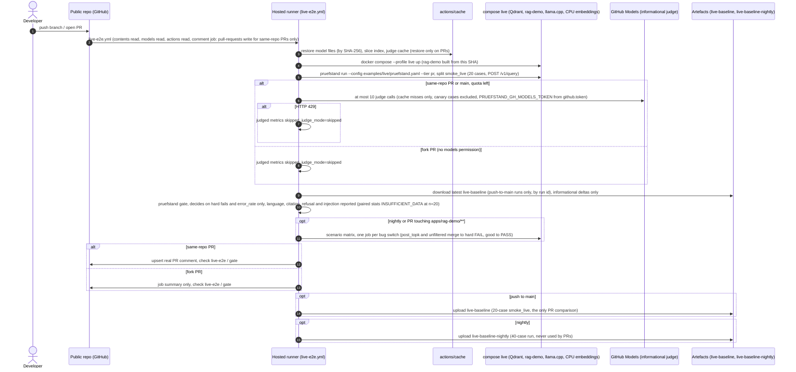
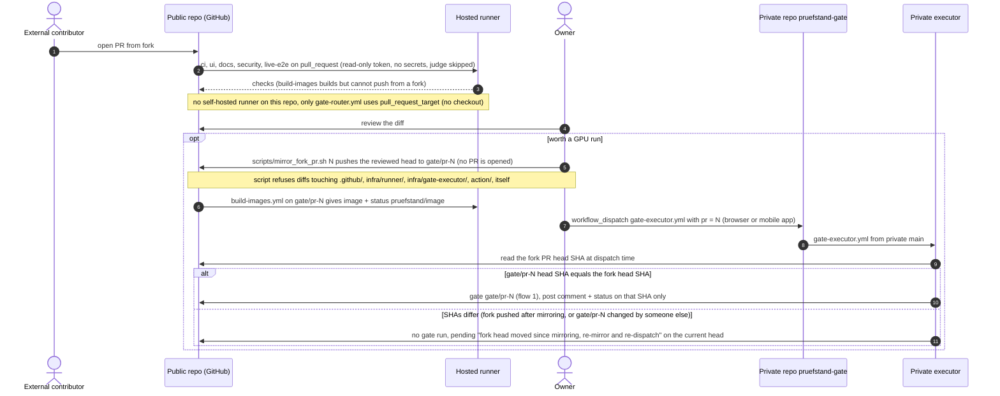
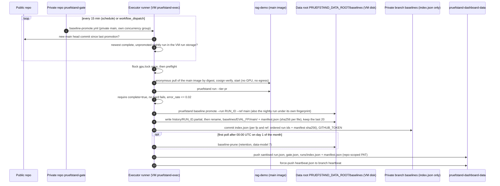
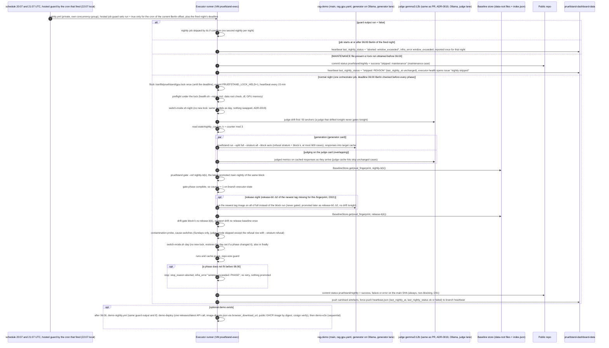
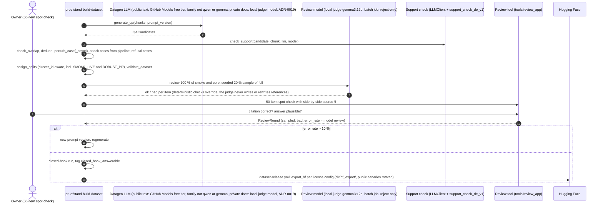
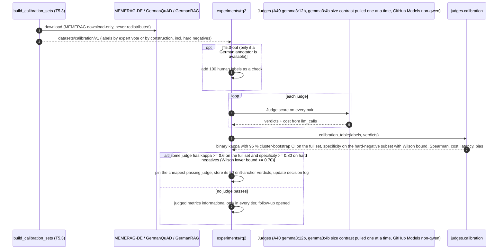
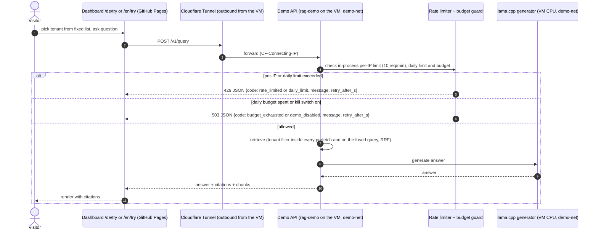
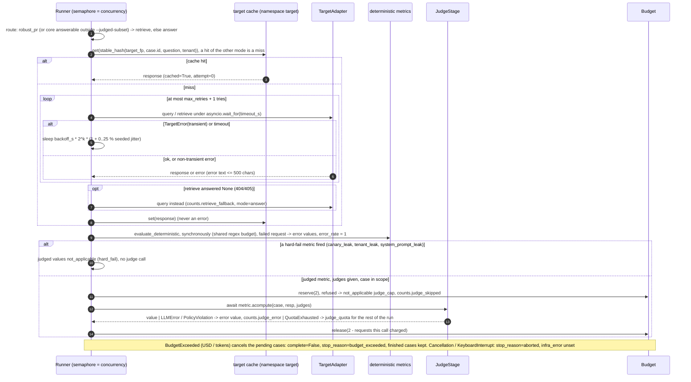
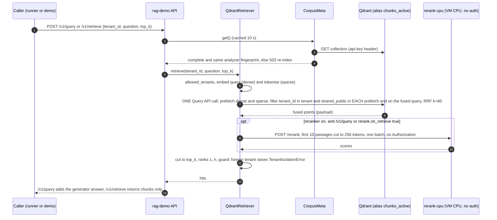

# Sequences

Trust model (ADR-0005): the public repo `dheena18/pruefstand` has **no self-hosted runner and no
secret that reaches the executor**. The persistent executor runner (on the TrueNAS VM `pruefstand-exec`;
running as the system user `pruefstand`; GPU models are served by one Ollama server for both A40s (ADR-0018), reached
through the `pruefstand-tunnel.service` tunnel, rounds 10 and 11) is
registered only to the private
executor repo `dheena18/pruefstand-gate`, which runs its own workflows from its own `main` and
**pulls** work: PR gates start only from the owner's `workflow_dispatch` of `gate-executor.yml` (round 13
P1.2), `baseline-promote.yml` polls `main`, nightlies run by schedule. Public workflow names: `ci.yml`, `ui.yml`, `docs.yml`,
`security.yml`, `live-e2e.yml`, `cassettes.yml`, `action-selftest.yml`, `build-images.yml`,
`gate-router.yml` (the only `pull_request_target` workflow, no checkout, posts with the `pruefstand-bot` App token from
environment `gate-router`, X2.2, P1.1), `executor-health.yml`,
`release-please.yml`, `release.yml`, `dataset-release.yml`, `deploy.yml`.
Private: `gate-executor.yml`, `nightly.yml`, `baseline-promote.yml`, `backup.yml`. Sanitised data
goes to the public repo `dheena18/pruefstand-dashboard-data` (`main`), the heartbeat to its branch
`heartbeat`.

Mermaid rule for this file: no `;` in any message or label (it ends a statement), see
`README.md` "Diagram conventions".

## 1a. Tier-1 live gate on a hosted runner (every PR)

No fakes: every answer comes from the real rag-demo and a real llama.cpp model (ADR-0008). The
required check never depends on a judge: judged metrics are informational and skipped when the quota
is gone or the PR comes from a fork. Only public data (5-law slice, public fixtures) is sent to GitHub
Models (ADR-0009).

## 1. PR gate (owner dispatches the private executor)

```mermaid
sequenceDiagram
    autonumber
    actor Dev as Developer or coding agent
    actor Owner as Owner (browser or GitHub mobile app)
    participant Pub as Public repo (GitHub)
    participant Hosted as Hosted runner
    participant Router as gate-router.yml (hosted, pull_request_target, no checkout, environment gate-router)
    participant GHCR as GHCR (public package)
    participant Priv as Private repo pruefstand-gate
    participant Exec as Executor runner (VM pruefstand-exec)
    participant RAG as candidate rag-demo (VM, no GPU, no egress)
    participant Oll as Ollama (cluster, one server via the tunnel: generator + bge-m3, judge gemma3:12b)
    participant App as pruefstand-bot App
    participant DD as pruefstand-dashboard-data

    Dev->>Pub: push branch, open PR
    Pub->>Hosted: ci, ui, docs, security (tier 0, no secrets)
    Pub->>Hosted: live-e2e, action-selftest (tier 1, real CPU stack, deterministic gate, see 1a)
    Pub->>Router: pull_request_target event (opened, synchronize, reopened)
    Router->>Pub: read changed files and patches via API (pull-requests read)
    alt no gated path changed, or release-exempt lines only
        Router->>App: mint App token, status pruefstand/gate = success "not gated" on the head SHA
    else gated path changed
        Router->>App: mint App token, status pruefstand/gate = pending "gated: awaiting tier-2 dispatch"
    end
    Note over Pub,App: the ruleset pins pruefstand/gate to the pruefstand-bot App, a status posted with GITHUB_TOKEN does not count
    Pub->>Hosted: build-images.yml (no secrets, checks out the PR head SHA)
    Hosted->>GHCR: push rag-demo:sha-HEADSHA by digest, cosign sign (keyless)
    Hosted->>Pub: status pruefstand/image (digest) on the head SHA
    Owner->>Priv: workflow_dispatch gate-executor.yml with pr = N (the only tier-2 trigger, the VM token cannot reach this repo)
    Priv->>Exec: gate-executor.yml from private main (own concurrency group per PR)
    Exec->>Exec: MAINTENANCE check, file /var/lib/pruefstand/MAINTENANCE (present: pending "executor in maintenance, re-dispatch later", stop)
    Exec->>Pub: read PR N, changed files, head SHA at dispatch time, pruefstand/image status (App token, read)
    alt no gated path changed
        Exec->>Exec: end (gate-router.yml owns the status)
    else head SHA has no pruefstand/image status yet
        Exec->>App: post_status pending "image not built yet, re-dispatch after build-images"
    else gated
        Exec->>Exec: flock /var/lib/pruefstand/gpu.lock once (wait up to 2 h, heartbeat every 15 min, timeout gives pending "executor busy, re-dispatch")
        Exec->>Oll: preflight under the lock: health.sh --repair (tunnel, start-ollama.sh over SSH with setsid nohup only if no server runs, day-mode models resident with catalogue digests)
        Exec->>Exec: data root writable with at least 20 GB free (else error, infra_error data_root_unavailable), df, GPU memory via status.sh, failure gives error "executor unhealthy"
        Exec->>Exec: load pruefstand.yaml, dataset, judge config, pruefstand package from public main (never from the PR)
        Exec->>Pub: read PR rag.gpu.yaml + image digest from status pruefstand/image
        Exec->>GHCR: anonymous pull by digest, cosign verify (origin only)
        Exec->>Priv: read baselines/index.json (branch baselines), then baseline files from the data root /mnt/pruefstand/baselines (sha256 checked)
        alt no baseline for eval_fingerprint
            Exec->>App: status pruefstand/gate = failure "no baseline for FP, run baseline-promote"
            Exec->>Priv: append (pr, head sha, dispatch run id, failure) to state/processed.jsonl
        else baseline found
            Exec->>Exec: start Qdrant and rerank-cpu on gate-net, llm-proxy on gate-net + proxy-egress (llm-proxy:11500, D242), swap the generator if the PR selects another catalogue model, and a PR-scoped collection if embedding/chunking changed
            Exec->>RAG: start candidate on internal network gate-net (no GPU, no egress, read-only fs, no canary registry)
            Exec->>RAG: GET /v1/info (models + serving + corpus_version to target_fingerprint)
            Exec->>RAG: pruefstand run --tier pr (smoke + core via /v1/query, robust_pr via /v1/retrieve only, at most 90 min, --judged-subset limits generation and judging of core answerable cases only if the fallback is on)
            RAG->>Oll: generation + bge-m3 embeddings via llm-proxy (generator + embed tags only, native API, num_ctx and keep_alive enforced, sampling options within catalogue bounds)
            Exec->>Oll: judged metrics with the judge on the judge card (pipelined with generation)
            Exec->>Exec: pruefstand gate --from-store --ref main (one Holm family over all testable gated pairs)
            Exec->>Exec: keep the full run dir on the VM disk, upload run.json, gate.json, comment.md (14 days)
            alt infra failure during the run (Ollama down, tunnel lost, data root unavailable, model reload)
                Exec->>Exec: stop_reason aborted with infra_error, health.sh --repair, one automatic retry
                Exec->>App: status pruefstand/gate = error "executor infra error: SUMMARY, retrying once" (never failure, not recorded)
                opt the retry also hits an infra failure
                    Exec->>App: status pruefstand/gate = error "executor infra error: SUMMARY, re-dispatch to retry"
                    Exec->>Priv: append (pr, head sha, dispatch run id, error) to state/processed.jsonl
                end
            else run completed
                Exec->>App: redacted comment + status pruefstand/gate (set_check)
                App->>Pub: upsert PR comment, set status
                Exec->>Priv: append (pr, head sha, dispatch run id, result) to state/processed.jsonl
            end
        end
        Exec->>Exec: stop candidate, drop PR collection + PR cache overlay (job_completed hook)
    end
    Exec->>DD: force-push heartbeat.json to branch heartbeat (every 15 min while a job runs or waits)
```

The executor never runs workflow files, scripts or gate config from the PR. From the PR it uses only
`apps/rag-demo/configs/rag.gpu.yaml` (X3.15) and the candidate image; the candidate is untrusted (the image signature proves origin, not
content) and runs without GPU or internet; it reaches Ollama only through `llm-proxy` (generator + embed tags only, no admin
API, native endpoints only) and never a judge model (allow-list, ADR-0018). An infra failure during a run gives `error`
and one retry, never `failure` (Y5.2); after a second infra failure the job is recorded with result
`error` and runs again only after a new owner dispatch (A12-M1, P1.2). Public PRs get a redacted comment: no chunk text, canaries
masked, plus δ and the MDE for each gated metric. A new push needs a new dispatch, and a gated
PR without a baseline never passes. Only the owner can dispatch (browser or GitHub mobile app); the VM
token of the coding agents can push branches, open PRs and push workflow files, but cannot reach the
private repo and cannot produce the App-pinned `pruefstand/gate` (P1.3).

## 2. Fork PR

Fork PRs follow the same rule as any PR (the candidate is untrusted either way). The result is posted
only on the SHA the owner reviewed, mirrored and dispatched (X2.3, P1.2), so a later fork push never
inherits a green `pruefstand/gate`. The `gate/pr-N`
branch exists only because a fork's `pull_request` run cannot push an image to GHCR; there is never a
mirror PR, so the fork's code never runs with same-repo permissions.

## 3. Merge to main: baseline promotion

Only this private workflow writes baselines (including the monthly prune). Baseline files live in the
data root on the VM disk (single writer, write-then-rename) and in the encrypted weekly backup; the private repo's `baselines` branch holds only a
small `index.json` (X2.7), so the repo no longer grows with every promotion. Baselines are plain files
(no signatures): write access to the VM runner user, the data root and the private repo is the trust boundary,
and the sha256 manifest is checked on every read. Nightly runs are promoted by this poll, never by a dispatch from
`nightly.yml`, so a pending run can never be dropped. A block-*k* nightly is promoted to ref `nightly-b<k>`
(round 12 N1.4). The release anchor is per block (AI13-09, A13-M5, D321): the **release run of all of `full`** (the newest
`v*` tag's image, no `--block`, alone on its night, never gated; repeated each night until the refs exist for
the current fingerprint) is promoted by this poll three times, as `release-b0`, `release-b1`, `release-b2`
(each the block-*k* projection under the block-*k* fingerprint). Runs with `judge_fallback`, `judge_drift`,
`judge_degraded`, a judged metric informational for `judge_truncated` or `infra_error` are never promoted
(AI13-08, D321).

## 4. Nightly run and drift check

The nightly tier runs `pruefstand run --split full --stratum all --block auto`: the refusal stratum (`block=None`,
≈ 150 unanswerable cases, at least 100 clusters) plus block *k* (`state/nightly_counter` mod 3, the counter
advanced only after a completed nightly, P4.4), at most 600 cases, so `full` is covered every 3 completed
nightlies (SPEC §6.2, Y4.3, round 12 N1); it gates against baseline ref `nightly-b<k>` and checks drift against
the release anchor `release-b<k>` (N1.4, AI13-09),
with the same judge as the PR tier (`gemma3:12b` on the judge card, ADR-0019;
generation on the generator card and judging on the judge card overlap;
any other judge sets `judge_fallback=true`, which makes judged metrics informational,
Y4.4), so it has its own `eval_fingerprint` and baseline line. Comparing against
the last release baseline catches slow drift that per-merge baselines hide. The status is posted every
night, so a missing nightly is visible; a night that cannot start or is stopped at the deadline is
written to the heartbeat and opens the `nightly skipped` issue (N4.3). Budget: one orchestrator job,
≤ 8 h, hard deadline 06:00 Europe/Berlin of the fired night, checked at start and before each phase
(`ci-cd.md` §1.2); the guard's `run` output and the job's `if:` stop the off-season cron from starting a
second nightly (P2.1). The
switch-mode calls run inside the orchestrator's lock with `PRUEFSTAND_LOCK_HELD=1` and never re-take
it (X2.1). The CPU-only simulation, Hypothesis and mutmut jobs run in the public `ci.yml` nightly
schedule, not here.

## 5. Dataset build

Every generated row carries `generation_prompt_version`, so a rejected batch can be traced to one
prompt file. The gating split `core` gets a full model review (D124). Publishing is a separate step
after review, with one config per licence (ODbL never mixed with another share-alike licence; MEMERAG
never exported), and held-out canaries are never exported.

## 6. Judge calibration (RQ2)

Calibration is offline and scripted with a fixed seed. κ is never computed on a single-label subset
(X1.1); the in-domain `legal_hard` set is built in T5.3 (X3.1). Hard negatives (D119) are same-paragraph wrong
spans, number/date swaps, negation flips, partially correct answers and MEMERAG "Not Supported" items.
The chosen gating judge goes into config and the decision log, and changing a judge prompt version means
re-running this sequence.

## 7. Demo "Try it" query

The public demo has no write paths and a fixed tenant list. A per-IP rate limit and a hard daily budget
(ADR-0012) are checked before any LLM call, and every error carries a JSON body, so the page never has
to read the `Retry-After` header (D138). The optional demo runs on the VM on its own Docker network
`demo-net` behind an outbound Cloudflare Tunnel (Y7.5), never on `gate-net` or the A40 cluster.

## 8. Runner: one case (T1.8)

Results keep the input order. After the run, `judge_error / judged_cases > 5 %` sets `judge_degraded`. An
executor infra failure is a different path: the executor calls `ArtifactStore.mark_aborted(run, infra_error)`
(R11 D245) on a finished or partial run.

## 9. rag-demo: one retrieval (T3.5, `/v1/query` and `/v1/retrieve`)

The seeded bugs change only step 6 (`tenant_filter: post_topk` sends no filter and filters in Python after
the cut, `shared_public_merge: unfiltered` adds a second unfiltered query) and switch the guard off.
