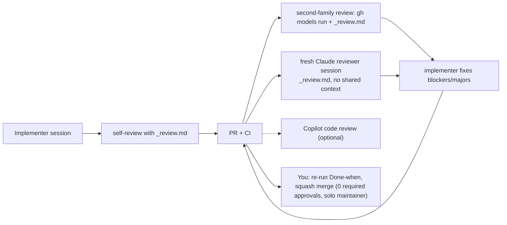

# AI workflow

Prüfstand is built almost entirely by AI sessions. This file covers how those sessions are run so
that the result stays consistent. The step-by-step playbook for one task is `prompts/_session-start.md`.

## 1. Who does what

| Tool | Role | Not for |
| --- | --- | --- |
| **Claude Code** (Opus) | design-heavy tasks: statistics, security, CI hardening, anything touching `interfaces.md` or ADRs; reviewer sessions for those tasks | bulk text generation |
| **Claude Code** (Sonnet) | standard implementation from a precise prompt; most tasks in `tasks/TASKS.md` | changing contracts |
| **GitHub Models via `gh models run`** (any GitHub account, free tier) | **default second-opinion reviewer** from a different model family than the implementer, fed `prompts/_review.md` + the diff (§3) | being the only reviewer; very large diffs (split per file) |
| **GitHub Copilot code review** (*optional*) | extra automatic review if you have a Copilot plan (Copilot is **not** included in GitHub Pro; it is a separate plan, free for verified students via GitHub Education) | being required anywhere |
| **Local models on the A40s** (Ollama, reached from the VM through the tunnels; provider `ollama`) | German text work at volume: synthetic private docs and canaries (the local judge model, never external), labeling suggestions, PR and nightly judging (the one judge `gemma3:12b`, ADR-0019; family plan: `gpu-cluster.md` §2) | code |
| **GitHub Models** (in CI) | the tier-1 **informational** judge only (≤ 10 calls per PR, ≤ 60 per nightly run plus 50 drift anchors, `ci-cd.md` §1.1a); the `gh models run` second-family reviews may share the same quota (**verify**, T0.6) | datagen, a hosted generator (D126), any required check, anything that needs guaranteed throughput |

## 2. Session rules

1. One task ID per session and branch. The session reads `CLAUDE.md` (auto-loaded), `docs/decisions.md` and the task prompt before anything else.
2. The session posts its plan first: files, interfaces, tests.
3. Tests come first; the session shows them failing before implementing.
4. Context hygiene: paste the prompt, not the whole spec. The prompt lists the sections to read. If the context gets long or the session loops, restart with `CLAUDE.md` + decisions + prompt + a 5-line status.
5. Evidence is required: every "Done when" item gets a command and its output. "It should work" is not evidence.
6. The session must not touch files outside the task's list without saying why.
7. The session ends with: summary, evidence, interface changes (or "none"), follow-ups with task IDs.

## 3. Review loops



Second-family review command (install once: `gh extension install github/gh-models`; pick a current
non-Anthropic model with `gh models list`). It runs on your personal GitHub Models quota; T0.6's
24-hour probe records whether that quota is shared with the CI `GITHUB_TOKEN` (**verify**), and if so
the reviews count against the daily total in `ci-cd.md` §1.1a:

```bash
git diff origin/main...HEAD -- . ':!**/__snapshots__/**' > /tmp/pr.diff
gh models run <model-id> "$(cat prompts/_review.md)" < /tmp/pr.diff > /tmp/review-second.md
```

If the diff is larger than the model's context, run it per directory. Paste the result into the PR as a
comment titled "Second-family review".

| Task type | Required reviewers |
| --- | --- |
| Standard | `gh models` second-family review + 1 fresh Claude reviewer (Sonnet) |
| `gate/`, `metrics/`, `judges/`, CI/runner, security, `interfaces.md`, ADR | `gh models` review + 1 fresh Claude reviewer (Opus) + you read every line (budget 45–60 min) |
| Docs-only | `gh models` review |

For statistics PRs the reviewer must recompute one worked example by hand (review item 6).

## 4. Interface changes

1. The implementer stops and writes one paragraph: what changes, why, which modules and tasks are affected.
2. You approve or reject it in the session.
3. If approved, the same PR updates `docs/architecture/interfaces.md`, writes a new ADR (or supersedes one), regenerates `schemas/`, and fixes every consumer. The PR is labelled `interface-change`.
4. Any open branch for a dependent task rebases and re-runs its tests.

Silent interface drift counts as a review blocker.

## 5. Parallel work with git worktrees

```bash
git worktree add ../pruefstand-T1.5b -b feat/T1.5b-deterministic-metrics origin/main
```

- Only tasks in the same parallel lane (`tasks/TASKS.md`, Critical path) run at the same time, one worktree each.
- Two sessions never edit the same file. Shared files (`docs/decisions.md`, `tasks/TASKS.md`) are edited in the last commit of the PR, and conflicts are resolved by appending.
- Every new worktree gets the git-ignored `.env` as a symlink, never committed (Y6.6):
  `ln -s ~/code/pruefstand/.env <worktree>/.env` (the lead agent does this, `prompts/_lead-agent.md`).
- Remove a worktree after merge with `git worktree remove ../pruefstand-T1.5b`.
- Shared files (`Makefile`, root `pyproject.toml`, `.gitignore`, `.env.example`, `.importlinter`, `DATA_LICENSES.md`,
  `docs/decisions.md`, `tasks/TASKS.md`) are append-only for parallel tasks: add lines in the last commit and rebase
  before merging. Make targets added after T0.1 go into `mk/<task>.mk` files included by the Makefile.

## 6. Development environment (Windows → TrueNAS VM via Remote-SSH; WSL2 optional)

- All work happens on the **TrueNAS VM `pruefstand-exec`** (Ubuntu 24.04, 64 GB) through **VS Code on
  Windows with Remote-SSH** (round 10 Z7, D202): the repo is cloned on the VM (`~/code/pruefstand`), and
  every coding-agent command runs in the VM terminal **as the owner login user** (Y1). The VM has rootful
  Docker, the data root `/mnt/pruefstand` (VM disk) and the tunnels of the system unit `pruefstand-tunnel.service` to
  the cluster's one Ollama server (`127.0.0.1:11434`, ADR-0018), so `make test-gpu` and tier-2 experiments run
  from the same shell. Never run code or keep a checkout on the cluster.
- **Sharing the VM with the executor (Y1, binding).** The executor runs as the system user `pruefstand`.
  Your user is in groups `pruefstand` and `docker` (which makes it root-equivalent, `security.md` C18).
  GPU work only through `pruefstand-lock <cmd>` (lock `/var/lib/pruefstand/gpu.lock`; the `mk/gpu.mk`
  targets use it). Planned maintenance: the file `/var/lib/pruefstand/MAINTENANCE`. Your stacks use
  compose profile `dev` with `PORT_OFFSET=10000` in your `.env` (Qdrant 16333/16334, rerank 18201,
  rag-demo 18000; `docker.md` §3), so they never collide with the executor's default ports. Prefer `make up PROFILES="core live dev"`; a raw `docker compose --profile …` is allowed only after `make ports-env` has written the effective ports literally into `.env`, verified by `make check-ports` (compose cannot add `PORT_OFFSET`; A12-M4, A13-M6, D310). Never touch
  `/var/lib/pruefstand/**` or `/home/pruefstand/**` directly.
- **Optional alternative: WSL2 Ubuntu 24.04** on the laptop; clone into the Linux filesystem, never under
  `/mnt/c` (slow I/O, line-ending and permission problems); reach the GPUs with your own
  `ssh -N -L 11434:localhost:11434 cairo-s101lp`.
- `git config --global core.autocrlf input`; the repo's `.gitattributes` (`* text=auto eol=lf`, T0.1) keeps every
  file LF. The planning pack is normalised to LF before the first commit (T0.0).
- `gh` on the VM: a **fine-grained token limited to the public repo** `dheena18/pruefstand` (contents + pull requests + workflows write, Workflows being required to push `.github/workflows/**`, D284; no administration, no access to `pruefstand-gate` or `pruefstand-dashboard-data`), given via `gh auth login --with-token` + `gh auth setup-git`, never `gh auth login --web` (full OAuth scopes); check `gh api repos/dheena18/pruefstand-gate` → 404 (R12 N4.4, `security.md` C18). The token can push branches, open/update PRs and push workflow files, but cannot produce `pruefstand/gate` (pinned to the `pruefstand-bot` App) or start tier 2 (only the owner's dispatch of the private `gate-executor.yml`; no `run-gate` label) (round 13 P1.3). Tier-2 dispatches, merges, bypasses and anything on the private repo are done by the owner in the browser or the GitHub mobile app. The remote is `https://github.com/dheena18/pruefstand.git`. On a laptop/WSL shell the same token type is fine.
- Tools: uv (official installer, then `uv python install 3.12`), Node 22 via fnm (`eval "$(fnm env)"` in
  `.bashrc`), `corepack enable` for pnpm, docker-ce on the VM (in WSL: Docker Desktop with WSL integration
  **or** docker-ce) plus `sudo usermod -aG docker $USER` and a new login shell, `make`, `jq`. T0.0 lists a
  verify command for each, VM first.

## 7. Claude Code configuration (`.claude/settings.json`, committed)

| Setting | Value / purpose |
| --- | --- |
| Hook `PostToolUse` on `Edit`/`Write` for `*.py` | `uv run ruff format <file> && uv run ruff check --fix <file>` gives fast feedback without waiting for CI |
| Hook `PostToolUse` on `*.py` under `packages/` | `uv run mypy <file> --follow-imports=silent` (fast, file-scoped) |
| Hook `PostToolUse` on `*.ts(x)` | `pnpm -C apps/dashboard exec eslint --fix <file>` |
| Hook `Stop` | `make lint typecheck arch` summary, so the session sees failures before it reports done (added by T0.1 once the Makefile exists; `.claude/settings.json` is created in T0.1) |
| Permissions allow | `uv run *`, `make *`, `pnpm -C apps/dashboard *`, `git status/diff/log/add/commit`, `docker compose *` |
| Permissions deny | `git push --force*`, `git commit --no-verify*`, `rm -rf *`, reading `.env*`, any read or write under `/var/lib/pruefstand/**` and `/home/pruefstand/**` (C18; `pruefstand-lock` is allowed) |

Hooks never auto-commit. Pre-commit (`.pre-commit-config.yaml`) runs the same tools at commit time.

## 8. Prompt maintenance

- Each task prompt in `prompts/` is versioned with the repo. If a prompt was wrong, fix the prompt file
  in the same PR as the code, so later sessions inherit the fix.
- `prompts/_TEMPLATE.md` is the only template; new tasks copy it.
- After every phase, run a retrospective: what did the sessions get wrong repeatedly? Turn each answer into a rule in `CLAUDE.md` or a check in CI. Prefer a check, because rules alone get ignored.
