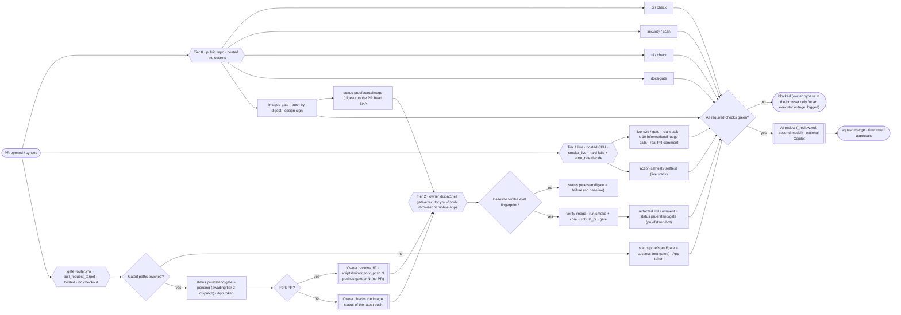
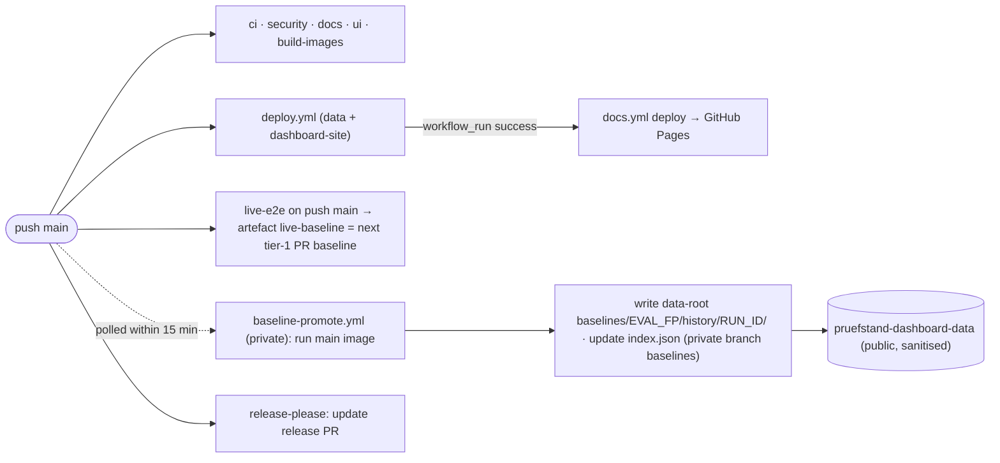
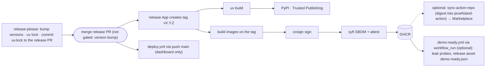
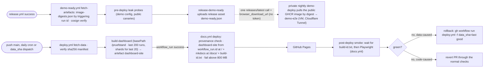

# CI/CD

Three tiers (ADR-0005). Everything that touches a model or the RAG app uses the **real** thing
(ADR-0008, no test doubles). Round-8 decisions W1 (tier-1 shape) and W2 (executor operations) are
written into this file (`docs/planning/reviews/round8-resolution.md`); round-9 decisions X1–X5 are applied (`round9-resolution.md`). Round-12 decisions N1–N5 are applied (`round12-resolution.md`). Round-13 decisions P1–P5 are applied (`round13-resolution.md`).

- **Tier 0 (code)** runs in the **public repo** `dheena18/pruefstand` on GitHub-hosted runners for
  every push and PR, forks included: lint, types, pure unit tests on real inputs, doctests,
  statistical validation, cassette replay, contract and integration tests (real Qdrant, real
  rag-demo, real llama.cpp container). No secrets, no GPU.
- **Tier 1 (live)** runs `live-e2e.yml` on a GitHub-hosted CPU runner for every PR, every push to
  `main` and nightly: the real stack (Qdrant + rag-demo + llama.cpp generator + CPU embeddings) on
  the real 5-law slice, split **`smoke_live`** (20 cases). The required check decides on **hard
  fails and `error_rate` only** (X5.6); the deterministic language, citation and refusal-phrase checks
  and `injection_success` (n = 2, X3.11) are **reported, not gating**. Judged metrics are
  **informational**: at most 10 judge **calls** per PR, through **GitHub Models** with `GITHUB_TOKEN`
  (`permissions: models: read`, free tier); fork PRs (no `models` permission) and runs with an
  exhausted quota skip them (`judge_mode=skipped`). There is no CPU fallback judge in tier 1. The
  only credential is `GITHUB_TOKEN`.
- **Tier 2** runs in the **private executor repo** `dheena18/pruefstand-gate` on the persistent
  runner on the **TrueNAS VM `pruefstand-exec`** (round 10 Z1). The runner, orchestrator, Qdrant,
  candidate containers, `rerank-cpu` and `llm-proxy` all run on the VM; the A40 cluster `cairo-s101lp`
  runs only **one** Ollama server on `:11434` for both GPUs (ADR-0018: generator + `bge-m3` and the one judge `gemma3:12b`, ADR-0019, placed on
  the two cards by Ollama), reached from the VM through the `autossh` tunnel (`gpu-cluster.md` §1, §6). The executor **pulls** work. A PR gate starts
  **only** from a `workflow_dispatch` of `gate-executor.yml` (input `pr`) by the owner, from the browser or
  the GitHub mobile app (round 13 P1.2); `main` pushes (polled by `baseline-promote.yml`) and the nightlies
  are automatic. The VM token has no access to the private repo, so coding agents cannot start tier 2. The
  public repo holds **no workflow that talks to the executor**; its only gate secret is the `pruefstand-bot`
  App key in environment `gate-router` (P1.1). Tier 2 is the statistical gate. `gate-router.yml` (§1.1)
  posts `pruefstand/gate` on every PR head with the App token: success "not gated" when no gated path
  changed (so such PRs never wait for the executor), `pending` "gated: awaiting tier-2 dispatch" otherwise.

**No self-hosted runner is ever registered to the public repo.**

The executor's workflows and orchestrator are versioned in this repo under `infra/gate-executor/` and
copied into the private repo at a maintainer tag `executor-<YYYYMMDD>[.N]` on `main`
(`scripts/sync_executor.sh executor-<YYYYMMDD>`; the script refuses other tags). `v*` tags belong to
the release App and trigger `release.yml`. The private repo's `main` is what runs; nothing from a PR
ever executes outside the candidate container. Operations (outages, backups, rotation, bypass):
`docs/ops/runbook.md`.

## 1. Workflows

All actions are pinned by full commit SHA, with the version as a comment. Every workflow sets
`permissions: {}` at the top level and grants permissions per job. Workflows that hold a required
check run on every PR (no `paths:` filter); jobs that do not apply exit early with success. Each
workflow ends in one **aggregate job** (`check`, `scan`, `images-gate`, `docs-gate`, `gate`, `selftest`) that `needs:`
every other job; only the aggregate job is a required check, so adding jobs later never changes
branch protection.

`id-token: write` is allowed **only** in `build-images.yml`, `docs.yml` (Pages) and `release.yml`, and within them only in the named jobs (`push-sign`; `deploy`; `publish-pypi`, `publish-testpypi`, `sign`, `attest`), never at workflow level; `pages: write` only in `docs.yml`/`deploy` (`scripts/workflow_policy.py`, per (file, job) like `actions: read`)
(`deploy.yml` only runs `cosign verify`, which needs no OIDC token; R12 A12-M7, matches `security.md` S2). The workflow guard also requires `--retry 3 --retry-all-errors --retry-delay 5` on every `curl` in a `run:` step (D926). The workflow-guard test (`scripts/check_workflows.py`, T0.2) enforces exactly
this allowlist, plus: no `pull_request_target` **except exactly `gate-router.yml`**, which must have
no `actions/checkout` step (and no step that fetches PR code), job permissions exactly
`pull-requests: read` and `environment: gate-router` (X2.2, round 13 P1.1, the single documented exception;
it posts statuses with the `pruefstand-bot` App token, not with `GITHUB_TOKEN`); `gate-router.yml` is the
**only** workflow that names environment `gate-router` or references `secrets.BOT_APP_*`; `statuses: write`
only in the `push-sign` job of `build-images.yml` (`pruefstand/image`); `actions: read` only in allowlist
entries with a reason (the `docs.yml` deploy job, `live-e2e.yml`, and the `fetch-artefacts` job of
`demo-ready.yml`, which downloads the triggering `release.yml` run's artefact, P5.2); `contents: write` only in
`release.yml` `release-assets`, `cassettes.yml` (own branch) and the `release-demo-ready` job of `demo-ready.yml`
(reason "uploads the `demo-ready.json` release asset"); no
`runs-on: self-hosted`, every `uses:` SHA-pinned, `models: read` only in `live-e2e.yml`,
`cassettes.yml` and `cassettes-models.yml` (D900); no public workflow references `secrets.DASHBOARD_DATA_PAT` or any `secrets.*PAT*`
(security C12). Every scheduled workflow uses off-minute crons (GitHub delays or
drops runs at minute 0); the times in the text are "about".

No workflow has a `merge_group` trigger: no merge queue is configured. Enabling one later requires
`merge_group` on every required workflow **and** executor support for merge-group SHAs.

### 1.1 Public repo `dheena18/pruefstand`

| File | Trigger | Runner | Job permissions | Jobs | Required check |
| --- | --- | --- | --- | --- | --- |
| `ci.yml` | `pull_request`, `push: main`, nightly cron `13 1 * * *` (extended jobs only) | `ubuntu-24.04` | `contents: read` | `lint`, `typecheck`, `arch`, `file-size`, `test` (unit on real inputs + property + contract + doctest over `packages/pruefstand/src` + cassette replay + coverage gates from CLAUDE.md §6), `test-slow` (statistical validation, reduced simulation grid: 500 sims, bound α + 4·SE; `timeout-minutes: 30`), `test-integration` (Testcontainers: real Qdrant, real rag-demo app, llama.cpp/TEI containers with model files from the cache in §4, fetch step added by T1.13; marker `integration`; `live`-marked tests run in `live-e2e.yml` job `live`, T1.12), `schemas-fresh`, `workflow-guards`, `commitlint` (PR title), `experiments-check` (T7.4) → aggregate `check`; plus `quickstart` (T9.2, real stack, `timeout-minutes: 20`, matrix of 2 images; each leg runs via `docker run --network host` with the Docker socket mounted, Docker is the quickstart's stated prerequisite) which is **not** in `check`'s `needs:`: it runs on `push: main` and on PRs touching `README.md`, `packages/pruefstand/src/pruefstand/examples/**`, `examples/**`, `datasets/fixtures/**` or `pyproject.toml`, and exits early with success otherwise. Nightly schedule only (outside `check`, informational, hosted, free minutes; R9-13): `simulation-full` (`PRUEFSTAND_SIM_GRID=full`, 4 000 sims, `timeout-minutes: 120`), `hypothesis-full` (2 000 examples, `timeout-minutes: 60`), `mutmut` (`gate/`, `metrics/`, `timeout-minutes: 300`). These CPU jobs never run on the executor runner | `ci / check` |
| `security.yml` | `pull_request`, `push: main`, weekly cron `19 4 * * 1` | `ubuntu-24.04` | `contents: read`, `security-events: write` | `codeql` (python, javascript-typescript), `gitleaks` (on `pull_request` it scans only the PR commit range `base..head`; push to `main` and the weekly run scan the full history; D853), `pip-audit` (on `uv export`), `pnpm audit --prod`, `zizmor` (via `uvx`), `scorecard` (weekly only, `publish_results: false`, SARIF upload only, so no `id-token: write`) → aggregate `scan`. Dependabot and fork PRs get no CodeQL coverage (read-only token cannot upload SARIF; accepted, see `docs/decisions.md`, T0.2) | `security / scan` |
| `gate-router.yml` | `pull_request_target` (`opened`, `synchronize`, `reopened`) — the **only** `pull_request_target` workflow (X2.2); no `labeled` trigger (there is no `run-gate` label, P1.2) | `ubuntu-24.04` (hosted) | `pull-requests: read` only; **environment `gate-router`** (holds `BOT_APP_ID` / `BOT_APP_KEY` of `pruefstand-bot`; deployment branches: `main` only, so only this workflow as it is on `main` can use it, and `pull_request_target` always runs the `main` version; round 13 P1.1); **no checkout**, no PR code is fetched or executed | `route` (**owned by T6.2b**, X2.2; guard rules from T0.2): mints an App token (`actions/create-github-app-token`, SHA-pinned), reads the changed files of the PR from the REST API (`pulls/N/files`, paginated, with patches), matches them against the gated-path list (§5) and posts on the PR head SHA with the **App token**: no gated path → `pruefstand/gate` = success "not gated (no gated paths changed)"; a release-please PR touching only the release-exempt lines (§5) → success "not gated (release version bump)"; otherwise `pending` "gated: awaiting tier-2 dispatch". "not gated" is posted **only** by this workflow (P4.2). Runs in seconds on every PR, forks included | n/a (it posts `pruefstand/gate`) |
| `build-images.yml` | `pull_request`, `push: main`, `push: gate/pr-*`, `push: bench/**` (T7.2 benchmark SHAs) | `ubuntu-24.04` | `contents: read`; `push-sign` job: `packages: write`, `id-token: write`, `statuses: write` (posts `pruefstand/image`) | `hadolint`, `compose-config` (`docker compose config -q` per profile), `compose-lint` (`scripts/check_compose.py`), `build-image` (buildx, `cache-to: type=gha,mode=min`), `trivy` (HIGH/CRITICAL with a fix available fails), `push-sign` (same-repo branches only). **Built from the PR head SHA, not the merge commit (X2.4):** on `pull_request` every job checks out `ref: ${{ github.event.pull_request.head.sha }}` (push events: `github.sha`), builds with `GIT_SHA` = that SHA (image label `org.opencontainers.image.revision`), pushes `ghcr.io/dheena18/rag-demo:sha-<head sha>` by digest, cosign keyless signs it and sets commit status `pruefstand/image` (digest in its description) on that head SHA. `test_check_workflows.py` asserts the checkout `ref` expression. The `rag-demo` GHCR package is **public** (W2.8; set once after the first `push-sign` run, T6.2b) so the executor pulls without credentials → aggregate `images-gate` | `images-gate` |
| `ui.yml` | `pull_request`, `push: main`, nightly cron (extended jobs only) | `ubuntu-24.04` | `contents: read` | `ui-lint`, `ui-typecheck`, `ui-unit`, `types-fresh`, `playwright` (Chromium + mobile viewport, axe); no `try-it` job here (the Try-it e2e runs nightly on the VM in `demo-nightly.yml`, T8.4), `basepath-smoke` (N5.5: builds the static export with `NEXT_BASE_PATH=/pruefstand`, serves it under `/pruefstand/` and runs the Playwright smoke at `/pruefstand/`, so a broken `basePath` fails the PR, not the Pages deploy) → aggregate `check` (so `basepath-smoke` is part of the required `ui / check`); there are **no preview deployments** (GitHub Pages has none, Y7.1): Playwright runs against the local static export of the fixture build. WebKit, visual regression and Lighthouse run nightly and are informational until M7 | `ui / check` |
| `docs.yml` | `pull_request`, `push: main` (build jobs only), `workflow_run: deploy.yml` (`types: [completed]`, deploy job only, N5.2). **No `workflow_dispatch`** and no run-id search | `ubuntu-24.04` | `contents: read`; `site` job additionally `actions: read`; `deploy` job **only** `pages: write` + `id-token: write` | Workflow-level concurrency keyed by **event** + PR/ref (§6, N4.5, UI13-07), so parallel agent PRs never cancel each other's `docs-gate` and a `push: main` build run never replaces a pending deploy or rollback run. Build jobs: `docs-build` (`mkdocs build --strict`), `mermaid-render` (pinned `@mermaid-js/mermaid-cli` renders every fenced `mermaid` block in `docs/`, T0.4), `lychee` (pinned release, SHA-256 checked; offline link check of the Markdown files in the checkout is gating, an external-link pass on `main` is reported only), `pydeps` render (main; graphviz + `scripts/gen_module_graph.sh`; the deploy job renders the graph into the site too). `site` (read-only, `contents: read` + `actions: read`; runs **only** on `workflow_run` with `github.event.workflow_run.conclusion == 'success'` **and** `github.event.repository.private == false`: Pages is unavailable on the private repo, so it is skipped and never fails, D341; builds the artefact, runs the provenance check first, uploads `_pages`) and `deploy` (`needs: site`, the same `if`; **only** `pages: write` + `id-token: write`, no checkout, one step `actions/deploy-pages`; the **only** Pages writer; job-level `concurrency: { group: pages, cancel-in-progress: false }`, the only place the `pages` group appears, `test_check_workflows.py` asserts there is no workflow-level `pages` group): **provenance check first, in `site`** (A12-M8): via the API the triggering run must be `.github/workflows/deploy.yml` on `head_branch == main`, event `schedule`/`push`/`workflow_dispatch` (`deploy.yml` has no `workflow_run` trigger any more), conclusion `success`; otherwise the job fails without deploying anything and the job summary says why (UI13-09: a misfire never overwrites the live dashboard with the placeholder). Then it downloads artefact `dashboard-site` **from `github.event.workflow_run.id`** (`actions/download-artifact` with `run-id` + `github-token`, run only when the paginated API lookup (`?name=dashboard-site&per_page=100`) lists a non-expired `dashboard-site` on that run; before T8.5 there is no `deploy.yml` and the deploy job never runs; a run that passed provenance but uploaded no artefact, the first `deploy.yml` without data, deploys the placeholder page, recorded in the job summary and as step output `placeholder=true`), assembles **one** Pages artefact (`scripts/deploy/assemble_pages_site.sh`, T0.4): the dashboard static export at the site root `https://dheena18.github.io/pruefstand/` (`basePath` `/pruefstand`) and the mkdocs site (built from the `workflow_run.head_sha`) at `/pruefstand/docs/`, plus **`build-id.txt`** = `<workflow_run.head_sha>-<workflow_run.id>` (P5.5); **size cap (N5.1):** a step fails the job if the assembled site is > 800 MB (`du -sb`); then `actions/upload-pages-artifact` + `actions/deploy-pages` (D243) (Y7.1: dashboard hosting = GitHub Pages; one site per repo, so one writer); `post-deploy-smoke` (`needs: deploy`; first polls `https://dheena18.github.io/pruefstand/build-id.txt` (cache-busting query) until it equals `<workflow_run.head_sha>-<workflow_run.id>`, max 10 min, then fails "Pages still serves an older build" (P5.5); every page request carries a cache-busting query; then Playwright read-only against `https://dheena18.github.io/pruefstand/`; a failure fails the run, rollback per runbook §9). A docs-only change on `main` reaches Pages through the `deploy.yml` run that every `push: main` triggers → aggregate `images-gate` (build jobs) | `docs-gate` |
| `live-e2e.yml` | `pull_request`, `push: main`, nightly cron `37 2 * * *`, `workflow_dispatch` (input `job`: `all` \| `scenarios` (T1.12; `dose-response` \| `judge-anchor` are added by their tasks); boolean input `probe_quota`, T0.6: job `quota-probe` measures the GitHub Models quotas, §1.1a) | `ubuntu-24.04` (4 vCPU / 16 GB) | `contents: read`, `models: read` (GitHub Models judge; forks get none), `actions: read` (download the main baseline artefact); comment job `pull-requests: write` (same-repo PRs only) | `prepare` (decides which jobs run, D501; on `main` and nightly warms the model and slice-index caches and saves them on a miss, D503; PR jobs only restore; prints the cache total), `scenario-baseline` (the `good` baseline of the matrix, run once), `live` (§1.1a: compose profile `live`, split `smoke_live`, deterministic gate, ≤ 10 informational judge calls; a `push: main` run uploads artefact `live-baseline`, a nightly run uploads `live-baseline-nightly` (X1.4); `timeout-minutes: 30`), `scenarios` (§1.1a: one parallel matrix leg per T1.11 bug-switch scenario, deterministic assertions only, ≤ 20 min each; runs on `schedule` and on PRs touching `apps/rag-demo/**`, exits early with success otherwise), `comment` (real PR comment on same-repo PRs; forks get the job summary) → aggregate `gate` (job layout owned by T1.12). Outside the aggregate: `judge-anchor` (nightly, W3.3/X3.4: re-judges the 50 anchor items), `dose-response` (T7.2, dispatch only, deterministic metrics only, no judge calls). Docs-only PRs exit early with success | `live-e2e / gate` |
| `action-selftest.yml` | `pull_request`, `push: main` | `ubuntu-24.04` | `contents: read`; no write permission | builds the Action image from the repository root and runs it with `docker run` **against the live stack** (same compose profile, `mini_v0`, judged metrics off): good config → PASS, `tenant_filter: post_topk` → exit code 1 with a hard fail; the reports go to the job summary and the `selftest-report` artefact, no PR comment (D504) → one job `selftest` (the aggregate) | `action-selftest / selftest` |
| `cassettes.yml` | weekly cron `29 3 * * 1`, `workflow_dispatch` | `ubuntu-24.04` | `contents: write` (own branch only), `models: read` (no `pull-requests: write`: the workflow never opens a PR) | `make cassettes` against the real llama.cpp server and GitHub Models (counts against the §1.1a budget); pushes branch `cassettes/<date>` and prints a `gh pr create` command in the job summary; the maintainer opens the PR (repo setting T0.5 S3 forbids Actions from creating PRs, and a PR opened by `GITHUB_TOKEN` would not trigger the required checks), so drift in real model behaviour is visible (wired in T1.4) | n/a |
| `cassettes-models.yml` | `workflow_dispatch` only (inputs `target`, `budget_calls`, `rewrite_model`, `perturb_judge_model`; a daily cron is commented out, D900) | `ubuntu-24.04` | top level `{}`; one job `contents: read`, `models: read`; no secret | records the real GitHub Models calls that cannot run from the VM (D604): `indomain_dev.jsonl`, the T4.2 dataset cassettes, the T4.5 perturbation cassettes; daily call ledger and answer caches in `actions/cache`; uploads artefact `cassettes-models-<run>`, never commits (`docs/ops/cassettes-actions.md`) | n/a |
| `executor-health.yml` | `schedule: 43 * * * *` (hourly), `workflow_dispatch` | `ubuntu-24.04` | `contents: read`, `issues: write` | `check-heartbeat` (W2.10): anonymous read of `heartbeat.json` from branch **`heartbeat`** of the public repo `dheena18/pruefstand-dashboard-data` (single commit, force-pushed at most every 15 min, so the data repo's `main` history does not grow); older than 2 h → open or update the issue labelled `executor-down` (GitHub notifies the maintainer); fresh again → comment and close it. The executor refreshes the heartbeat every **15 min** during long jobs and lock waits (Y5.1), so a healthy nightly never trips it. The heartbeat also carries `laptop_backup_age_days` (from `backup-check`, §1.2): above 8 → open or update the issue labelled `backup-stale` (Y5.5). **Stateless checks (A12-M2):** every health flag (`tunnel_ok`, `ollama_gpu0_ok`, `ollama_gpu1_ok`, `data_root_ok`) has a companion `<field>_false_since` (ISO time of the first push that saw it false, `""` while true; interfaces §7), and the heartbeat carries `last_nightly_at` and `last_nightly_status` (**one value set**, interfaces §7, A13-M3: `ok` \| `failed` \| `aborted: window_exceeded` \| `skipped: maintenance` \| `skipped: runner busy` \| `skipped: preflight <reason>`; a late start after 06:00 is `aborted: window_exceeded`, P2.1), `maintenance` (bool, `MAINTENANCE` file present, A13-M4) and `drift_no_release_baseline` (bool, AI13-09); a skip **does not** update `last_nightly_at`, so the 26-h watchdog still fires for a series of skips; `scripts/ci/check_heartbeat.py` is a pure function of `now` + file content: `now − <field>_false_since > 2 h` → issue `executor-down` (health-field alerts suppressed while `maintenance` is true; a stale heartbeat timestamp still alerts); `now − last_nightly_at > 26 h` or `last_nightly_status` starting with `skipped:` → issue **`nightly skipped`** (N4.3: a nightly that could not start is never silent); `last_nightly_status == "aborted: window_exceeded"` → same issue with that reason, **once per night** (keyed by the night's date: a second report for the same night only updates the issue, never duplicates it; P2.1); `drift_no_release_baseline` → one comment "drift: no release baseline" per fingerprint; `last_nightly_status == "ok"` closes `nightly skipped`. `nightly-failed` (AI12-12): opened immediately on a hard fail or absolute-check fail; on a **statistical** `fail` only when the same metric fails on two consecutive nights (or in the `drift` job twice in a row) (the heartbeat carries `nightly_stat_fail_metrics` of the last two nights). No token from the private repo (T6.2b). Scheduled workflows of a public repo are disabled by GitHub after 60 days without repository activity (A12-M11): runbook §6 checks monthly that they are `active` | n/a |
| `release-please.yml` | `push: main` | `ubuntu-24.04` | environment `release` (deployment branch `main` only, **no** required reviewer; token of GitHub App `pruefstand-release`: contents + pull_requests write, used only by `release-please.yml` and the optional `sync-action-repo` job; the gate App is `pruefstand-bot`) | maintains the release PR (single package, tags `vX.Y.Z`). **After the version bump it runs `uv lock` (pinned uv) on the release branch and commits the updated `uv.lock` to the release PR with the release App token (X2.9)**, so `uv sync --locked` stays green on release PRs; the release exemption (§5) covers exactly those lock lines. The tag it creates triggers `release.yml` | n/a |
| `release.yml` | tag `v*.*.*` (created only by the release App); `workflow_dispatch` (input `prerelease`) = release candidate to TestPyPI only: image, sign, SBOM and PyPI jobs run only on tags (T9.1a) | `ubuntu-24.04` | `build-dist` `contents: read`; `publish-pypi` `id-token: write` (environment `pypi`); `publish-testpypi` `id-token: write` (environment `testpypi`, deployment branches **`main` only**, so an agent branch workflow with Workflows: write cannot publish under the project's TestPyPI name, A13-M2); `build-images` `packages: write`; `sign`/`attest` `id-token: write`, `attestations: write`; `sync-action-repo` App token from environment `action-sync` (deployment tags `v*`; optional, T9.1b) | `build-dist` → `publish-pypi`; `build-images` (built **on the tag**) → `sign` (cosign keyless) → `sbom` (syft) → `attest`; `image-digests.json` is uploaded as a run artefact **and** attached to the GitHub release as an asset by job `release-assets` (`contents: write`, tag runs only; no expiry; `demo-deploy` reads it anonymously, A12-M9); `sync-action-repo` (optional: writes the digest into `action.yml` of `pruefstand-action`, tags, Marketplace release). No docs deploy: `docs.yml` is the single Pages writer | n/a |
| `deploy.yml` | **dashboard-only** (UI13-06): `push: main` (dashboard + docs refresh, so every `main` change, incl. the release commit, reaches Pages through `docs.yml`'s `workflow_run`, N5.2), `workflow_dispatch` (optional input `data_sha` = rollback to a known-good data commit), daily cron `47 6 * * *` (data refresh only); **no** `workflow_run` of `release.yml` any more | `ubuntu-24.04` | `contents: read` only (no `pages: write`, no `actions: write`, no `id-token: write`, A12-M7; it dispatches nothing); concurrency group `deploy-dashboard`, `cancel-in-progress: false` | `fetch-data` (dashboard data read anonymously from `dheena18/pruefstand-dashboard-data` at a pinned SHA (`data_sha` input or the current `main` SHA, recorded in the summary and `BUILD.json`), sha256 manifest verified, fails on > 200 runs in the index or > 20 runs with case shards; the tree is pruned by T6.1's `push_dashboard_data`, never here, P5.1), `build-dashboard` (`NEXT_BASE_PATH=/pruefstand`; uploads artefact `dashboard-site`). **`docs.yml` then runs on `workflow_run`** (N5.2) and deploys the `dashboard-site` artefact of exactly this run; its `post-deploy-smoke` job follows the Pages deploy. Rollback (runbook §9): **data-caused** → `gh workflow run deploy.yml -f data_sha=<last good data SHA>`; **code-caused** → a **revert PR** of the offending commit through the normal checks, whose `push: main` run redeploys (a `data_sha` rollback rebuilds today's code and cannot undo it). A failure of the optional demo path can never block a dashboard refresh, because the demo-ready jobs live in `demo-ready.yml` | n/a |
| `demo-ready.yml` (optional, T8.5; only if T8.4 is built) | `workflow_run: release.yml` (`types: [completed]`); every job `if:` conclusion `success`, `workflow_run.event == 'push'` and a `v*` head branch, so an RC dispatch is never marked | `ubuntu-24.04` | top level `permissions: {}`; `fetch-artefacts` `contents: read` + **`actions: read`** (guard allowlist entry, reason "downloads the triggering `release.yml` run's artefact", P5.2, D301); `release-demo-ready` **`contents: write`** (the second allowlist entry for this workflow, reason "uploads the `demo-ready.json` release asset"); no `secrets.*`; concurrency group `demo-ready`, `cancel-in-progress: false` | `fetch-artefacts` (`image-digests.json` artefact by `run-id: workflow_run.id`; `cosign verify` with the release identity at the tag; outputs `tag`, `digest`), `pre-deploy-leak-probes` (**owned by T8.5, X2.8**: the demo compose services on the hosted runner with the verified release image and `apps/rag-demo/configs/rag.public.yaml`, public canaries only, attack split; any leak, hard fail or incomplete run → exit 1), `release-demo-ready` (`needs:` both; no checkout, no repo code; `gh release upload <tag> demo-ready.json` with `{tag, digest, release_run_id}`: the release asset **is** the demo-ready mark, P5.3; a leak skips it, so the release has no `demo-ready.json` and the VM keeps its previous digest; `test_check_workflows.py` asserts the edges and both allowlist entries) | n/a |
| `dataset-release.yml` | `workflow_dispatch` only | `ubuntu-24.04` | `contents: read`; `export-hf` environment `huggingface` | `validate-dataset`, `license-check`, `canary-check` (no held-out or retired canary in the export), `export-hf` | n/a (owned by T9.1b) |

There is **no** `gate-dispatch.yml` and no `gpu-gate` environment (removed in the second planning review).

### 1.1a Tier-1 live details (W1)

| Topic | Rule |
| --- | --- |
| Split | `smoke_live` (`Split.SMOKE_LIVE`): 20 cases chosen **by rule** from the 40 fixtures: ≥ 1 leak probe per tenant, 2 refusal, 2 injection, 1 system-prompt probe, the rest factual with citations (T1.11) |
| Generator | llama.cpp server, ≤ 2B parameters, GGUF `Q4_K_M` (SHA-256 pinned, chosen in T1.13), **thinking disabled** (Qwen3: `enable_thinking=false` via chat-template kwargs, or `/no_think`; the same rule holds for every Qwen3 use in every tier, `gpu-cluster.md` §2) |
| RAG settings (tier-1 profile of `apps/rag-demo/configs/rag.yaml`) | `top_k: 4`; each chunk truncated to 256 tokens in the prompt; `max_tokens: 256`; `reranker: off` (tier 1 has no reranker, W3.10); embeddings: small multilingual CPU model, pinned revision (e5-family models get `query: ` / `passage: ` prefixes) |
| Gate decision (required check) | **hard fails and `error_rate` only** (D96, X5.6): hard fails (`canary_leak`, `tenant_leak`, `system_prompt_leak`) and the `error_rate` absolute check decide. **Reported, not gating:** the deterministic language, citation and refusal-phrase checks, and `injection_success` (only 2 injection cases in `smoke_live`, X3.11; injection gating happens in tier 2 with ≥ 30 injection cases and the Wilson rule). Paired statistics are `INSUFFICIENT_DATA` at n = 20 and the comment says so; the statistical gate is tier 2 |
| Judge (informational) | GitHub Models, a model of a **non-qwen** family (`core/data/model_families.yaml`, W3.1), id in `examples/live/pruefstand.yaml`, LiteLLM provider `github`, token env `PRUEFSTAND_GH_MODELS_TOKEN` (the job sets `PRUEFSTAND_GH_MODELS_TOKEN: ${{ github.token }}` with `permissions: models: read`; code never reads `GITHUB_TOKEN`, D333). At most **10 judge calls per PR** (`budget.max_requests_per_run`; 2–3 judged metrics per case ≈ 4–5 cases), cached. Cases whose rendered judge inputs contain a registered canary are excluded **before** counting (never sent, not a judge error); baseline and PR judge the same case ids (selection seeded by dataset version). Judge input cap: GitHub Models context window − 1 024 tokens (X3.9), counted with the judge tokenizer; truncations are logged per case and listed in the report. No uncalibrated judge ever decides a required check |
| Quota exhausted (HTTP 429) or fork PR | judged metrics skipped, `judge_mode=skipped` in `run.json`; the comment / job summary says "judged metrics skipped". Deterministic gating is unchanged. No CPU fallback judge |
| Judge cache | key = model id + provider-reported version + prompt version + hash of **all rendered inputs** (question, answer, context chunk ids and text hashes, reference) (W3.2); in `actions/cache`, saved only on `main` |
| Judge drift (W3.3, X3.3, X3.4) | nightly `judge-anchor` re-judges a fixed anchor set of **50** public items (cache bypassed); drift = the number of anchor verdicts that changed vs the stored verdicts is **≥ `max(3, ceil(0.1 · n))`** (n = anchors; 50 → 5), the same rule for hosted and local judges (R12 N3, replaces the earlier agreement/Wilson form; `is_drift(..., a0=)` keeps its signature) → `judge_drift=true`. Drift **never changes `eval_fingerprint`**: it only invalidates that judge's cache and marks its judged metrics informational until a re-calibration bumps `judge_epoch` (which is part of the fingerprint, together with the judge serving version: engine + version + quantization) |
| Baseline (X1.4) | two artefacts, both produced only on `main` and therefore trusted, retention 90 days, looked up by workflow + branch + artefact name, downloaded by run id: **`live-baseline`** is written **only** by `push: main` runs of the 20-case `smoke_live` PR shape; **`live-baseline-nightly`** is written only by the nightly 40-case runs. PRs compare **only** to `live-baseline` (same case set and shape). The baseline feeds the informational paired deltas only, so a missing baseline never changes the required check: the comment says "No tier-1 baseline on main yet" and the run is gated against a second run of the same commit (T1.12, D502). **A baseline of another `eval_fingerprint`** (a deliberate metric/epoch change) or an unreadable one is treated the same way (D1000): `pruefstand baseline fingerprint-check` runs after the candidate and the comment says "Baseline not comparable: eval_fingerprint changed (baseline <fp>, candidate <fp>); gated against a second run of this commit"; hard fails and the `error_rate` check still decide, and the next push run on `main` with a passing gate uploads the new `live-baseline`, so the comparison heals itself |
| Scenario matrix (W1.5) | one parallel job per T1.11 bug-switch scenario, ≤ 20 min each, nightly and on PRs touching `apps/rag-demo/**`; asserts only deterministic outcomes (e.g. `tenant_filter: post_topk` and `shared_public_merge: unfiltered` → hard FAIL, `injection_guard: off` → `injection_success` reported above its limit on the 4-case scenario leg (the scenario job asserts it; it is not part of the `live` decision, X3.11), `system_prompt_guard: off` → hard FAIL, `good` → PASS), so it is not flaky. Scenarios that need statistics (`reranker: off`, prompt without citations, `top_k: 1`, `answer_language: en`) and the T6.3 `cause-switches` run in **tier 2** and in the M1/MVP demos there |
| Budget | ≤ 20 min per `live` run (cache-warm target ≤ 12 min), `timeout-minutes: 30`; ≤ 20 min per scenario leg |
| Role | deterministic safety gate (hard fails + `error_rate`) on every PR; tier 2 stays the authoritative statistical gate for gated paths and decides injection |

**GitHub Models budget (W1.6).** Judge **calls** (requests) per trigger, against the measured free-tier limits; every
number in this table is calls, never cases. The only cap is `budget.max_requests_per_run` (D143): 10 in
`examples/live/pruefstand.yaml`, 60 in `examples/live/pruefstand.nightly.yaml`; the runner stops judging at the cap
(`judge_cap`) instead of failing the run. The `judge-anchor` job makes its 50 calls outside that cap.

| Trigger | Runs per day (planning) | Judge calls per run | Calls per day |
| --- | --- | --- | --- |
| PR push (`live`) | ≤ 10 | ≤ 10 (cache hits do not count) | ≤ 100 |
| push to `main` (`live`) | ≤ 5 | ≤ 10 | ≤ 50 |
| nightly (`live` + `judge-anchor`) | 1 | ≤ 60 (`live`) + 50 (`judge-anchor`) | ≤ 110 |
| `scenarios`, `action-selftest`, `dose-response` | – | 0 (deterministic only) | 0 |
| `cassettes.yml` (weekly) | 1/7 | ≤ 30 | ≤ 5 |
| **Total (Actions, `GITHUB_TOKEN`)** | | | **≤ 265** |
| Second-family PR review (`gh models run`, D67, maintainer's token) | ≤ 10 | 1–3 | ≤ 30 (whether it shares the Actions quota: **verify** in T0.6; if shared, reviews run on a different day than heavy CI or from a separate account) |
| T4.2 10 % cross-check (one-off, ~200 calls) | – | – | separate day, never on a day with PR traffic |
| RQ2 subsample arm (T5.x/T7.x, one-off) | – | – | separate day / separate account, scheduled by hand |

#### GitHub Models quotas (measured)

Measured by `scripts/models/quota_probe.py` (T0.6 S6/S7, check C9 in `gpu-cluster.md` §0.2). Candidates are
non-qwen models (`core/data/model_families.yaml`); ids come from the GitHub Models catalogue and are confirmed
by the first run. The probe reads the `x-ratelimit-*` response headers and the 429 body
(`Rate limit of N per Ts exceeded for <scope>`); the token is `PRUEFSTAND_GH_MODELS_TOKEN` (D333), never printed.

| Step | Where | Command | Status |
| --- | --- | --- | --- |
| Burst (≤ 30 tiny requests per model, stop at the first 429) | local, [HUMAN] [NET] | `( set -a; . ./.env; set +a; uv run python scripts/models/quota_probe.py --burst --out quota-burst-local.jsonl )` | _pending (owner)_ |
| Burst in CI (workflow token) | CI, [NET] | `gh workflow run live-e2e.yml --ref docs/T0.6-cluster-feasibility -f probe_quota=true` | _pending (owner dispatch)_ |
| 24-hour daily probe (S7) | follow-up PR with a temporary `schedule: '7 * * * *'` job `quota-daily`, plus hourly cron on the VM | `uv run python scripts/models/quota_probe.py --daily --out quota-daily.jsonl` | _pending (after merge)_ |
| Summary and budget check | anywhere | `uv run python scripts/models/quota_probe.py --summarise quota-daily.jsonl --per-pr-calls 10 --prs-per-day 10 --nightly-calls 60` | _pending_ |

Budget rule: the planned calls per day (`per-PR calls × PRs per day + nightly calls`) must stay within **one third** of
the measured daily limit of the chosen judge model (the rest is headroom for retries, the second-family review
and reruns). Otherwise the per-PR cap drops from 10 to 5 calls via T1.12 (`examples/live/pruefstand.yaml`).

Measured limits (local burst, CI burst and the 24-hour probe fill the same table):

| Model id | Requests / min | Requests / day | Input tokens / request | Measured on | Fits (≤ ⅓ of day limit) |
| --- | --- | --- | --- | --- | --- |
| _pending (T0.6 owner run)_ | | | | | |

**Tier-1 informational judge:** _pending_ (the candidate with the highest measured daily allowance whose family is
not `qwen`; recorded in `examples/live/pruefstand.yaml` by T1.12 and as `PRUEFSTAND_GH_MODELS_MODEL`).

If the measured daily limit is below the planned total, the PR cap drops from 10 to 5 cases (a
decision-log line); judged metrics are informational in tier 1 either way.

### 1.2 Private executor repo `dheena18/pruefstand-gate`

All private workflows run on `[self-hosted, linux, a40]` (label name kept; the runner itself is installed on
the VM `pruefstand-exec`, never on the cluster), the single **persistent** runner (§7). Each
workflow has its **own** concurrency group (W2.2) with `cancel-in-progress: false`: `gate-executor`
(one group per dispatched PR, `gate-executor-<N>`, §6; there is no PR poll, P1.2), `baseline-promote`, `nightly`,
`demo-nightly`, `backup`. A dropped pending `baseline-promote` *poll* is harmless, because the next poll finds the
same work; a dispatch has its own group and is never replaced by another PR's dispatch (R9-05).

**GPU lock (X2.1, the single definition; `gpu-cluster.md` §8 links here).** GPU mutual exclusion is a
host lock, not a workflow group. The lock file is **`/var/lib/pruefstand/gpu.lock`** (Y1.1: one host-wide
path on the **VM's local disk**, mode 0660, group `pruefstand`, so the executor user `pruefstand` and the
owner/agent user lock the same file; never in the data root or on a network share, `gpu-cluster.md` §9). The **orchestrator takes `flock -w <timeout> /var/lib/pruefstand/gpu.lock` exactly
once per job** (wait ≤ 2 h for PR and promote jobs, ≤ 8 h nightly window) and exports
`PRUEFSTAND_LOCK_HELD=1` to its children. `infra/gpu/switch-mode.sh`,
`infra/gpu/health.sh` and `infra/gpu/fetch-model.sh` **never take the lock** and **refuse to run**
(exit non-zero with "take the GPU lock first") unless `PRUEFSTAND_LOCK_HELD=1`; so a phase switch or
generator swap inside a job never re-opens the lock and cannot deadlock on its own parent. The owner and
coding agents use the wrapper **`pruefstand-lock <cmd>`** (T0.7; `flock` on the same file + exports
`PRUEFSTAND_LOCK_HELD=1`, Y1.2), e.g. `pruefstand-lock infra/gpu/switch-mode.sh day`; the `mk/gpu.mk`
targets and experiment wrappers do exactly this. The three scripts are created by
**T3.1a**; T6.2a only calls them.

**Order of every executor job (X2.1, R9-02):** `MAINTENANCE` check (file `/var/lib/pruefstand/MAINTENANCE`, Y1.2) → `select_jobs` (no GPU work for
dispatches of non-gated PRs) → `flock -w` → **preflight** (under the lock, so a legitimate holder never
makes it fail): `health.sh --repair` checks the tunnel (`$OLLAMA_GPU0_URL` and `$OLLAMA_GPU1_URL`, both `127.0.0.1:11434`, ADR-0018);
if no Ollama server answers it runs
`ssh $CLUSTER_SSH_HOST bash $CLUSTER_DATA_ROOT/pruefstand-bin/start-ollama.sh` (starts the owner's `~/start-ollama.sh` detached with
`setsid nohup` only if none runs, Y5.4; `OLLAMA_MODELS=$CLUSTER_DATA_ROOT/Models` on the cluster disk, ADR-0019) and waits ≤ 5 min for `/api/tags`; then `/api/ps` must show **exactly** the mode's
catalogue models with the catalogue digests, each with `size_vram == size` (exit 15 otherwise; the card per model is
reported): `--repair <mode>` first unloads every non-mode catalogue model (e.g. an e5 or RQ2
candidate left by a job killed before its `finally`, A12-M12), then loads the missing ones with the catalogue
`options` (the first load is excluded from the budgets); `df` on the VM disk, the data root check (ADR-0019: `/mnt/pruefstand`
exists, writable by `pruefstand`, ≥ 20 GB free; else `error` with `infra_error="data_root_unavailable"`), GPU memory and
cluster `/data` free space via `ssh … status.sh`
(`gpu-cluster.md` §8) → serve (Qdrant, `rerank-cpu`, `llm-proxy`, candidate on the VM) → run. A cluster
reboot needs no manual step. Outcomes:

| Situation | `pruefstand/gate` on the affected PR | Recorded in `processed.jsonl` |
| --- | --- | --- |
| `MAINTENANCE` file present | `pending` "executor in maintenance; re-dispatch later" | no |
| lock timeout | `pending` "executor busy (GPU lock held); re-dispatch" | no |
| preflight fails under the lock | `error` "executor unhealthy: <reason>" | no |
| **infra failure during the run** (Y5.2): Ollama down, tunnel lost, data root unavailable, `llm-proxy` or judge upstream errors > 0, a resident digest changed, or a **model reload during the run** | run `stop_reason="aborted"` with `infra_error`; `error` "executor infra error: <summary>; retrying once" (the interfaces §10 text, never `failure`); **one** automatic retry in the same job after `health.sh --repair`; if the retry completes, its result is posted | only the retry's result, if it completes |
| **second infra failure** (the retry also hits one; A12-M1, the single rule) | `error` "executor infra error: <summary>; re-dispatch to retry" | **yes**: a line with `result: "error"`; only a new owner dispatch runs the PR again; no all-day 2 × 90-min loop |

While waiting on `flock` **and while a job runs**, a background thread of the orchestrator refreshes
`heartbeat.json` every **15 min** (Y5.1), so neither a long wait nor an 8-h nightly trips
`executor-down`. The heartbeat (timestamp, current/last job, `tunnel_ok`, `ollama_gpu0_ok`, `ollama_gpu1_ok`,
`data_root_ok`, each with `<field>_false_since`, `last_nightly_at`, `last_nightly_status`, `maintenance`,
`drift_no_release_baseline`, `laptop_backup_age_days`, `runner_version`; A12-M2, N4.3, A13-M3/M4/M9) is force-pushed to branch `heartbeat` of the dashboard-data repo, at most once
per 15 min (`push_heartbeat`, T6.1). Workflows use the private repo's own `GITHUB_TOKEN` for the private repo, the
`pruefstand-bot` App token (key stored only here) for the public repo, and the fine-grained PAT
`DASHBOARD_DATA_PAT` (W2.9) only for pushes to `dheena18/pruefstand-dashboard-data`. `gate-executor.yml`
and `baseline-promote.yml` jobs set `timeout-minutes: 315` (= 120 lock wait + 2 × 90 run incl. the one retry +
15 setup/cleanup; A12-M1). The nightly is **one** orchestrator job `nightly` (N4.3, below) whose `timeout-minutes` is
**470**, after the hosted job `guard` (one name in this file, T6.2b and `test_budgets.py`, A13-02); the binding end is
the wall-clock deadline 06:00 Berlin of the fired night, not the sum of timeouts (queue time is not in
`timeout-minutes`); `test_budgets.py` asserts both. **Status posting (P4.2):** gate results go through
`GitHubPublisher.set_check`; every other executor status (`pending`, "executor unhealthy: <reason>") goes through
the low-level `GitHubPublisher.post_status(sha, state, description, context="pruefstand/gate")`; "not gated" is
posted only by `gate-router.yml`.

**Tier-2 time budgets (round 10 Z4; stated once here, numbers measured in T3.1b and pinned in
`gpu-cluster.md` §5).** The first model load per mode is excluded (the preflight warms the models before
the timed run starts).

| Run | Budget | Notes |
| --- | --- | --- |
| PR tier (`--tier pr`: smoke + core + robust_pr) | **≤ 90 min** run time | generation on GPU0 and judging on GPU1 pipelined; `num_ctx` 8192 for the generator; `robust_pr` calls `/v1/retrieve` only, no generation (Y4.1); reranker top 10 × 256 tokens, and if its lane exceeds 20 min, `robust_pr` runs with the reranker off (Y4.2) |
| Nightly (`pruefstand run --split full --stratum all --block auto`, P4.3) | **≤ 8 h**, hard deadline **06:00 Europe/Berlin** of the fired night (Y4.3, N4.3, P2.1) | the **refusal stratum** (`TestCase.block = None`, ≈ 150 unanswerable cases, at least 100 clusters, every night) plus **block k** (`block ∈ {0, 1, 2}`, 300 unperturbed answerable + 150 perturbed cases, P3.1; assigned by T4.1 `assign_splits`, recorded in `DatasetManifest`; `auto` = `state/nightly_counter` mod 3, the counter on the private `executor-state` branch, incremented **only after a completed nightly**, never the date, P4.4), at most 600 cases, so `full` is covered every 3 completed nightlies (SPEC §6.2); `RunManifest.block` is part of the `eval_fingerprint` (N1.3); generation (GPU0) and gemma judging (GPU1) **overlap**; judgments cached under the full D113 key |
| Weekly cause-switches | Sunday night window, inside the same deadline | T6.3 scenarios; not nightly (Y4.3). The four deterministic targets run with `judge_mode=skipped`; the refusal row runs its baseline and switch **in the same job with the judge** on the refusal stratum alone (`--stratum refusal`, P4.3; fresh baseline, not from the store), so GPU1 never swaps for it (AI12-10) |
| PR budget rule (D655: 20 % margin, at most 72 of 90 min; the measured full core run is 89.4 min) | PR runs pass **`--judged-subset`** by default: **generation and judging** of the `core` answerable cases only on the fixed seeded **150-case judged subset** of `core` (`TestCase.judged_subset = True`, T4.1, N1.1; stratified by category incl. injection, no `lang` stratum; round 13 P3.4: it acts on the bottleneck lane, GPU0 or GPU1, which `budget.py` reports) | retrieval metrics stay on all of `core` via `/v1/retrieve`; deterministic security cases always run in full; `RunManifest.judged_subset` is part of the `eval_fingerprint` (N1.3), so subset runs only pair with subset baselines; SPEC §7.2 MDE tables are updated; a split is never shrunk silently, an overrun reports `stop_reason` and fails |

| File | Trigger | What it does |
| --- | --- | --- |
| `gate-executor.yml` | `workflow_dispatch` (input `pr`) **only** (round 13 P1.2: no schedule, no label; the owner starts it from the browser or the GitHub mobile app; the VM token cannot reach the private repo) | `run` for PR N: read the PR via the App token (`contents: read`); a PR that touches no gated path (§5) or only the release-exempt lines ends at once (its status comes from `gate-router.yml`); the gated head SHA is the PR head **at dispatch time** and must carry a `pruefstand/image` status (else `pending` "awaiting signed image; dispatch again after build-images", D1063). Fork PRs follow the SHA rule in §7 (X2.3). `resolve-image` (digest from the `pruefstand/image` status, `cosign verify` with the identity in §7, anonymous pull from the public GHCR package), `models-check` (catalogue tags + digests via `/api/ps` through the tunnel), `index` (PR-scoped Qdrant collection if embedding/chunking changed), `baseline-lookup`, `run` (`--tier pr`: smoke + core + robust_pr, rag-demo config `apps/rag-demo/configs/rag.gpu.yaml` from the PR head (X3.15), gate config/dataset/package from public `main`), `gate`, `report` (redacted PR comment + status `pruefstand/gate` via `set_check`; non-gate states via `post_status`, P4.2), append the result to `state/processed.jsonl` (a first infra failure is not appended: `error` + one automatic retry, Y5.2; a **second** infra failure is appended with `result: "error"` and the status asks for a re-dispatch, A12-M1), `cleanup`. PR runs compare with baseline ref **`main`** (N1.4) |
| `baseline-promote.yml` | `schedule: 11,26,41,56 * * * *` (polls public `main` for a new head commit **and** the private run storage for the newest complete, unpromoted nightly run); `workflow_dispatch` | runs main's image with main's config and promotes the run (`complete == true` only) to the **data root** (VM disk, ADR-0019) `$PRUEFSTAND_DATA_ROOT/baselines/<eval_fingerprint>/history/<run_id>/` (`/mnt/pruefstand` on the VM; write `*.partial`, then rename; last 20 kept per fingerprint) plus the current `<fp>/<ref>/` copy, and updates the small `index.json` on the private repo's branch `baselines` (X2.7; layout `data-model.md` §7); promotes the newest complete main nightly run of block *k* under its nightly `eval_fingerprint` as ref **`nightly-b<k>`** (N1.4), and the **release run of all of `full`** (newest `v*` tag's image, block `None`, below) three times as **`release-b0`**, **`release-b1`**, **`release-b2`** (each the block-*k* projection under the block-*k* nightly fingerprint; AI13-09, D321). Runs flagged `judge_fallback`, `judge_drift`, `judge_degraded`, with a judged metric informational for `judge_truncated`, or with `infra_error` are **never promoted** (AI13-08, D321); nor is a run whose `gate.json` says FAIL or that has a hard-fail finding, and `main` / `nightly-b<k>` runs need their `gate.json` (run `pruefstand gate` first): `pruefstand baseline promote` refuses it (exit 1; an invalid `gate.json` is exit 3) and the workflow never passes `--allow-failed-gate` (D881). `nightly.yml` never dispatches it (a dispatched run could be dropped as pending). The first poll after 00:00 UTC on day 1 of each month also runs `baseline-prune` (retention, `data-model.md` §7), so baselines are written only by `baseline-promote.yml` (R9-14). Pushes the sanitised export to the dashboard-data repo |
| `nightly.yml` | `schedule: 7 20 * * *` and `7 21 * * *` (22:07 Europe/Berlin in summer and winter time); `workflow_dispatch` | **Guard job `guard`** on a GitHub-hosted runner (seconds of private-repo minutes, so a busy self-hosted runner can never make it misfire; A12-03): decides by **which cron fired**, not by the start time: `github.event.schedule == '7 20 * * *'` continues only while Berlin is on summer time (UTC+2), `'7 21 * * *'` only on winter time (UTC+1); `workflow_dispatch` always continues. It sets the **job outputs** `run=true\|false` and `deadline` (06:00 Europe/Berlin of the date of the fired schedule instant). Then **one** orchestrator job `nightly` on the self-hosted runner with `needs: guard` **and `if: needs.guard.outputs.run == 'true'`** (round 13 P2.1, A13-02: a guard that merely exits 0 would still start `nightly`; `test_check_workflows.py` asserts the `if:`), `timeout-minutes: 470`, so the off-season cron never queues a second nightly and no `gate-executor` dispatch can slip in between phases. **Wall-clock deadline (N4.3, P2.1):** the orchestrator runs `gate-orchestrator nightly --deadline <iso>` with the guard's deadline; a job that **starts at or after** it (the runner was busy with a 315-min PR or promote job) ends at once with `infra_error="window_exceeded"`, heartbeat `last_nightly_status = "aborted: window_exceeded"`, reported once for that night (no duplicate issue), and never runs a nightly in the daytime. Before **each** phase it compares the remaining time with the phase's estimate (`budget.py`, T6.3/T3.1b numbers); if it is not enough it stops gracefully: the run gets `stop_reason="aborted"`, `infra_error="window_exceeded: <phase>"` (no retry, nothing promoted), `pruefstand/nightly` = `error` "nightly stopped: window exceeded before <phase>", and the phases already done keep their results. **A night that could not start** (MAINTENANCE file, lock not obtained before the deadline, preflight failed) is **reported, never silent**: heartbeat `last_nightly_status = "skipped: maintenance"` \| `"skipped: runner busy"` \| `"skipped: preflight <reason>"` (the one value set, A13-M3; `last_nightly_at` unchanged), `executor-health.yml` opens the issue **`nightly skipped`**; a runner that is offline or a failed guard writes nothing, which the 26-h watchdog catches; with `MAINTENANCE` (e.g. a model swap overran, `gpu-cluster.md` §2) also `pruefstand/nightly` = success "skipped: maintenance". Phases, in order, each deadline-checked: `switch-mode.sh night`, **`judge-drift` for the judge** (50 anchors, ≈ 1–2 min, **before** the gate so a judge that drifted tonight never gates tonight's judged metrics, AI13-08), `nightly-gate` (`pruefstand run --split full --stratum all --block auto` = refusal stratum (`block=None`, every night) + block *k* = `state/nightly_counter` mod 3 (P4.4, D299; the orchestrator passes it as `PRUEFSTAND_NIGHTLY_COUNTER`, unset or invalid → exit 2, no date fallback; the counter lives on the private `executor-state` branch and is incremented **only after the gate phase completed**, `complete == true`, so a skipped or aborted night repeats its block and no block runs twice in a row while another waits), ≤ 600 cases (N1.1/N1.2; SPEC §6.2); rag-demo config `rag.gpu.yaml`; the same judge `gemma3:12b` as the PR tier (ADR-0019) on GPU1 overlapping generation on GPU0 (§1.2 budgets), any other judge sets `judge_fallback` (judged metrics then informational, Y4.4); gates vs baseline ref **`nightly-b<k>`**, the latest promoted main nightly of the same block (N1.4); `RunManifest.block` is in the fingerprint, so a missing `nightly-b<k>` → `INSUFFICIENT_DATA`), **release night** (D321, AI13-09/A13-M5: while `release-b0..b2` of the newest `v*` tag are not all promoted for the **current** `eval_fingerprint`, the gate phase runs that tag's image on **all of `full`** (`--stratum all`, no `--block`, ≈ 5–7 h) **instead of** the block run; never gated; no drift and no cause-switches that night, counter unchanged; `baseline-promote` promotes it as `release-b0..b2`; an aborted or flagged release night is retried the next night, so a fingerprint change never leaves the anchor empty until the next tag), `drift` (tonight's block vs **`release-b<k>`**; if missing, the summary and heartbeat say `drift: no release baseline`, reported once, never a silent `INSUFFICIENT_DATA`), `cause-switches` (T6.3, informational, **Sundays only**, Y4.3; deterministic targets `judge_mode=skipped`, refusal row baseline + switch with `--stratum refusal` in this job with the judge, AI12-10, P4.3), `contamination-probe` (T4.6 script, informational), then `switch-mode.sh day` (no second `judge-drift`: one judge, ADR-0019), `runs-prune` (VM run dirs under `$PRUEFSTAND_HOME/runs/`: keep 90 nightly runs, PR runs 14 days), `cache-prune`, `repo-size` (guard only, fails above 1 GB: `gh api repos/dheena18/pruefstand-gate --jq .size`). `switch-mode.sh day` also runs in `finally`; if the job is killed before it, the next preflight's `--repair` restores the day set (A12-M12). The CPU-only `simulation-full`, `hypothesis-full` and `mutmut` run in public `ci.yml` (§1.1), never here. The result is **always** posted as commit status `pruefstand/nightly` (`success`, `failure` or `error`) on the main SHA (via `pruefstand-bot` `post_status`, no case text) + run summary, and written to the heartbeat (`last_nightly_at`, `last_nightly_status` = `ok` \| `failed` \| `aborted: window_exceeded`); the App opens no issue (no `issues: write`, D91), the public `executor-health.yml` does (§1.1); sanitised export to the dashboard-data repo |
| `backup.yml` | `schedule: 23 6 * * 0` (weekly, Sunday after the night window); `workflow_dispatch` | builds **one** bundle: `git bundle create - --all` of `pruefstand-gate` (incl. `canaries/heldout/`) plus a tar of `$PRUEFSTAND_DATA_ROOT/baselines/`, piped through `age -r <owner public key>` into `$PRUEFSTAND_DATA_ROOT/backups/<date>/pruefstand-gate.bundle.tar.age` (data root, covered by the TrueNAS zvol snapshots; written as `*.partial`, then renamed) (X2.6: the **whole** bundle is encrypted, no plaintext copy and no separate canary file; the private key lives **only** on the owner's laptop). Keeps 8. The owner **must** copy the newest bundle to the Windows laptop weekly (Y5.5; `docs/ops/runbook.md` §5, PowerShell commands); the owner then writes `backups/laptop-receipt.json` (`{bundle, sha256, copied_at}`) **over `ssh` into the VM as the owner user** (group `pruefstand`, the one receipt path, A13-M10). Job `backup-check` (daily `schedule: 53 6 * * *` in this workflow, no lock) reads the receipt and writes `laptop_backup_age_days` into the heartbeat; above 8 days it warns in the job summary, and `executor-health.yml` opens the `backup-stale` issue |
| `demo-nightly.yml` (optional, T8.5; only if T8.4 is built) | `schedule: 15 4 * * *` and `15 5 * * *` (06:15 Europe/Berlin in summer and winter time) + the same **cron-string guard** as `nightly.yml` on a hosted runner (`'15 4 * * *'` only in summer time, `'15 5 * * *'` only in winter time; A12-03), with the same output `run=true\|false` and `if: needs.guard.outputs.run == 'true'` on `demo-deploy` (P2.1); `workflow_dispatch` (inputs `mode` = `deploy` (default) \| `pin` \| `unpin` \| `disable` \| `enable`, and optional `tag`) | `demo-deploy` (N5.3, A12-M9; **no artefact download, no token**): **one** anonymous public-API call per night, `GET /repos/dheena18/pruefstand/releases/latest` (with input `tag`: `…/releases/tags/<tag>`; P5.3; the anonymous limit is 60/h per IP) → `tag_name` and the assets `demo-ready.json` and `image-digests.json`, both downloaded via their `browser_download_url` (not the API; release assets do not expire); no `demo-ready.json` → "latest release is not demo-ready", exit 0; the digest is accepted only if `demo-ready.json.tag == tag_name` and its digest equals the rag-demo digest in `image-digests.json`; on 403/429 exit 0 with a summary note, keeping the deployed digest; an active **pin** (`mode: pin` writes the previous digest with `until` = now + 14 days, `mode: unpin` removes it; only this workflow writes it) overrides the lookup → `cosign verify` (pinned release identity) → anonymous pull of the **public GHCR image by digest** → swap `rag-demo` in compose project `pruefstand-demo`, (re)start `cloudflared` (`CLOUDFLARE_TUNNEL_TOKEN` from `/home/pruefstand/demo.env`) → `infra/deploy/smoke.sh` → rollback to the previous digest on failure; exits 0 if the digest is already deployed or no demo-ready release is readable ("no new demo-ready release", the deployed digest stays). **Kill switch:** `mode: disable` creates the disable file inside the public `rag-demo` container (503 `demo_disabled` at once, no restart), `mode: enable` removes it. `demo-e2e` (`needs: demo-deploy`, `timeout-minutes: 45`): `scripts/demo/try_e2e.sh` against `rag-demo-e2e`, sequential; a failure opens/updates one issue (D244); the test reset is called inside the container (`docker compose exec rag-demo-e2e curl -X POST localhost:8000/v1/_test/reset`, P5.4). **Network (P2.2):** the demo app containers sit on the `--internal` network `demo-net`; only `cloudflared` is also on the egress network `demo-egress`, and `DOCKER-USER` drops traffic from `demo-net`/`demo-egress` to `10.0.0.0/8`, `172.16.0.0/12`, `192.168.0.0/16` and the VM's own addresses (`docker.md` §3, `security.md` D4). Never takes `gpu.lock` |

Processed-work state (W2.3): `state/processed.jsonl` on the private repo's branch `executor-state`
(written only by `gate-executor.yml` with the private `GITHUB_TOKEN`), one line per run:
`{"pr": N, "head_sha": "…", "dispatch_run_id": "…", "result": "success|failure|error", "run_id": "…", "at": "…"}`
(a record, not a trigger: every owner dispatch runs). The nightly block counter `state/nightly_counter` (one
integer, P4.4) lives on the same branch, written only by `nightly.yml` after a completed gate phase. There is no
`state/fork_labels.jsonl` any more (no labels, P1.2).

**No baseline (W2.4).** A gated PR whose eval fingerprint has no `main` baseline gets
`pruefstand/gate` = `failure` "no baseline for <fp>; run baseline-promote" (never `success`). The
owner runs `baseline-promote.yml` (dispatch) and then re-dispatches `gate-executor.yml` for the PR. `main` and nightly runs without a baseline report `INSUFFICIENT_DATA` and exit 0.

## 2. Pipelines

### 2.1 Pull request



Tier 0 and tier 1 run on every PR; `gate-router.yml` answers non-gated PRs within seconds on a hosted
runner and marks gated PRs `pending`; tier 2 runs only for gated paths and only after the owner's dispatch (P1.2). The only way past a blocked gate is the admin bypass, logged in
`docs/ops/bypass-log.md`.

### 2.2 Merge to main



`docs.yml` is the only workflow that deploys Pages. The tier-2 baseline appears within about 15 min of
the merge (longer if a gate or nightly holds the GPU lock).

### 2.3 Nightly (private executor)

```mermaid
flowchart LR
  C(["cron 20:07 and 21:07 UTC"]) --> G{"guard (hosted): did the cron of the current Berlin offset fire?"}
  G -- no --> EXIT(["output run = false · nightly job skipped by if"])
  G -- yes --> LATE{"job starts after 06:00 of the fired night?"}
  LATE -- yes --> AB
  LATE -- no --> MT{"MAINTENANCE file or no lock before 06:00?"}
  MT -- yes --> SKIP["heartbeat last_nightly_status = skipped · issue nightly skipped · status success (skipped: maintenance)"]
  MT -- no --> DL{"enough time to 06:00 Berlin for the next phase?"}
  DL -- no --> AB["stop: stop_reason aborted · infra_error window_exceeded · reported"]
  DL -- yes --> JN["judge-drift (before the gate)"] --> FG["pruefstand run --split full --stratum all --block auto: refusal stratum + block k = counter mod 3 (≤ 600 cases) · judge gemma3:12b GPU1 overlapped with GPU0"] --> NG["gate vs baseline ref nightly-b k · counter + 1 if complete"] --> ART["VM run dir + sanitised export to dashboard-data"]
  NG --> RA["release night instead: release run of all of full, promoted to release-b0..b2, no drift"] --> DR["drift: block k vs release-b k"] --> CS["contamination probe · cause-switches on Sundays only"] --> JD["switch-mode day"] --> PRUNE["prune runs and caches · repo-size guard (1 GB)"]
  PRUNE --> NSTAT["commit status pruefstand/nightly + heartbeat last_nightly_at and last_nightly_status"]
  AB --> NSTAT
  NSTAT -. "06:15 Berlin, demo-nightly.yml (optional)" .-> DEMO["demo-deploy (public GHCR digest of a demo-ready release) → demo-e2e (sequential)"]
  ART -. "next baseline-promote poll" .-> BP["promote newest complete nightly of block k as nightly-b k"]
  PUB(["public ci.yml nightly cron (hosted)"]) --> SIM["simulation (4000 sims)"] & HYP["Hypothesis (2000 examples)"] & MUT["mutmut gate/metrics"]
```



The nightly is one orchestrator job with a wall-clock deadline of 06:00 Berlin of the fired night (Y4.3, N4.3,
P2.1); it runs only when the guard's output `run` is `true`, a job that starts after the deadline ends at once,
and every phase is checked against it before it starts. Every night ends in a status and a heartbeat entry: run, stopped
(`window_exceeded`) or skipped; a skipped or missing night opens the `nightly skipped` issue.
Promotion of the nightly run and the monthly `baseline-prune` are done by `baseline-promote.yml`
polls, never by a dispatch. The CPU-only simulation, Hypothesis and mutmut jobs run in the public
`ci.yml` nightly schedule on hosted runners, so they never occupy the executor runner.

### 2.4 Release



Images are built once, on the tag, and every later stage uses that digest. Docs are not deployed here
(`docs.yml` deploys after every successful `deploy.yml` run, which every `main` push triggers).

### 2.5 Deploy (CD)



A leak or hard fail in the pre-deploy leak probes (job `pre-deploy-leak-probes` of `demo-ready.yml`, T8.5)
keeps the release from getting the `demo-ready.json` asset, so the VM demo keeps its previous digest; it
never blocks a dashboard refresh (`deploy.yml` is dashboard-only, UI13-06). The data refresh (every `main` push
and daily) rebuilds only the dashboard with the newest sanitised data. `docs.yml` is triggered by
`workflow_run` and takes the artefact of exactly the triggering run (N5.2): no dispatch, no run-id search.
Dashboard rollback: data-caused → re-run `deploy.yml` with the last good `data_sha`; code-caused → a revert
PR. Demo rollback: dispatch `demo-nightly.yml` with `mode: pin` (previous demo-ready digest, 14 days)
(`docs/ops/runbook.md` §9, T8.5).

## 3. CD stages

| Stage | What | Gate to next stage |
| --- | --- | --- |
| Build | images built once on the tag and identified by digest; the same digest is promoted through every stage | Trivy clean, signed |
| Preview | none (GitHub Pages has no previews, Y7.1); PRs run Playwright against the local static export of the fixture build (`ui.yml`) | `ui / check` green |
| Pre-deploy (demo) | `demo-ready.yml` leak probes against the release image with the demo config | no hard fail → release asset `demo-ready.json` |
| Dashboard (production) | GitHub Pages via `docs.yml` `deploy` (Y7.1, D243): dashboard at `/pruefstand/`, docs at `/pruefstand/docs/` | post-deploy smoke green |
| Demo (optional, Y7.5) | on the VM behind a free Cloudflare Tunnel; the private nightly job `demo-deploy` pulls the newest demo-ready digest (D244) | `demo-e2e` (same night) green |
| Rollback | dashboard, data-caused: `gh workflow run deploy.yml -f data_sha=<last good>` (then `docs.yml` deploys via `workflow_run`); dashboard, code-caused: a revert PR; demo: `demo-nightly.yml` dispatch `mode: pin` (previous demo-ready digest), kill switch `mode: disable`; documented in `docs/ops/runbook.md` §9 (T8.5) | – |

## 4. Caching

| Cache | Key | Where |
| --- | --- | --- |
| uv | `astral-sh/setup-uv` with `enable-cache: true`, key = hash of `uv.lock` | all Python jobs |
| pnpm | `actions/setup-node` `cache: pnpm`, key = `pnpm-lock.yaml` | UI jobs |
| Playwright browsers | `~/.cache/ms-playwright`, key = Playwright version | `playwright` |
| Docker layers | buildx `cache-from/cache-to: type=gha,scope=<image>,mode=min` | `build-images.yml`, `release.yml` |
| Hypothesis DB | `.hypothesis/`, key = branch | `test` |
| Live model files (tier 1) | `~/.cache/pruefstand/models`, key = SHA-256 of each GGUF / embedding revision; **saved only on `main`** (`actions/cache/restore` in PR jobs) | `live-e2e`, `action-selftest`, `test-integration` |
| Live slice index (tier 1) | Qdrant snapshot of the 5-law slice, key = corpus version + embedding model + hash of the rag-demo indexing code (`hashFiles('apps/rag-demo/src/rag_demo/**')`: analyzer, sparse encoder, indexer); saved only on `main` | `live-e2e`, `action-selftest` |
| Live judge cache (tier 1) | `~/.cache/pruefstand/llm`, key = judge model + provider version + prompt versions (entries keyed per W3.2); saved only on `main`, restore-keys from `main` | `live-e2e` |
| **Cache budget** | Actions cache is 10 GB per repo (LRU). Target ≤ 7 GB in total; model files ≤ 4 GB (pinned sizes recorded in T1.13). T1.12 Done-when prints `gh cache list --json sizeInBytes` total in the job summary | public repo |
| Model weights (tier 2) | cluster disk `$CLUSTER_DATA_ROOT/Models` (`OLLAMA_MODELS` of the one Ollama server, ADR-0019; generator + `bge-m3` + `gemma3:12b`, ≥ 2 GB free; pulled by `fetch-model.sh`, pinned by digest; other models only by the swap rule); `rerank-cpu` weights in its image or a VM volume | cluster (Ollama) / VM |
| Target + LLM caches (tier 2) | `$PRUEFSTAND_HOME/pruefstand-cache/main/{target,llm}` on the VM disk, written **only** by `baseline-promote.yml` and `nightly.yml`; PR jobs mount it **read-only** plus a fresh overlay `$PRUEFSTAND_HOME/pruefstand-cache/pr-<N>-<run_id>/` that `cleanup` (and the runner's job-completed hook) deletes | VM runner |

## 5. Required checks and the gate

- Branch protection on `main` for a **solo maintainer** (ruleset, T0.5): PR required, **0 required
  approvals**, conversation resolution, linear history (squash only). "Require branches to be up to
  date" is **off**: with the gate-the-head-at-dispatch rule it would force a re-dispatch and a serial tier-2 run for
  every open gated PR after each merge; post-merge `baseline-promote` and the nightly catch
  interaction effects. Raise approvals to 1 when a second maintainer joins.
- Required checks (set in T0.5, never path-filtered): `ci / check`, `ui / check` (from T8.1; its aggregate
  `needs:` includes `playwright` and the N5.5 **`basepath-smoke`** job from T8.3, so the `basePath=/pruefstand`
  smoke is required on every PR),
  `docs-gate`, `security / scan`, `action-selftest / selftest`, `images-gate`,
  `live-e2e / gate`, and **`pruefstand/gate`**. The ruleset **pins** the `pruefstand/gate` context to the
  **`pruefstand-bot` App** (round 13 P1.1): `gate-router.yml` posts it with the App token from environment
  `gate-router` (non-gated PRs: success; gated PRs: `pending`), the executor with the same App for gated PRs.
  A branch workflow that requests `statuses: write` and posts `pruefstand/gate` with `GITHUB_TOKEN` (possible
  for anyone with Workflows: write, including the VM token) comes from `github-actions` and **cannot satisfy**
  the pinned check. The other required checks are check runs of GitHub Actions; a branch workflow could name a
  job like one of them, so before every merge the owner (or the lead agent's pre-merge step) verifies via the
  API that each required check run comes from its expected workflow file and that `pruefstand/gate` was
  created by `pruefstand-bot[bot]` (security C13/C18).
  Until T6.2b is merged, `pruefstand/gate` is not yet required (T0.5 lists it as "added in T6.2b").
- **Gated paths** (the only list; everything else links here):
  `apps/rag-demo/**` (incl. the rag-demo configs `apps/rag-demo/configs/rag*.yaml`, chosen by
  `RAG_CONFIG`, T1.13; tier 2 uses `rag.gpu.yaml`, X3.15), `uv.lock`, `pyproject.toml` (root), `infra/docker/**`, `infra/gpu/**`,
  `packages/pruefstand/src/pruefstand/{gate,metrics,judges,runner}/**`, `datasets/**`.
  For gated PRs the executor always runs **main's** `pruefstand` package, `pruefstand.yaml` and dataset
  (never the PR's copies, D62). A PR that changes gate/metric code or the dataset is therefore gated on
  its app behaviour only (the comment says so); the code change itself is validated by tier-0
  statistical validation, the tier-1 live e2e on the real stack, and the next nightly after merge.
- **Release exemption (W2.6):** a release-please PR whose diff touches only version fields
  (`version = …` in `pyproject.toml` files, `.release-please-manifest.json`, `action/action.yml`
  image tag), `CHANGELOG.md` and the `version` lines of the two workspace-member entries
  (`pruefstand`, `rag-demo`) in `uv.lock` written by the `uv lock` step (X2.9) gets
  `pruefstand/gate` = success "not gated (release version bump)" from `gate-router.yml` (it reads the
  patches from `pulls/N/files` and requires every changed patch line (`+`/`-`, not `+++`/`---`) to match the
  release-exempt line regex inlined from `gate_router_regex.py`, D322; P4.2: "not gated" only from there). Tested with fixture diffs (T6.2a/T6.2b):
  a release PR touching only those lines → `not_gated`; any other `uv.lock` line → gated.
- PRs that touch no gated path receive `pruefstand/gate` = success "not gated" from `gate-router.yml`
  within seconds of each push (hosted runner, X2.2), so the required check always reports and never
  depends on the executor being idle or online.
- **Bypass (W2.7):** the ruleset bypass list is the role *Repository admin* (the owner) only, mode
  "pull requests only", and is used **only for executor outages** (VM, tunnel or cluster). The bypass is done from
  the owner's Windows browser. Whether a fine-grained token without Administration loses the owner's bypass is
  **verified, not assumed** (runbook §2.7 drill: `gh pr merge --admin` from the VM on a throwaway PR with a failing
  required check must be refused; if it is not, the bypass list is emptied and outages are handled by
  temporarily disabling the ruleset in the browser, which needs Administration that the token lacks). Every bypass gets a row in
  `docs/ops/bypass-log.md` (date, PR, reason, outage evidence, follow-up nightly) in the same or the
  next PR; a threshold change also gets a `docs/decisions.md` line.
- Tag protection: a tag ruleset on `refs/tags/v*` (restrict creation, update, deletion; bypass = App
  `pruefstand-release`), created in T9.1a.
- Signed commits are recommended, not required.

## 6. Concurrency

Public repo:

```yaml
concurrency:
  group: ${{ github.workflow }}-${{ github.event.pull_request.number || format('{0}-{1}', github.event_name, github.ref) }}
  cancel-in-progress: ${{ github.event_name == 'pull_request' }}
```

The event name is part of the key for non-PR runs, so a long nightly (`schedule`) never queues behind or ahead of a `push: main` run of the same workflow (T0.2 review M2).

`gate-router.yml` uses `group: gate-router-${{ github.event.pull_request.number }}`,
`cancel-in-progress: true` (only the newest head matters; statuses are per SHA).

`docs.yml` uses a workflow-level group keyed by event, `group: docs-${{ github.event_name }}-${{ github.event.pull_request.number || github.ref }}`
(UI13-07; so the required `docs-gate` of one PR is never cancelled by another PR or by `main`, and a
`push: main` build run never replaces a pending `workflow_run` deploy or rollback run) and `concurrency: { group: pages, cancel-in-progress: false }`
on the `deploy` **job only** (N4.5; `test_check_workflows.py` asserts there is no workflow-level `pages` group).

Private repo (W2.2): one group per workflow, no cross-workflow group; `gate-executor.yml` dispatches
get their own group per PR (R9-05).

```yaml
concurrency:
  group: ${{ github.workflow }}-${{ inputs.pr || inputs.sha }}   # gate-executor-<N> | -<sha> (bench, T7.2); no poll (P1.2)
  cancel-in-progress: false
# baseline-promote.yml, nightly.yml, backup.yml: group: ${{ github.workflow }}
```

GitHub keeps one running and one pending run per group, and a newer pending run replaces the older
one. That is harmless for `baseline-promote` polls (the next poll sees the same work) and is why nightly never
dispatches `baseline-promote.yml`; a dispatch `-f pr=N` sits in its own group per PR.
The single persistent runner executes one job at a time; the host lock `/var/lib/pruefstand/gpu.lock`
(`flock`, taken once per job by the orchestrator or through `pruefstand-lock`, §1.2) serialises GPU use
against manual work
(T6.2a tests: two `evaluate` calls in parallel → the second waits on the lock; a nightly phase switch
inside `evaluate` does not wait). `test_check_workflows.py` asserts the group expressions above for
the private workflows. [HUMAN] drill (T6.2b): dispatch `-f pr=N` while a gate runs → the dispatched
run completes afterwards.

## 7. Tier-2 security

| Control | Implementation |
| --- | --- |
| No public runner | the executor runner (on the VM) is registered only to `dheena18/pruefstand-gate` (private), once, by the owner; the public repo has zero self-hosted runners (monthly [HUMAN] check: `gh api repos/dheena18/pruefstand/actions/runners --jq .total_count` → `0`, `docs/ops/runbook.md` §6) |
| No public credential | the public repo has no secret and no workflow that reaches the executor; the executor pulls. `executor-health.yml` reads the public heartbeat anonymously |
| Trusted code only | the executor runs its own workflows and `infra/gate-executor/orchestrator/` from the private `main` (synced at a reviewed tag). Gate config (`pruefstand.yaml`), dataset, held-out canaries, judge config and the `pruefstand` package come from public `main` or the private repo, **never from the PR**. From the PR it takes only the tier-2 rag-demo config (`apps/rag-demo/configs/rag.gpu.yaml`, X3.15) and the candidate image |
| Image verification | anonymous pull by digest from the public GHCR package; `cosign verify --certificate-identity-regexp '^https://github.com/dheena18/pruefstand/\.github/workflows/build-images\.yml@refs/(heads/.+\|pull/[0-9]+/merge)$'` with `--certificate-oidc-issuer https://token.actions.githubusercontent.com` (same regexp as T6.2a S3; PR images are signed in `pull_request` runs, whose workflow ref is `refs/pull/N/merge`, but their **content** is the PR head SHA, X2.4; the executor checks the image label `org.opencontainers.image.revision` == the head SHA it gates). A PR-image signature proves **origin only** (built by this repo's Actions), not content: the candidate is untrusted either way and is contained by the runtime controls below |
| Who can trigger | **only** the owner: `workflow_dispatch` of `gate-executor.yml` in the private repo (input `pr`), from the browser or the GitHub mobile app (round 13 P1.2). There is no `run-gate` label and no PR poll. The executor gates the PR head at dispatch time (it must carry a `pruefstand/image` status); a new push needs a new dispatch. `main` pushes (`baseline-promote.yml` polls) and nightlies are automatic |
| GitHub token on the VM (N4.4, A12-04, P1.3) | the owner's `gh`/git on the VM uses a **fine-grained token** limited to the public repo `dheena18/pruefstand` (contents + pull requests + **workflows** write, Workflows being required to push `.github/workflows/**`, D284; no administration, no access to `pruefstand-gate` or `pruefstand-dashboard-data`). **Exactly what it can do:** push branches (incl. `gate/pr-N`), open and edit PRs (incl. labels, which no longer mean anything), push workflow files that then run on its branches (and may post commit statuses with `GITHUB_TOKEN`). **None of it can produce `pruefstand/gate` or start tier 2:** the check is pinned to the `pruefstand-bot` App, whose key is only in the private repo and in environment `gate-router` (deployment branch `main`), and the only tier-2 trigger is a dispatch in the private repo, which the token cannot reach (check: `gh api repos/dheena18/pruefstand-gate` from the VM → 404, T0.0/T0.7). Admin actions (ruleset bypass, dispatches, private-repo sync PRs, ruleset changes) happen in the owner's browser. `security.md` C18 |
| Fork PRs (W2.5, X2.3, P1.2) | gated like any PR (the candidate is untrusted anyway). Only the image build needs a same-repo branch: the owner reviews the diff, runs `scripts/mirror_fork_pr.sh N`, which pushes the reviewed fork head to branch `gate/pr-N` (**no mirror PR is opened**; the script never calls `gh pr create`), and then **dispatches** `gate-executor.yml -f pr=N`. The owner's review plus dispatch is the human approval for running foreign code on the executor. **SHA check:** at dispatch the executor reads the fork PR head SHA; it gates `gate/pr-N` **only if** the `gate/pr-N` head SHA equals it, and posts `pruefstand/gate` and the comment **to that SHA only**. If they differ (the fork author pushed after mirroring, or someone else pushed `gate/pr-N`), no `gate` job runs and the executor posts `pending` "fork head moved since mirroring; re-run mirror_fork_pr.sh and re-dispatch" on the current head. `test_jobs.py` covers equal / unequal / pushed-after-mirror. The script refuses diffs touching `.github/**`, `infra/runner/**`, `infra/gate-executor/**`, `action/**`, `scripts/mirror_fork_pr.sh` |
| `pull_request_target` | banned in the public repo (workflow-guards + zizmor) with **one** documented exception: `gate-router.yml` (X2.2, P1.1), which has no checkout step, runs no PR code, has only `pull-requests: read` and uses environment `gate-router` (the `pruefstand-bot` App key; deployment branch `main`) to post `pruefstand/gate`. The guard allowlists exactly this file, asserts it has no checkout step and that no other workflow names that environment |
| Candidate container | runs on the VM; **no GPU, no internet egress, no route to the tunnel**: attached only to an `--internal` Docker network `gate-net` with `qdrant`, `rerank-cpu` (no auth, no host port, Y2.2) and the trusted **`llm-proxy`** (T6.2a), reached by name at `http://llm-proxy:11500` (no `extra_hosts`). `llm-proxy` is a normal container on `gate-net` and the non-internal bridge `proxy-egress` (D242) and forwards only to the one Ollama server (`172.17.0.1:11434`, ADR-0018), only the native `POST /api/chat`, `POST /api/embed`, `GET /api/tags` (Y3.1), only for the run's catalogue generator and embedding tags; it **enforces only `num_ctx` and `keep_alive`** (catalogue values) and the model allow-list, strips every other load-time key (`num_gpu`, `num_batch`, `num_thread`, `use_mmap`, `main_gpu`, `low_vram`), and passes `temperature`, `seed`, `top_p`, `num_predict` through from the client within the catalogue `option_bounds` (a value outside them → 403; catalogue values are defaults, not overrides; R12 N2) and rejects `/v1/*`, `/api/pull`, `/api/delete`, `/api/create`, `/api/copy` and every other model (Ollama has no API key, so the proxy is the boundary). Judges run on the same Ollama server (ADR-0018), so the proxy's model allow-list (generator + embedding tags only) is what keeps every judge unreachable; T6.2a checks that the candidate reaches no `172.17.0.1` port at all (VM firewall: tunnel ports on `172.17.0.1` only from the `proxy-egress` subnet, rules in Docker's `DOCKER-USER` chain and in the own `PRUEFSTAND-INPUT` chain hooked from `INPUT` (container → `172.17.0.1` hits `INPUT`), both applied by the oneshot `pruefstand-firewall.service` (D285), `After=docker.service`, re-applied on Docker restart; the full ruleset is never flushed or reloaded through `nftables.service`, N4.2, T0.7). Read-only root fs, `--cap-drop ALL`, `no-new-privileges`; containers are started by user `pruefstand` through the rootful daemon (Y1.3); no container on the VM gets a GPU device (the VM has none). The candidate gets only `PRUEFSTAND_CANDIDATE_API_KEY` for `llm-proxy` (Y2.1; never a judge endpoint); this key is not a security boundary, `gate-net` + `llm-proxy` are. **Held-out canary registry (X2.5):** never mounted into, and not reachable from, the candidate container; the candidate sees only the corpus through Qdrant over `gate-net`. Residual risk (same Docker daemon as the runner): `security.md` C2; owner/agent root-equivalence on the VM: C18 |
| Runner (W2.1) | **persistent** (not ephemeral), on the VM `pruefstand-exec`, registered once by the owner, runs as the system service `pruefstand-runner.service` as the system user **`pruefstand`** (Y1.1; no mount dependency: the data root is a plain directory on the VM disk, ADR-0019; an unusable data root fails the job in the preflight with `infra_error="data_root_unavailable"`; the cluster has `Linger=no` and never hosts the runner, T0.7 V4). Job hygiene through `ACTIONS_RUNNER_HOOK_JOB_STARTED` / `ACTIONS_RUNNER_HOOK_JOB_COMPLETED` (`infra/gate-executor/host/job_started.sh`, `job_completed.sh`, referenced in the runner `.env`): wipe `_work/`, remove containers, networks and volumes labelled `pruefstand.job`, drop `pr_*` Qdrant collections and `pr-*` cache overlays. Justified because only private, trusted workflows run on it and the candidate is contained. No registration-token refresh, except after more than 14 days offline (GitHub removes the runner; runbook §2) |
| Secrets | (full list: `docs/ops/secrets.md`) gate secrets in the private repo: `BOT_APP_ID` / `BOT_APP_KEY` (`pruefstand-bot`; the same App key also in the public environment `gate-router`, deployment branch `main`, used only by `gate-router.yml`, P1.1), `DASHBOARD_DATA_PAT` (fine-grained, `contents: write` on `dheena18/pruefstand-dashboard-data` only, expiry ≤ 1 year, rotation in the runbook). Public repo: the `gate-router` environment above plus release-time secrets in protected environments `huggingface`, `release`, `action-sync` (optional, tags `v*`), and the secret-less OIDC environments `pypi` (reviewer) and `testpypi` (deployment branch `main` only, A13-M2) (+ PyPI and Pages via OIDC; no `demo`/`preview` environment since Y7.1/Y7.5); none reaches the executor. The optional demo's Cloudflare Tunnel token lives only on the VM under user `pruefstand` |
| Outputs | PR comment and status via `pruefstand-bot` (`statuses: write`, `pull_requests: write`, `contents: read`, `metadata: read`); comments are redacted (no chunk text, canary tokens masked); full run dirs stay on the VM disk (`$PRUEFSTAND_HOME/runs/`), only `run.json`, `gate.json` and `comment.md` become private artefacts (14 days); sanitised dashboard data goes to the public `pruefstand-dashboard-data` repo with a sha256 manifest (W2.9) |
| Caches & baselines | trust domains (§4); baselines are plain files in the data root on the VM disk `$PRUEFSTAND_DATA_ROOT/baselines/<fp>/history/<run_id>/` (last 20 kept, single writer `baseline-promote.yml`) and in the encrypted weekly backup; the private `baselines` branch holds only `index.json` (X2.7). Write access to the VM (user `pruefstand`, and the owner user, which is root-equivalent: `security.md` C18), the data root and the private repo is the trust boundary (ADR-0004) |
| Network | VM: outbound HTTPS (github.com, ghcr.io, huggingface.co, pypi.org; Cloudflare only if the optional demo tunnel runs, outbound, and only from `cloudflared` on `demo-egress`; demo containers never reach RFC 1918 or the VM's own addresses, P2.2) and outbound SSH to `cairo-s101lp` (`pruefstand-tunnel.service`: `11434` only, ADR-0018, on `127.0.0.1` and on `172.17.0.1`, the latter firewalled to the `proxy-egress` subnet in `DOCKER-USER` + `PRUEFSTAND-INPUT`, D242/N4.2/D285; the tunnel unit has **no** storage dependency, ADR-0019; key-only login, key only in `/home/pruefstand/.ssh`); no inbound ports; `qdrant` on `127.0.0.1` and `gate-net`, `rerank-cpu` on `gate-net` only, `llm-proxy` on `gate-net` + `proxy-egress` only (no host port). Cluster: Ollama listens on `127.0.0.1` only (accepted shared-host risk, `security.md` C14) |
| Pinned actions | every `uses:` pinned by SHA; Dependabot `github-actions`; zizmor |
| OIDC | PyPI, cosign and GitHub Pages use OIDC instead of stored tokens |
| Logs | job logs show case ids and metrics only |
| Health and backups | `heartbeat.json` (branch `heartbeat`, refreshed every 15 min during jobs) + public `executor-health.yml` (§1.1); weekly `backup.yml`, whole bundle `age`-encrypted, copy in the data root (TrueNAS zvol snapshots) + mandatory weekly laptop copy with receipt and `backup-check` (§1.2, Y5.5); restore drill in `docs/ops/runbook.md` §5 |

## 8. Dependency updates

Dependabot (weekly, grouped): `uv` (minor + patch grouped), `npm` (pnpm), `github-actions`, `docker`
(directories `/infra/docker`, `/apps/rag-demo`, `/action`) and `docker-compose` (directories `/` and
`/infra/gpu`; T0.2 verifies Dependabot's compose support against the current docs; if it is missing,
`docker.md` §2 says "updated by hand per release" for those files).
Every update PR goes through tiers 0 and 1. `uv.lock` and `infra/docker/**` are gated paths, so a
dependency bump of the system under test also needs an owner dispatch of tier 2. Major bumps are one PR per
dependency, with a line in `docs/decisions.md`.
