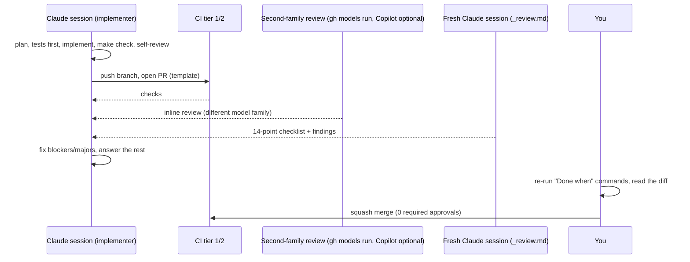

# Git workflow

Binding summary: `CLAUDE.md` §7.

## 1. Branches

| Branch | Purpose | Who writes |
| --- | --- | --- |
| `main` | always releasable; protected from T0.5 on (`ci-cd.md` §5) | squash merges only |
| `<type>/<task-id>-<slug>` | one task, e.g. `feat/T1.6-gate-stats`, `fix/T3.5-tenant-filter`, `docs/T0.4-mkdocs` | the session working on that task |
| `gate/pr-<N>` | maintainer-pushed copy of a reviewed **fork** PR head (`scripts/mirror_fork_pr.sh`), only so `build-images.yml` can build its image; **no PR is opened for it**; the owner then dispatches `gate-executor.yml -f pr=N` in the private repo (browser or GitHub mobile app; there is no `run-gate` label, round 13 P1.2), and the executor gates `gate/pr-N` only if its head SHA equals the fork head SHA at dispatch time, posting the result to that SHA only (D104, X2.3); never merged | owner |
| `cassettes/<date>` | weekly re-recorded cassettes pushed by `cassettes.yml`; the maintainer opens the PR | `cassettes.yml` |
| `bench/**` | benchmark SHAs for T7.2 (triggers `build-images.yml`); never merged | experiments |
| `release-please--branches--main` | release PR | release-please bot |
| `mutation/<M-id>` | benchmark mutations, if stored as branches (T7.1a/T7.1b); never merged | experiments |

Baselines are **not** in this repo. Other repos and branches:

| Repo / branch | Purpose | Who writes |
| --- | --- | --- |
| `pruefstand-gate` (private) `main` | executor workflows + orchestrator, synced at `executor-<YYYYMMDD>` tags | maintainer (`scripts/sync_executor.sh`) |
| `pruefstand-gate` `baselines` (protected, no force-push) | baseline `index.json` only; the baseline files live in the data root `$PRUEFSTAND_DATA_ROOT/baselines/` (VM disk, ADR-0019) (ADR-0004, X2.7, D209) | `baseline-promote.yml` only (incl. the monthly prune) |
| `pruefstand-gate` `executor-state` | `state/processed.jsonl` (D102; a record of dispatched runs), `state/nightly_counter` (block rotation, P4.4) | `gate-executor.yml` (processed), `nightly.yml` (counter) |
| `pruefstand-dashboard-data` (public) `main` | sanitised dashboard data + sha256 manifest (D108) | executor, with a repo-scoped PAT |
| `pruefstand-dashboard-data` (public) `heartbeat` | `heartbeat.json`, one force-pushed commit (D109) | executor, with a repo-scoped PAT |

**Bootstrap exception.** Before branch protection exists, T0.0 pushes the planning pack and T0.1
lands on `main` directly: `git push origin main` (T0.0) and, for T0.1, either a direct push or
`git push -u origin HEAD && gh pr create --fill && gh pr merge --squash`. From T0.5 on, every change goes
through a PR.

The branch types match the commit types: `feat`, `fix`, `test`, `docs`, `refactor`, `ci`, `chore`, `perf`, `build`.

## 2. Conventional Commits

```text
<type>(<scope>): <imperative summary, ≤ 72 chars>

<body: why, not what; wrap at 100>

Refs: T1.6
BREAKING CHANGE: <only if the public API/CLI/schema changes>
```

- The scope is the module or app: `gate`, `metrics`, `runner`, `rag-demo`, `dashboard`, `ci`, `docker`, `docs`, `action`.
- The PR title must be a valid Conventional Commit, because the squash-merge commit uses it. `commitlint` checks it in CI.
- `feat` bumps the minor version, `fix` and `perf` bump the patch, and `BREAKING CHANGE` bumps the major (minor while `0.x`).

## 3. PR template (`.github/pull_request_template.md`)

```markdown
## Task
T<ID> — <title> · prompt: `prompts/<ID>-<slug>.md`

## Summary
<3–5 lines: what changed and why>

## Evidence (one line per "Done when" item)
- [ ] `<command>` → <result / link to CI log / screenshot>

## Interface changes
None | <paragraph: what, why, impact> + ADR link

## Follow-ups
- <task ID or new issue>

## Checklist
- [ ] Tests written first; `make check` green
- [ ] Coverage gates hold; no rule weakened
- [ ] Docs updated (docstrings, module README, diagrams, `docs/decisions.md`)
- [ ] `prompts/_review.md` run in a fresh Claude session and via `gh models run` (second family); findings resolved
- [ ] Copilot code review comments answered (only if Copilot is enabled)
- [ ] No secrets, raw corpora or model weights added
```

Issue templates: `bug.yml`, `task.yml` (links a task ID) and `regression-report.yml` (gate result + run id).

## 4. CODEOWNERS

```text
*                                   @dheena18
/packages/pruefstand/src/pruefstand/gate/      @dheena18
/packages/pruefstand/src/pruefstand/metrics/   @dheena18
/.github/                           @dheena18
/infra/runner/                      @dheena18
/infra/gate-executor/               @dheena18
/docs/adr/                          @dheena18
/docs/architecture/interfaces.md    @dheena18
```

With one maintainer this mostly documents ownership. Branch protection requires **0 approvals**
(a solo maintainer cannot approve their own PR); the required checks and the review loop are the
safeguard. Raise required approvals to 1 when a second maintainer joins.

## 5. Review flow



Rules:
- The reviewer session never shares context with the implementer session.
- Fix every blocker and major before merge. A minor finding is either fixed or turned into a follow-up issue.
- A PR over 400 changed lines (excluding tests and fixtures) is split before review.

## 6. Merging

- Squash merge only, using the PR title as the commit message, with `Refs: T<ID>` in the body.
- Delete the branch after merge, and tick the task in `tasks/TASKS.md` in the same PR or the next one.
- Never force-push to `main`. Force-pushing your own task branch is fine before review starts.

## 7. Releases and versioning

release-please keeps the release PR (`CHANGELOG.md`, version in `pyproject.toml` files, Action `vX`
tag). SemVer applies to the CLI, the config schema (`version: 1`), the target API (`/v1`), the run
artefact schemas (`schema_version`) and the public Python API listed in `interfaces.md`. Details in `release.md`.
