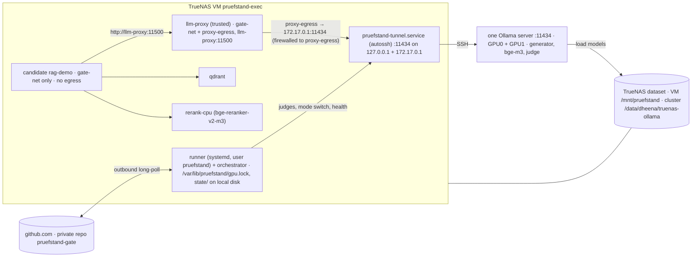

# GPU cluster (2 × NVIDIA A40) and the executor VM

**This file is the single source of truth for GPU placement, VRAM, serving (Ollama), model families,
cluster/NAS storage, the cluster ↔ VM bridge and time budgets.** SPEC §6.2, `deployment.md` and the task
prompts link here instead of repeating numbers. Host ports on the VM are defined once, in `docker.md` §3.
The binding sources of this revision are `docs/planning/reviews/round10-resolution.md` (Z1–Z7, owner facts
2026-10-31) and `round11-resolution.md` (Y1–Y7: one service user, native Ollama API, budgets, unattended
operation); round-12 changes from `round12-resolution.md` (N1, N2, N4, N7) and `round12-{arch,ai}.md`.
**ADR-0018 (2026-10-31): one Ollama server on `127.0.0.1:11434` serves both A40s**; there is no second port,
no per-GPU server and no datagen server. What the owner already set up is recorded in `docs/ops/setup-log.md`.

## 0. Facts and feasibility results

### 0.1 Owner facts (2026-10-31; from `ollama list`, `nvidia-smi`, `df -h`, `loginctl`)

| Fact | Value | Consequence |
| --- | --- | --- |
| Cluster host | `cairo-s101lp`, plain SSH (no Slurm), user workdir `/data/dheena` | the cluster is reached only by SSH |
| GPUs | 2 × A40, 46 068 MiB each, idle; driver for CUDA 13.4 | ≈ 45 GiB usable per card (§3) |
| Local disk | `/` 7 GB free, `/data` 14 GB free | **nothing is stored on the cluster** outside the NAS mount: no checkout, no caches, no state, no logs except the Ollama logs on the NAS (§8) |
| NAS | TrueNAS dataset mounted at `/data/dheena/truenas-ollama` (1 PB; mount type **verify**, T0.6 C5) | models and scripts live there; the VM mounts the same dataset at `/mnt/pruefstand` (Z2) |
| Ollama | **one** server already running on `127.0.0.1:11434` (process of the cluster user) that sees **both** A40s (setup log §1, §3; ADR-0018); `/api/tags`: `qwen3.8:27b-q8_0`, Ollama family `qwen35`, 27.3 B, `Q8_0`, 29 978 242 050 bytes, digest `8f5fb6b71ea00052cbe8545738c55ce61112c4e571cb60ca4dad00b131766039`, native context 262 144, capabilities `completion, tools, thinking, vision` | the tier-2 generator; family `qwen35` → plan family `qwen` (`core/data/model_families.yaml`), `think: false` required; licence **verify** with `ollama show` (T0.6 C3); the server's model dir (`OLLAMA_MODELS`, from `/proc/<pid>/environ`) **verify** in T0.6 C4; if it is not the NAS `ollama-models/`, the model is moved or re-pulled there once (T3.1a, Z7) |
| Docker / vLLM | not confirmed | **assumed absent** on the cluster; vLLM and TEI are dropped from the default plan |
| systemd linger | `Linger=no` | no persistent user services on the cluster; the running server is reused; only if none runs is the one server started **detached with `setsid nohup`** (Y5.4, ADR-0018; survives logout unless logind kills the session scope (`KillUserProcesses=yes`): `setsid` changes the process session, not the cgroup; T0.6 C4 decides go/no-go, the fallback is linger or an admin exception; A12-M10) and relaunched by the VM preflight when down (§8) |
| Copying files | the owner cannot copy files directly to the cluster | code reaches the cluster only as scripts in NAS `bin/`, written by the VM from its git checkout (Z2); data reaches it through the NAS |
| GitHub | Pro (no Copilot); free providers only | unchanged (CLAUDE.md §5, §7) |
| VM access to the cluster (Z7) | **done** (setup log §2): user `pruefstand` logs in with the key `/home/pruefstand/.ssh/id_ed25519_cluster` through the alias `cairo-s101lp` in `/home/pruefstand/.ssh/config`, which uses a public TCP endpoint with a non-default `Port` (placeholders only in git) | no password is ever stored; a new endpoint port changes only `Port` in that file (setup log §6) |
| VM size (Z7) | TrueNAS host 128 GB RAM; VM gets **64 GB** | CPU models on the VM ≤ 24 GB in total (reranker, tier-1 ≤ 2B GGUF, CPU embeddings); GPU models stay on the cluster |
| Owner workflow (Z7) | VS Code on Windows, terminal via **Remote-SSH into the VM** | the VM is the primary development **and** execution machine; coding agents run their commands on the VM; WSL2 is optional |

### 0.2 Feasibility checks (filled in by T0.6 and T0.7)

T0.6 checks the cluster and the NAS (mostly owner-run commands plus an Ollama API check over an SSH
tunnel); T0.7 builds and checks the VM. T3.1a and T6.2a depend on both.

| # | Check | Command (example) | Result |
| --- | --- | --- | --- |
| C1 | SSH access, GPUs visible and idle | `ssh cairo-s101lp 'id; nvidia-smi --query-gpu=index,name,memory.total,memory.used --format=csv'` | **done** 2026-10-31: key login works, 2 × A40 46 068 MiB (setup log §1, §2); idle state re-checked by T0.6 |
| C2 | Ollama installed, version | `ssh cairo-s101lp 'ollama --version; command -v ollama'` | _pending_ |
| C3 | Generator model present; family, licence, context, quantisation, digest | `ollama list`; `ollama show qwen3.8:27b-q8_0` (architecture, parameters, context length, licence); digest from `ollama list` / `GET /api/tags` | tag, family `qwen35`, 27.3 B, `Q8_0`, digest, context 262 144, capabilities: **done** 2026-10-31 (setup log §3); licence and base model _pending_ (`ollama show`) |
| C4 | A detached process survives logout (Y5.4, **go** condition); the existing server's model dir and env; `OLLAMA_MODELS` on the NAS readable | `ssh cairo-s101lp 'setsid nohup sleep 600 >/dev/null 2>&1 </dev/null & echo $!'`, disconnect, reconnect, `ps -p <pid>` → still running; record `loginctl show-user $USER -p KillUserProcesses`; the env of the running server: `tr '\0' '\n' < /proc/<ollama-serve-pid>/environ` filtered to `OLLAMA_*` and `CUDA_VISIBLE_DEVICES` (model dir, `MAX_LOADED_MODELS`, `NUM_PARALLEL`, `KEEP_ALIVE`; ADR-0018); `ls /data/dheena/truenas-ollama/ollama-models` | _pending_ (the server itself already runs, setup log §1) |
| C5 | NAS mount: type, free space, writable | `findmnt -T /data/dheena/truenas-ollama`; `df -h` on it; write + delete one file in a `mktemp -d` under it | _pending_ |
| C6 | NAS **read** throughput on the cluster (drives model load time) | `dd if=<existing model blob> of=/dev/null bs=16M count=256 iflag=direct` (4 GiB, read-only) | _pending_ |
| C7 | SSH port forwarding allowed; Ollama API answers through the tunnel with thinking off | forwarding and `/api/tags` through the tunnel: **done** 2026-10-31 (`pruefstand-tunnel.service`, setup log §3). Thinking-off check on the VM through that tunnel: `curl -s 127.0.0.1:11434/api/chat -d '{"model":"qwen3.8:27b-q8_0","think":false,"stream":false,"messages":[{"role":"user","content":"Sag Hallo."}]}'` → German text, no thinking content (where no tunnel exists: a **temporary** forward on 21434 only, Y1.4, `ssh -N -o ExitOnForwardFailure=yes -L 21434:localhost:11434 cairo-s101lp &`, closed afterwards) | forwarding: done; `think:false` _pending_ |
| C8 | Outbound HTTPS from the cluster for model pulls | `curl -sSfI https://registry.ollama.ai/v2/ https://huggingface.co` | _pending_ |
| C9 | GitHub Models free quota for the tier-1 informational judge | 24-hour scheduled probe (D99), recorded in `ci-cd.md` §1.1a | _pending_ |
| V1 | VM `pruefstand-exec`: Ubuntu 24.04, ≥ 8 vCPU, **64 GB RAM** (Z7), Docker, local disk ≥ 200 GB free | T0.7 | _pending_ |
| V2 | VM mounts the NAS dataset at `/mnt/pruefstand`, sees the same files as the cluster | T0.7: `ls /mnt/pruefstand/ollama-models` matches C4 | _pending_ |
| V3 | **system** unit `pruefstand-tunnel.service` (runs as user `pruefstand`, Y1.1) up after a VM reboot; `curl -s 127.0.0.1:11434/api/tags` on the VM | T0.7 | unit + `127.0.0.1:11434` **done** 2026-10-31 (setup log §3); reboot test and the `172.17.0.1:11434` forward _pending_ (T0.7) |
| V4 | Service user `pruefstand` exists, the owner login user is in group `pruefstand`; `/var/lib/pruefstand` (mode 2770, group `pruefstand`) holds `gpu.lock` (0660); `pruefstand-lock true` works for both users; the runner can run as a **system** service as `pruefstand` | T0.7 (runner itself: T6.2a) | _pending_ |
| V5 | VM → cluster login by **SSH key only** (Z7); `ssh -o BatchMode=yes cairo-s101lp true` succeeds with no password prompt | T0.7 | **done** 2026-10-31 (setup log §2) |
| V6 | VS Code Remote-SSH from Windows into the VM works; the repo checkout lives on the VM | T0.0 / T0.7 | _pending_ |
| V7 | **TrueNAS host** reboot (Y5.3): the VM autostarts, `/mnt/pruefstand` comes back through its systemd mount unit (`x-systemd.automount,nofail`), tunnel (no NAS dependency) and runner (`Wants=` + `After=mnt-pruefstand.automount`, N4.1) are active without manual steps. **V7b** (A12-01): the NAS share stays unavailable for 5 min after the VM boots → runner and tunnel are active anyway and the first poll posts `error` with `infra_error="nas_unavailable"` ("NAS not mounted") | T0.7 [HUMAN] | _pending_ |

**Decision:** _go / no-go_ (date, who). Without Docker/vLLM on the cluster the design is
Ollama-only (Z3); a no-go now means "Ollama cannot serve or the NAS is too slow to load models", and the
fallback is one rented 48 GB GPU host running one Ollama server with the same VM-side design.

## 1. Topology (Z1)

| Machine | Runs | Never runs |
| --- | --- | --- |
| **Cluster** `cairo-s101lp` | **one** Ollama server on `127.0.0.1:11434` for both GPUs (`CUDA_VISIBLE_DEVICES=0,1`; ADR-0018): the already running server is reused; only if none runs is it started detached with `setsid nohup` (Y5.4); `OLLAMA_MODELS` on the NAS | runner, repo checkout, Docker, Qdrant, data, caches, state, locks |
| **TrueNAS VM** `pruefstand-exec` (Ubuntu 24.04, ≥ 8 vCPU, 64 GB RAM, rootful Docker) | **primary development machine** (VS Code Remote-SSH, coding agents, repo checkout; owner login user) and executor (system user **`pruefstand`**, Y1.1): persistent GitHub self-hosted runner (systemd), orchestrator, `/var/lib/pruefstand/gpu.lock` + state files on local VM disk, Qdrant, rag-demo candidate containers, CPU models ≤ 24 GB total (reranker, tier-1 ≤ 2B GGUF via llama.cpp, CPU embeddings), pruefstand, `autossh` tunnels to the cluster; baselines, backups, datasets on the NAS at `/mnt/pruefstand` | — |
| **Windows laptop** | VS Code with Remote-SSH into the VM (Z7); WSL2 optional (alternative dev environment) | code execution, gate runs |

The VM reaches Ollama through the tunnel command (ADR-0018: port `11434` only; the `127.0.0.1` forward already
runs, setup log §3; T0.7 adds the `172.17.0.1` forward once Docker exists and never drops it later, which would
lose the proxy path, A13-M7): `autossh -M 0 -N -o ExitOnForwardFailure=yes -L 127.0.0.1:11434:localhost:11434
-L 172.17.0.1:11434:localhost:11434 cairo-s101lp`, run by the **system** unit `pruefstand-tunnel.service` as user
`pruefstand` (Y1.1; `Wants=`/`After=network-online.target`, `Restart=always`, `RestartSec=10`). The alias
`cairo-s101lp` in `/home/pruefstand/.ssh/config` holds the real host, user and non-default `Port`. The VM logs in to the cluster
with an **SSH key** created on the VM for user `pruefstand` (`/home/pruefstand/.ssh/id_ed25519_cluster`,
`ssh-keygen` + `ssh-copy-id`, Z7); the private key lives only there, never in GitHub, the NAS, an image or
the owner's home, and no password is stored anywhere.

**VM identities (Y1, binding).**

| Identity | Owns / runs | Notes |
| --- | --- | --- |
| system user `pruefstand` | runner (`pruefstand-runner.service`), orchestrator, `pruefstand-tunnel.service`, cluster SSH key, `PRUEFSTAND_HOME=/home/pruefstand/pruefstand` (state, runs, caches, Qdrant data), `/var/lib/pruefstand/` (`gpu.lock` 0660, `MAINTENANCE`), executor secrets (`runner.env`) | the only identity with the cluster key; member of group `docker` |
| owner login user | VS Code Remote-SSH, coding agents, dev checkout, `.env` (dev values) | in groups `pruefstand` and `docker`; GPU work only through `pruefstand-lock <cmd>` (same lock file); cluster calls only through the sudo wrapper `sudo -n -u pruefstand /usr/local/bin/pruefstand-cluster <op>` (T3.1a; never `ssh` to the cluster); never touches `/var/lib/pruefstand/**` or `/home/pruefstand/**` directly |
| group `docker` | rootful Docker daemon (dedicated VM, Y1.3) | members `pruefstand` and the owner user only; root-equivalent (`security.md` C18) |



## 2. Models, families and modes (Z3)

All LLM and embedding serving is **Ollama**. Every client (rag-demo, `LLMClient`, the T3.1b bench) uses the
**native** Ollama API only (`/api/chat`, `/api/embed`; LiteLLM provider `ollama_chat`), never `/v1/*`, so
`num_ctx` and the other options apply (Y3.1). Nothing outside `infra/gpu/` and `infra/cluster/` knows about
the tunnel.

| Role | Family | Model (verify exact tag; pin by digest in T3.1b) | Lane (URL setting) / expected card | Approx. VRAM |
| --- | --- | --- | --- | --- |
| Generator (tier 2) | **qwen** (Ollama family `qwen35`) | `qwen3.8:27b-q8_0` (existing, digest `8f5fb6b7…1766039`), `think: false` required (capability `thinking`); smaller same-family swap for M11: a Qwen3 8B/14B `q8_0` tag (T3.1b) | `gpu0` (`OLLAMA_GPU0_URL`), one card | ~29 GB + KV |
| Embeddings (tier 2) | bge | `bge-m3` (Ollama) | `gpu0`, any card | ~1.5 GB |
| Reranker (tier 2) | bge | `BAAI/bge-reranker-v2-m3` on the **VM CPU** (sentence-transformers), reranks the top **10**, passages truncated to 256 tokens, batched (Y4.2) | VM `rerank-cpu` | — |
| PR judge | **mistral** (gemma if mistral fails T5.4) | Mistral Small 24B-class, `Q4_K_M` | `gpu1` (`OLLAMA_GPU1_URL`), the other card | ~15 GB + KV |
| Nightly judge | **gemma**, 27B-class (D141) | Gemma 3 27B-class, `Q4_K_M` (PR judge unloaded at night) | `gpu1`, the other card | ~17 GB + KV |
| Datagen (weekend) | **llama**, 70B-class | Llama 3.3 70B-class, `Q4_K_M`, split over both cards by Ollama (all other models unloaded) | `all` (`OLLAMA_GPU0_URL`), both cards | ~43 GB + KV |
| Tier 1 (GitHub runner) | qwen (generator); non-qwen GitHub Models judge | unchanged: ≤ 2B GGUF on CPU via llama.cpp | GitHub | — |

**Lanes, not servers (ADR-0018).** One Ollama server serves every model; `OLLAMA_GPU0_URL` and `OLLAMA_GPU1_URL`
are both `http://127.0.0.1:11434` on the VM and name the generator lane and the judge lane. Ollama places each
model on a card itself; `health.sh` reports the card per model and fails (exit 15) when a model is not fully in
VRAM or, outside datagen, spans both cards. Generator and judge are kept apart by model, not by port: `llm-proxy`
lets candidates use only the run's generator and embedding tags.

The family plan (D112) is unchanged: one family per role, no judge in the generator's family; datagen
`llama` differs from every judge family. `qwen3.8:27b-q8_0` is not an official Qwen release name: Ollama
reports family `qwen35` (setup log §3), which `core/data/model_families.yaml` maps to the plan family `qwen`;
T0.6 C3 records the licence and base model from `ollama show`, and T3.1b pins the tag at digest
`8f5fb6b71ea00052cbe8545738c55ce61112c4e571cb60ca4dad00b131766039` only if the licence is on the allowlist (else
the generator falls back to an official Qwen3 tag). Licences are checked per checkpoint (DATA_LICENSES §5).

| Mode | When | Generator lane (`gpu0`) | Judge lane (`gpu1`) |
| --- | --- | --- | --- |
| **day** (default) | development, PR gates, baseline runs | generator + `bge-m3` | PR judge |
| **night** 22:00–06:00 Europe/Berlin (Y4.3) | nightly subset of `full`, weekly cause-switches, calibration (T5.4) | generator + `bge-m3` (unchanged) | PR judge unloaded, gemma nightly judge loaded |
| **datagen** (manual weekend jobs, X3.12) | T4.2, T4.5, T2.6, T5.3 pass 1, RQ2 70B arm; `switch-mode.sh datagen` creates `MAINTENANCE` itself and is the only mode allowed while it exists (Y6.2) | all day models unloaded (`keep_alive: 0`); the same server loads llama 70B, which Ollama splits over GPU0 + GPU1 | ← same |

Every mode switch is API loads and unloads on the one server; the server is never restarted for a mode.

Because the nightly judge sits on the other card than the generator (they do not fit one card together, §3),
nightly generation (phase A) and judging (phase B) **may overlap**: the judge starts on cases whose responses are cached while
generation continues. Judgments stay cached under the full D113 key. If the nightly judge is not
available, nightly runs with the PR judge (`judge_fallback=true`); any judge other than the configured one
makes the judged metrics of that run **informational**, and judged metrics are never compared across judges
(Y4.4). The 70B model is never used by a gate run.

**Night window (Y4.3, N4.3).** 22:00–06:00 Europe/Berlin, budget ≤ 8 h, **hard deadline 06:00**. GitHub cron
is UTC only, so `nightly.yml` has two entries, `7 20 * * *` (22:07 CEST) and `7 21 * * *` (22:07 CET); a
hosted job `guard` decides by **which cron fired** (`github.event.schedule`), not by the start hour, and sets
the output `run=true|false`; the orchestrator job runs only `if: needs.guard.outputs.run == 'true'` (round 13
P2.1), so a nightly queued behind a busy runner still runs and the off-season cron never starts a second one
(A12-03, A13-02). The nightly is one orchestrator job with the deadline 06:00 Berlin **of the fired night**; a job
that starts after it ends at once with `infra_error="window_exceeded"` (reported once for that night); before each
phase it checks the remaining time and, if it is not enough, stops with `stop_reason="aborted"`,
`infra_error="window_exceeded"`; a night that cannot start is reported (heartbeat `last_nightly_status`,
issue "nightly skipped"). Each night runs `pruefstand run --split full --stratum all --block auto` (P4.3): the
**refusal stratum** (`TestCase.block = None`, ≈ 150 unanswerable cases, at least 100 clusters) plus **block k**
(`block ∈ {0,1,2}`, 300 unperturbed answerable + 150 perturbed cases, P3.1; assigned by T4.1, recorded in
`DatasetManifest`; `auto` = `state/nightly_counter` mod 3, the counter incremented only after a completed
nightly, P4.4), at most 600 cases, so `full` is covered every 3 completed nightlies (SPEC §6.2, N1). The night
judge's anchor check (`judge-drift`) runs right after `switch-mode.sh night` and before the gate (AI13-08). `RunManifest.block` is in the
`eval_fingerprint`; the nightly gates vs baseline ref `nightly-b<k>`. Cause-switches run **weekly** (Sunday
night), not nightly (`ci-cd.md` §1.2). If a nightly is killed before its `finally` (`switch-mode.sh day`),
the next preflight's `health.sh --repair day` unloads gemma and restores the day set (A12-M12).

**Catalogue.** `infra/gpu/models.yaml` (T3.1a) lists every servable model: `id` = **`ollama/<tag>`** (the one
id format in configs and catalogue, Y3.3; the bare `<tag>` appears only in Ollama API bodies; translation to
LiteLLM's `ollama_chat/<tag>` happens only inside `llm/backends/litellm.py`), `engine: ollama` (or `cpu`
for the reranker), `tag`, `digest` (Ollama manifest sha256; tags are mutable, the digest is the pin),
`quantization`, `family`, `role`, `server` (`gpu0|gpu1|all|vm`: the lane, i.e. which URL setting a client uses, not a
physical card or port, ADR-0018), **`options`** (`num_ctx`,
`num_predict`, `temperature`, `seed`, `top_p`, plus `option_bounds` (min/max for the sampling keys); preload uses exactly
these. R12 N2: `llm-proxy` **enforces only `num_ctx` and `keep_alive`** (they are load-time; a different value
forces a reload) and the model allow-list, strips other load-time keys, and passes `temperature`, `seed`,
`top_p`, `num_predict` through from the client within the catalogue `option_bounds` (outside → 403); catalogue values are defaults,
not overrides. Judges are trusted clients and send the catalogue values unchanged), `license`, `provisional`; embed entries also `query_prefix`,
`doc_prefix`, `max_input_tokens`. `infra/gpu/endpoints.yaml` maps service → `base_url_env`
(`OLLAMA_GPU0_URL`, `OLLAMA_GPU1_URL`, `RERANK_URL`), `model_id` (= the catalogue `id`), `family`, `kind` (`chat|embed|rerank`).
A PR may only select catalogue models, else `unsupported_config` (WARN). Swapping the generator inside the
catalogue = unload + load on the one server inside the job, under the lock. The same holds for the embedding
model (AI12-08): a PR, mutation M3 or RQ1 config that selects another catalogue embedding model (e.g.
e5-large) → unload `bge-m3`, preload the selected embed model with its catalogue `options` before indexing,
restore `bge-m3` in `finally`; with `OLLAMA_MAX_LOADED_MODELS=3` (generator + embed + judge) a fourth resident
model would evict one of them and its next request would count as `model_reload`.

**Index per PR.** Unchanged: a PR that changes the embedding model or chunking gets a PR-scoped Qdrant
collection `pr_<N>_<shortsha>` (on the VM), deleted in `cleanup` and by the job-completed hook.

### 2.1 Serving rules (every role)

- **Ollama server env** (the one server, Z3, ADR-0018; source `infra/cluster/cluster.env.template`, T3.1a/ADR-0009):
  `CUDA_VISIBLE_DEVICES=0,1`, `OLLAMA_NUM_PARALLEL=4`, `OLLAMA_MAX_LOADED_MODELS=3`, `OLLAMA_KEEP_ALIVE=24h`,
  `OLLAMA_NOPRUNE=1` (no blob pruning at start on the NAS store),
  `OLLAMA_KV_CACHE_TYPE=f16` (explicit; a quantised KV cache changes outputs), `OLLAMA_FLASH_ATTENTION=1`,
  `OLLAMA_MODELS=$CLUSTER_NAS_ROOT/ollama-models` (T0.6 C4 records the existing server's model dir),
  `OLLAMA_HOST=127.0.0.1:11434` (loopback on the cluster; reached only through the tunnel). No prompt logging
  (`OLLAMA_DEBUG` unset). (AI12-04) The already running server is reused when healthy; its environment is read
  from `/proc/<pid>/environ` and a difference from `cluster.env` is a WARN, not a restart (runbook §2a).
- **Context is always explicit.** Ollama silently truncates prompts longer than `num_ctx`, so every
  request carries the catalogue `options.num_ctx` (Y3.2; `/v1/*` would ignore it, hence native only): generator 8192;
  **both judges 12288** — PR judge (Mistral) and nightly judge (Gemma) (**verify** Gemma's sliding-window cache
  behaviour in T3.1b). **Rule for judges (AI12-09, round 13 AI13-04, D306):** judge `num_ctx` = generator `num_ctx`
  8 192 + rubric/answer allowance ≤ 3 072 + 1 024 output reserve = **12 288**, because a faithfulness input holds
  the same chunks as the generator prompt plus rubric and answer; T3.1b may lower it only if its VRAM measurement
  fails;
  if that does not fit at 4 slots, lower `OLLAMA_NUM_PARALLEL` to 2 **before** lowering `num_ctx` (the setting is
  server-wide since ADR-0018, so it also halves the generator's slots: re-run the PR and nightly budgets). KV memory
  per model ≈ `num_ctx × OLLAMA_NUM_PARALLEL × KV-bytes-per-token`.
- **Qwen thinking is disabled** (D95): native `/api/chat` with `"think": false` (`/v1` is never used, Y3.1). The `<think>`
  strip stays as the safety net and is counted (X3.13). Tier 1 (llama.cpp) unchanged.
- **Embeddings**: `bge-m3` via `/api/embed` (dense only; the sparse side is our own analyzer, T3.3),
  `options.num_ctx` = the maximum chunk length in tokens (1024–2048, recorded with the truncation count;
  not bge-m3's 8192, which under 4 slots could reserve ≈ 3 GiB more VRAM, AI12-08), truncation counted;
  T3.1a S8 measures bge-m3 VRAM at the pinned `num_ctx`. e5-family prefixes (D121) as before if an e5 model is ever served. **Verify** in T3.1b that
  Ollama's bge-m3 vectors match the reference checkpoint closely (cosine ≥ 0.99 on 20 passages).
- **Structured output**: `format` (JSON schema) on `/api/chat`, **verify** in the pinned version; JSON
  repair (T5.1) stays.
- **Judge input cap** (X3.9): judge context window (`num_ctx`) − 1 024 tokens, counted with the judge's
  tokenizer; truncations logged, counted, listed in the report. **Tokenizer source (AI13-05):** every catalogue
  entry carries `tokenizer: {source, sha256}` (Qwen and Mistral from their HF repos; Gemma after the owner accepts
  its terms, or extracted from the GGUF vocabulary with the `gguf` reader); rag-demo bakes the generator's
  tokenizer next to `bge-m3`'s; every native response's `prompt_eval_count` is compared with the local count and a
  mismatch > 2 % or `prompt_eval_count ≥ num_ctx − num_predict` is counted in `/v1/health.stats.prompt_overflow`.
  Ollama caps are `options.num_ctx` (never the vLLM term `max-model-len`).
- **Determinism and fingerprint**: catalogue `options` (`temperature 0`, `seed`, …); not bit-exact with parallel slots. Serving
  facts: `/v1/info.serving.engine = ollama`, `engine_version`, `quantization` (`Q8_0`), `model_sha256` =
  Ollama manifest digest; judges enter `judge_serving` (X3.3). Changing tag, digest or quantisation changes
  the `eval_fingerprint` → new baseline.
- **First load is slow**: models load straight from the NAS (no local cache is possible, §0.1); the
  first load per mode (29 GB at the C6 throughput) is **excluded from timing budgets**; the preflight warms
  the models of the mode before the timed run starts.

## 3. Memory budget (planning numbers; T3.1b replaces them with measurements)

A40: 46 068 MiB ≈ 45 GiB per card. KV bytes per token are architecture-specific (**verify** with
`ollama show` / the server log at load): planning values 256 KiB/token for a 27B dense model with 8 KV
heads (64 layers × 8 × 128 × 2 × 2 B), 160 KiB for Mistral Small 24B (40 layers), less for Gemma 3
(sliding window).

| Card (expected) / mode | Models | Weights | KV (`num_ctx` × 4 slots) | Card total |
| --- | --- | --- | --- | --- |
| generator card, day + night | generator `qwen3.8:27b-q8_0` + `bge-m3` | ~29 GB + ~1.2 GB | generator 8192 × 4 = 32 k tokens ≈ 8 GB; bge-m3 small | ≈ 40 GB of 45 (16384 × 4 would need ≈ 16 GB KV and does **not** fit) |
| judge card, day | PR judge Mistral Small 24B `Q4_K_M` | ~14–15 GB | 12288 × 4 = 48 k ≈ 7.5 GB | ≈ 23 GB of 45 |
| judge card, night | gemma 27B `Q4_K_M` (PR judge unloaded) | ~17 GB | **12288** × 4 (= 8 192 + 3 072 + 1 024, D306): with the sliding-window cache ≈ 6–8 GB; **without** it ≈ 23 GB (12 288 × 4 × 0.48 MiB) (**verify** in T3.1b) | ≈ 25–27 GB of 45 with SWA, ≈ 41 GB without (fits; 16384 without SWA ≈ 48 GB would not) |
| generator card, embed swap (M3, RQ1 e5) | generator + e5-large instead of `bge-m3` | ~29 GB + ~1.2 GB | as the bge-m3 row | ≈ 40 GB of 45 (**verify**, AI12-08) |
| both cards, datagen | llama 70B `Q4_K_M`, split | ~43 GB (≈ 21.5 GB/card) | 8192 × 4 = 32 k ≈ 10 GB total | ≈ 27 GB per card |

`OLLAMA_MAX_LOADED_MODELS=3` holds generator + embeddings + one judge; the mode switch unloads one judge before
loading the other, so two judges are never resident at once. Ollama places the models; the generator (≈ 40 GB with
KV) and a judge (≥ 23 GB) cannot share a card, so they land on different cards, and `health.sh` reports the
placement. If a measured total exceeds 44 GB on the generator card, lower `num_ctx` before lowering
`OLLAMA_NUM_PARALLEL`, and record it; on the judge card the judge rule of §2.1 applies instead (lower `OLLAMA_NUM_PARALLEL` to 2 first, `num_ctx` 12 288 is lowered only if
T3.1b's VRAM measurement still fails, D306).

## 4. Serving commands (baseline; verify against the pinned Ollama version in T3.1a)

Cluster side (`infra/cluster/start-ollama.sh`, run from NAS `bin/`; ADR-0018). **Reuse first:** if an Ollama
server already answers `/api/tags` on `127.0.0.1:11434` (the existing server, setup log §1), the script starts
nothing and exits 0; `status.sh` reports its pid and its `OLLAMA_*` environment (from `/proc/<pid>/environ`) and
flags differences from `cluster.env` as WARN. **Only if none runs** does it start **one** server, never a second
one. Z7: a server started by the script uses the NAS store because it exports
`OLLAMA_MODELS=/data/dheena/truenas-ollama/ollama-models` (from `CLUSTER_NAS_ROOT`) before `ollama serve`; a
server started any other way may use `~/.ollama` on the full local disk (T0.6 C4 records which dir the existing
server uses). The script refuses to start if the NAS path is not mounted.

```text
# only when no server answers on 127.0.0.1:11434
setsid nohup env CUDA_VISIBLE_DEVICES=0,1 OLLAMA_HOST=127.0.0.1:11434 \
  OLLAMA_MODELS=$CLUSTER_NAS_ROOT/ollama-models OLLAMA_NUM_PARALLEL=4 OLLAMA_MAX_LOADED_MODELS=3 \
  OLLAMA_KEEP_ALIVE=24h OLLAMA_NOPRUNE=1 OLLAMA_KV_CACHE_TYPE=f16 OLLAMA_FLASH_ATTENTION=1 ollama serve \
  > $CLUSTER_NAS_ROOT/run/ollama.log 2>&1 < /dev/null &
echo $! > $CLUSTER_NAS_ROOT/run/ollama.pid
modes (day, night, datagen) never restart the server: they only load/unload models through the API
```

Y5.4: `setsid nohup` (not `tmux`) so the server survives the end of the SSH session unless logind kills
the session scope (`KillUserProcesses=yes`; `setsid` does not leave the cgroup); T0.6 C4 decides go/no-go,
the fallback is linger or an admin exception (D228 wording, A12-M10). Pid and log files live in **one**
directory, NAS `run/` (A12-M3), and exist only for a server the script started; the pre-existing server has
none, and `status.sh` finds it by `pgrep -u "$USER" -f 'ollama serve'` plus the listener on `:11434`. After a
cluster reboot the pid file is stale, so `stop-ollama.sh` and `status.sh` act on a pid only if
`/proc/<pid>/cmdline` is `ollama serve` **and** `:11434` is listening for that pid; otherwise the pid file is
treated as stale and removed. `stop-ollama.sh` stops only a server whose pid file the scripts wrote; the
pre-existing server is stopped only by the owner (runbook §2a). The settings have one source: `bin/cluster.env`,
rendered by T3.1a from `infra/cluster/cluster.env.template` and written to NAS `bin/` (Y6.3);
`start-ollama.sh` derives the NAS root from its own path.

**Placement check (ADR-0018).** `GET /api/ps` must show `size_vram == size` for every resident model (else
`health.sh` exit 15). `status.sh` reports the card of each model by joining
`nvidia-smi --query-compute-apps=pid,gpu_uuid,used_memory --format=csv` with the Ollama runner process of each
model (the runner's `--model` blob path ↔ the model's manifest layers; **verify** on the pinned version in T3.1a,
fallback: the server log's offload lines). Outside `datagen` a model on two cards is also exit 15.

VM side (through the tunnel): load = `POST /api/generate {"model": <tag>, "keep_alive": "24h", "options": <catalogue options>}`
(empty prompt; the catalogue `options`, above all `num_ctx`, must match what requests send, else the first
real request reloads the model, AI12-04), unload = the same with `"keep_alive": 0`; resident models =
`GET /api/ps`.

## 5. Time budgets (Z4; T3.1b measures, then pins)

| Run | Work (approx.) | Budget |
| --- | --- | --- |
| smoke (50 cases) | 50 generations + ~150 judge calls | ≤ 10 min (excl. first model load) |
| **PR tier**: core (300) + robust_pr (≈ 300–440, **`/v1/retrieve` only**, no generation, D125/Y4.1) | 300 generations (generator card) + ~900 judge calls (judge card), pipelined; reranker lane top 10 × 256 tokens (Y4.2) | **≤ 90 min**; reranker lane ≤ 20 min, else `robust_pr` runs with reranker off (documented as first-stage robustness) |
| Missing baseline | no ad-hoc run: `failure` "no baseline for <fp>; run baseline-promote" (D103) | ≤ 90 min in the promote job |
| Nightly (Y4.3, N1, N4.3) | night-judge anchor check, then `--split full --stratum all --block auto`: refusal stratum (`block=None`, ≥ 100 clusters) + block k = `state/nightly_counter` mod 3 (P4.4), **≤ 600 cases**: generation on the generator card overlapped with gemma judging on the judge card (~1,800 calls), drift vs `release-b<k>` (on a release night the release run of all of `full`, ≈ 5–7 h, replaces the block run and drift, D321), contamination probe, PR-judge drift, prunes | **≤ 8 h**, hard deadline 06:00 Europe/Berlin of the fired night incl. `flock` wait; a late start ends at once; each phase checked against the deadline, else `window_exceeded` |
| Weekly cause-switches (Sunday night) | T6.3 scenarios on `core` | inside the Sunday night window (replaces that night's subset if both do not fit) |
| Datagen (weekend, X3.12) | llama 70B batch | manual, outside the night window; `switch-mode.sh datagen` sets `MAINTENANCE` itself (Y6.2) |

Planning estimate (unverified, T3.1b replaces it): generator 27B Q8 ≈ 1 000–1 500 tok/s prefill and
≈ 15–20 tok/s decode per slot; PR judge 24B Q4 ≈ 1 500–2 500 tok/s prefill, ≈ 30–40 tok/s decode per
slot → PR tier ≈ 60–80 min, nightly subset ≈ 1.5–2 h with overlap. **If T3.1b measures more than the budget**,
PR runs pass `--judged-subset`: **generation and judging** of the `core` answerable cases run only on the fixed
seeded 150-case judged subset of `core` (`TestCase.judged_subset`, T4.1; stratified by category incl. injection,
no `lang` stratum; round 13 P3.4: it acts on the bottleneck, and `budget.py` reports which lane binds, generator or
judge); retrieval metrics stay on all of `core` via `/v1/retrieve`, deterministic security cases always run in
full; `RunManifest.judged_subset` is part of the fingerprint, N1, and the SPEC MDE tables are updated (Z4). Never silently shrink a split; a budget overrun reports `stop_reason` and fails.
Measured run-dir sizes: PR run _pending (T6.3)_, nightly run _pending (T6.3)_.

## 6. How CI reaches the GPUs

- The **runner and orchestrator run on the VM** (T6.2a): persistent systemd service, outbound long-poll
  to the private repo only; no inbound port anywhere. PR gates start only from the owner's `workflow_dispatch`
  in the private repo (round 13 P1.2); `baseline-promote.yml` polls public `main` (ADR-0005).
- **GPU access is only through the tunnel**: `OLLAMA_GPU0_URL=http://127.0.0.1:11434` and
  `OLLAMA_GPU1_URL=http://127.0.0.1:11434` on the VM (two settings, one server, ADR-0018). The orchestrator and
  judges (trusted, user `pruefstand`) use them directly.
- **Candidate isolation.** The candidate rag-demo container is on the `--internal` network `gate-net`
  only (no route to the internet, no GPU). It reaches `qdrant`, `rerank-cpu` (`http://rerank-cpu:8201`) and
  the trusted **`llm-proxy`** (T6.2a) by name on `gate-net` (`http://llm-proxy:11500`; no `extra_hosts`).
  D242 (supersedes the host-network design of Y1.5/D215; port set reduced by ADR-0018): the `autossh` tunnel
  binds `11434` on `127.0.0.1` **and** on the Docker bridge gateway `172.17.0.1`; `llm-proxy` is a normal container on
  `gate-net` and the small non-internal bridge `proxy-egress` (subnet `10.231.0.0/24`, T0.7) and forwards to
  `http://172.17.0.1:11434` over `proxy-egress`; the VM firewall accepts the tunnel port `11434` on `172.17.0.1` only
  from the `proxy-egress` subnet (rules in Docker's `DOCKER-USER` chain and in the dedicated
  `PRUEFSTAND-INPUT` chain hooked from `INPUT`, since container → `172.17.0.1` hits `INPUT`, not
  `DOCKER-USER`; both applied by the oneshot `pruefstand-firewall.service`, D285, `After=docker.service`, re-applied on Docker restart; never a full-ruleset
  flush or reload through `nftables.service`, which would delete Docker's isolation rules; N4.2). It requires
  `Authorization: Bearer $PRUEFSTAND_CANDIDATE_API_KEY` (Y2.1), forwards only `POST /api/chat`,
  `POST /api/embed` and `GET /api/tags` (native API, Y3.1; `/v1/*` is rejected), and only for the
  catalogue generator and embedding tags of the run; it enforces only `num_ctx` and `keep_alive` (catalogue
  values), strips other load-time keys and passes `temperature`, `seed`, `top_p`, `num_predict` through
  within the catalogue `option_bounds` (outside → 403, R12 N2), and rejects `/api/pull`, `/api/delete`, `/api/create`,
  `/api/copy` and any other model name (Ollama has no API key, so this proxy is the boundary that keeps a
  candidate from unloading or deleting models or loading a judge). It counts upstream (Ollama/tunnel)
  errors separately from candidate errors and exposes them on `/health` (Y5.2). Judges run on the same server
  (ADR-0018), so the **model allow-list is the separation**: a judge tag, `/api/generate` or `/api/ps` → 403;
  no judge is ever reachable through it. T6.2a verifies that the candidate cannot reach `172.17.0.1` on any
  port and that `llm-proxy` answers 403 for every judge tag.
- The candidate gets only `PRUEFSTAND_CANDIDATE_API_KEY` for `llm-proxy`, never a judge endpoint, and never
  the held-out canary registry (X2.5). `rerank-cpu` has **no** auth (Y2.2): it is reachable only on
  `gate-net`, has no host port in the executor stack and holds no secrets.
- **Accepted risk (record in `security.md`)**: on the cluster, Ollama listens on `127.0.0.1`, so other
  local users of `cairo-s101lp` could call it (inference, and `pull`/`delete` on the NAS model store).
  Mitigations: digest check in the preflight (a changed or missing model fails the run, never passes it),
  models re-pullable from the registry, ask the admins whether per-user network namespaces exist.
- Development happens on the VM (VS Code Remote-SSH, Z7), so the tunnel of `pruefstand-tunnel.service`
  serves development too (GPU work through `pruefstand-lock`); from WSL (optional) a personal
  `ssh -N -L 11434:localhost:11434 cairo-s101lp`. Never a public tunnel: the existing ngrok URL to the
  cluster's Ollama is **rejected** (`security.md`, setup log §5), and the optional demo's Cloudflare Tunnel
  (`deployment.md` §5) exposes only the CPU demo, never Ollama.

## 7. The VM and its runner

T0.7 creates the VM on TrueNAS (Ubuntu 24.04, autostart on host boot, **rootful** Docker with group
`docker` = `pruefstand` + owner only, system user `pruefstand`, `/var/lib/pruefstand`, the
`pruefstand-lock` wrapper, the NAS dataset at `/mnt/pruefstand` as a systemd mount unit with
`x-systemd.automount,nofail` (Y5.3), the cluster SSH key of `pruefstand`, the system unit
`pruefstand-tunnel.service`, which has **no** NAS dependency, N4.1; the oneshot `pruefstand-firewall.service`,
N4.2). T6.2a installs the persistent runner there as the system service
`pruefstand-runner.service` running as `pruefstand` (pinned release + sha256 for the **first install only**; auto-update stays **on**, and the unit's `ExecStart` is the runner's `run.sh` (or the generated `svc.sh` unit), which restarts the listener after an update, never `Runner.Listener` directly; GitHub stops assigning jobs to a runner about 30 days behind with `--disableupdate`; heartbeat `runner_version`, runbook §6; A13-M9; `Wants=` + `After=mnt-pruefstand.automount`, never `Requires=`, N4.1: a late or
lost NAS never leaves the runner in "dependency failed"; the preflight fails the job with
`infra_error="nas_unavailable"` instead), with the job-started/-completed hooks (`infra/gate-executor/host/job_started.sh` /
`job_completed.sh`) that wipe `_work/`, remove containers/networks/volumes labelled `pruefstand.job`, and
drop `pr_*` Qdrant collections and `pr-*` cache overlays. Docker on the VM is the container runtime for
everything (Qdrant, candidate, `rerank-cpu`, `llm-proxy`); the cluster has none.

**Two stacks on one VM (Y1.4).** The executor stack (`compose.executor.yml`, user `pruefstand`) uses the
default ports and publishes nothing except what `docker.md` §3 lists; the owner/agent **dev** stack uses
compose profile `dev` with `PORT_OFFSET=10000` (Qdrant 16333/16334, rerank 18201, rag-demo 18000), so both
can run at once. Compose cannot do arithmetic, so the offset reaches raw `docker compose` only through
literal ports: `make ports-env` writes the effective per-service ports once into the owner's VM `.env`
(`QDRANT_HTTP_PORT=16333`, `QDRANT_GRPC_PORT=16334`, `RERANK_HOST_PORT=18201`, `RAG_DEMO_HOST_PORT=18000`, `LLM_PROXY_PORT`; names in `docker.md` §3), so a plain
`docker compose --profile core|live up` on the VM binds the dev ports too; `make check-ports` (and a
`vm_check` warning) flags any `pruefstand-dev` container on a default port (A12-M4). Done-when checks against
internal-only services use `docker compose exec` or the `dev` ports, never `localhost` of the executor stack
(Y6.5).

## 8. Operations (Z5)

Recurring and incident procedures are in `docs/ops/runbook.md`. All commands run **on the VM**; cluster
scripts are invoked as `ssh "$CLUSTER_SSH_HOST" bash "$CLUSTER_NAS_ROOT/bin/<script>.sh"`.

| Task | Command |
| --- | --- |
| GPU lock (D101, X2.1, Y1.1) | **`/var/lib/pruefstand/gpu.lock`** on the **VM's local disk** (mode 0660, group `pruefstand`; one host-wide path for every user; never on the NAS: no reliable locking there). Taken **once per job** by the orchestrator (`flock -w`, ≤ 2 h PR/promote, ≤ 8 h nightly) or, for the owner and agents, by the wrapper **`pruefstand-lock <cmd>`** (installed by T0.7 in `/usr/local/bin`; `flock` on the same file, exports `PRUEFSTAND_LOCK_HELD=1`), which the `mk/gpu.mk` targets use. `switch-mode.sh`, `health.sh`, `fetch-model.sh` (T3.1a) never take the lock and refuse without `PRUEFSTAND_LOCK_HELD=1` |
| Maintenance | file **`/var/lib/pruefstand/MAINTENANCE`** (Y1.2; not a per-user variable): `pruefstand-lock touch /var/lib/pruefstand/MAINTENANCE` → dispatched gates post `pending` "executor in maintenance; re-dispatch later", and `executor-health.yml` suppresses health-field alerts (heartbeat `maintenance`, A13-M4); nightly posts success "skipped: maintenance"; `rm` it to resume. `switch-mode.sh datagen` creates it itself, `switch-mode.sh day` from datagen removes it (Y6.2); only `datagen` is allowed while it exists |
| Preflight (every job, after the lock) | `infra/gpu/health.sh --repair`: `timeout 10 mountpoint -q /mnt/pruefstand`; tunnel port `11434` answers (else `sudo systemctl restart pruefstand-tunnel`, allowed for `pruefstand` by one `sudoers` line); if no Ollama server answers, `ssh … bin/start-ollama.sh` (starts the one server detached with `setsid nohup` only if none runs; ADR-0018), wait for `/api/tags` (≤ 5 min); then `/api/ps` must show **exactly** the mode's catalogue models with catalogue digests, each with `size_vram == size` (exit 15 otherwise; the card per model is reported): catalogue models outside the mode are unloaded first (e.g. gemma left by a killed nightly, or llama 70B left by datagen, A12-M12; non-catalogue models of other users are reported as WARN and left alone; T3.1a test: night models resident + `--repair day` → only the day models remain), missing ones are preloaded with the catalogue `options`; mount missing → `infra_error="nas_unavailable"` (N4.1); GPU memory via `ssh … bin/status.sh` (`nvidia-smi` CSV). A cluster reboot needs no manual step |
| Infra failure mid-run (Y5.2) | Ollama down, tunnel lost or NAS unavailable during a run (or `llm-proxy`/judge upstream errors > 0, or **a model reload during the run**) → run `stop_reason="aborted"` with `infra_error`, commit status **`error`** (not `failure`), not recorded as processed; **one** automatic retry after `health.sh --repair`; a **second** infra failure is recorded in `processed.jsonl` with `result: "error"` and the status says "…; re-dispatch to retry" (A12-M1, P1.2, `ci-cd.md` §1.2) |
| Mode switch | `infra/gpu/switch-mode.sh day|night|datagen` (VM, under the lock): only unload/load through the Ollama API (`keep_alive: 0` / `"24h"`, load with the catalogue `options`); no server start or stop, no per-GPU server (ADR-0018) |
| Deploy cluster scripts | `infra/gpu/deploy-cluster-bin.sh` (VM, T3.1a): copies `infra/cluster/*.sh` from the VM checkout to `$PRUEFSTAND_DATA_ROOT/bin/` (write to `*.partial`, then `mv`) plus `bin/SHA256SUMS`; the orchestrator re-runs it when `infra/cluster/**` changed on `main` |
| Pull / update a model | `fetch-model.sh <models.yaml id>` (VM, under the lock): `ssh … OLLAMA_HOST=127.0.0.1:11434 ollama pull <tag>` into the server's store (the NAS), then compare the manifest digest with `models.yaml`; mismatch → `ollama rm <tag>`, exit 1. One pull at a time |
| Logs | `ssh … tail -n 200 $CLUSTER_NAS_ROOT/run/ollama.log` for a server the scripts started (on the NAS, truncated at each start; nothing on the cluster disk); the pre-existing server logs wherever its owner started it (T0.6 records it); owner: `sudo -n -u pruefstand /usr/local/bin/pruefstand-cluster status` |
| Stop GPU serving | normally: unload all models (`switch-mode.sh` / API `keep_alive: 0`), the server keeps running. Stopping the server itself: executor `ssh … bin/stop-ollama.sh` (as `pruefstand`; acts only on a server whose pid file the scripts wrote); owner `pruefstand-lock sudo -n -u pruefstand /usr/local/bin/pruefstand-cluster stop-ollama` (T3.1a wrapper); the pre-existing server only by hand (runbook §2a). The wrapper's mutating ops (`start-ollama`, `stop-ollama`, `pull`, `rm`) require the GPU lock: sudoers `env_keep += PRUEFSTAND_LOCK_HELD`, and the wrapper checks that `flock -n /var/lib/pruefstand/gpu.lock true` **fails** (lock held); `status`/`show` are lock-free (A12-M5) |
| Runner status | `systemctl status pruefstand-runner` on the VM; heartbeat on branch `heartbeat` of `pruefstand-dashboard-data`, refreshed **every 15 min** during long jobs and lock waits (Y5.1) |
| Free disk | VM: `docker system prune --filter until=168h` (never volumes); run dirs rotated by `runs-prune`. Cluster: nothing to prune (nothing stored) |

## 9. Storage: VM local disk vs the NAS (Z2)

| Variable | Value | Holds |
| --- | --- | --- |
| lock dir (VM, fixed path) | `/var/lib/pruefstand` (local VM disk, group `pruefstand`, mode 2770) | `gpu.lock`, `MAINTENANCE` (Y1.1, Y1.2) |
| `PRUEFSTAND_HOME` (VM executor) | `/home/pruefstand/pruefstand` (local VM disk; the owner's own dev `PRUEFSTAND_HOME` is `~/pruefstand` and holds only dev state) | `state/processed.jsonl`, `runner/`, `runs/<run_id>/`, `qdrant/`, `pruefstand-cache/` (target + LLM caches; per-PR overlays), DuckDB RunIndex, `src/` checkout |
| `PRUEFSTAND_DATA_ROOT` (VM) | `/mnt/pruefstand` | the NAS dataset (layout below) |
| `CLUSTER_NAS_ROOT` (VM `.env`) | `/data/dheena/truenas-ollama` | the same dataset as seen from the cluster |
| `CLUSTER_SSH_HOST` (VM `.env`) | `cairo-s101lp` | SSH target of the tunnel and of `bin/` scripts |
| `OLLAMA_GPU0_URL`, `OLLAMA_GPU1_URL` (VM `.env`) | both `http://127.0.0.1:11434` (ADR-0018) | the one tunnel end; generator lane and judge lane |

`PRUEFSTAND_MODEL_CACHE` is **dropped** (no local model cache on the cluster; Ollama loads from the NAS;
tier 1 uses `LIVE_MODEL_DIR`, D203).

The VM mounts the dataset with a **systemd mount unit** (`/etc/fstab` entry with
`x-systemd.automount,nofail,x-systemd.mount-timeout=30`, Y5.3); the one unit name everywhere is
**`mnt-pruefstand.automount`**. `pruefstand-runner.service` has `Wants=` + `After=mnt-pruefstand.automount`
(never `Requires=`; N4.1), `pruefstand-tunnel.service` has **no** NAS dependency, and mount loss is handled
by the preflight only (`timeout 10 mountpoint -q`, exit 16 → `error` with `infra_error="nas_unavailable"`).

NAS dataset layout (cluster `/data/dheena/truenas-ollama/`, VM `/mnt/pruefstand/`):

| Path | Content | Single writer |
| --- | --- | --- |
| `ollama-models/` | `OLLAMA_MODELS` of the one server (models pulled once; the existing qwen model moved/re-pulled here once if T0.6 C4 finds the server uses another dir, T3.1a) | `fetch-model.sh` via the one server |
| `bin/` | cluster scripts, `cluster.env` (Y6.3) + `SHA256SUMS` | `deploy-cluster-bin.sh` (VM executor, trusted `main` checkout) |
| `run/` | `ollama.log` + `ollama.pid`, only for a server the scripts started (log truncated at each start; pid checked against `/proc/<pid>/cmdline` and `:11434` before use, A12-M3) | the cluster scripts (`start-ollama.sh`, `stop-ollama.sh`) |
| `data/`, `corpus/`, `datasets/` | downloaded sources (T2.1), corpus versions (T2.5), dataset releases (T4.7b) | producing tasks on the VM |
| `baselines/<fp>/history/<run_id>/` | promoted baseline runs (`BaselineStoreConfig.data_root`, X2.7; last 20 per fingerprint); pointers in `index.json` on the private `baselines` branch | `baseline-promote.yml` |
| `backups/<date>/` | weekly `pruefstand-gate.bundle.tar.age` (X2.6; keep 8); the owner **must** also copy it to the laptop weekly (Y5.5), which alone holds the private key | `backup.yml` (T6.2b) |
| `backups/laptop-receipt.json` | `{bundle, sha256, copied_at}` written after each copy **over `ssh` into the VM as the owner user** (group `pruefstand`; PowerShell commands in runbook §5, A13-M10); `backup-check` warns when `copied_at` is older than 8 days (Y5.5) | the owner user on the VM (via `ssh` from the laptop) |
| `cache/` | large, rebuildable caches that do not fit the VM disk (none by default) | per owning task |
| `feasibility/`, `transfer/` | T0.6 output; files the owner exchanges through the TrueNAS share | owner |

**NAS rules (binding for every task).**

- **No locks, state or databases on the NAS**: `flock`/`fcntl` across clients are not reliable on network
  file systems; `/var/lib/pruefstand/{gpu.lock,MAINTENANCE}`, `state/`, Qdrant, DuckDB and in-progress run dirs stay on the VM
  disk. Each NAS path has exactly one writer (table above), serialised by the VM lock.
- **Write-then-rename**: write `<name>.partial` (or a temp dir), `fsync`, then `mv` to the final name;
  readers ignore `*.partial`. Baseline run dirs are immutable after the rename; `index.json` is updated in
  git only after the rename succeeded.
- **Latency**: every `stat`/`open` is a network round trip (WebDAV-backed mounts are worst). Move whole
  directories with one `rsync`/`tar`, never iterate file by file from Python; measure in T0.6 C6 / T0.7.
- **No mmap-heavy or symlink-dependent use** beyond Ollama's own model loading (Z3 accepts that, with the
  first-load cost excluded from budgets); plain files only; no git working trees on the NAS.
- **Mount can drop**: scripts check `timeout 10 mountpoint -q` (or the sentinel `.pruefstand-data-root`)
  and fail with a clear message; a drop during a run is an infra failure (`error` + one retry, Y5.2); gate runs need only the VM disk + the tunnel, except baseline reads (promote, gate),
  which fail loudly.
- File names: ASCII, no `:` or trailing spaces.
