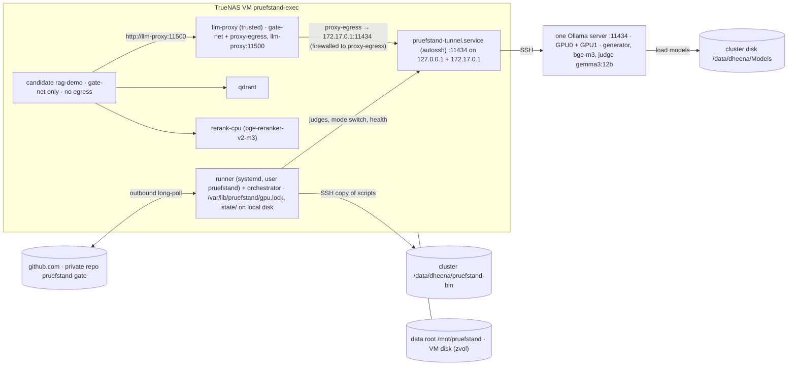

# GPU cluster (2 × NVIDIA A40) and the executor VM

**This file is the single source of truth for GPU placement, VRAM, serving (Ollama), model families,
cluster/VM storage, the cluster ↔ VM bridge and time budgets.** SPEC §6.2, `deployment.md` and the task
prompts link here instead of repeating numbers. Host ports on the VM are defined once, in `docker.md` §3.
The binding sources of this revision are `docs/planning/reviews/round10-resolution.md` (Z1–Z7, owner facts
2026-10-31) and `round11-resolution.md` (Y1–Y7: one service user, native Ollama API, budgets, unattended
operation); round-12 changes from `round12-resolution.md` (N1, N2, N4, N7) and `round12-{arch,ai}.md`.
**ADR-0018 (2026-10-31): one Ollama server on `127.0.0.1:11434` serves both A40s**; there is no second port,
no per-GPU server and no datagen server. **ADR-0019 (2026-10-31): models on the cluster's own disk
(`OLLAMA_MODELS=/data/dheena/Models`), one judge (`gemma3:12b`) for PR and nightly, no local datagen model, data
root a plain directory on the VM disk.** What the owner already set up is recorded in `docs/ops/setup-log.md`.

## 0. Facts and feasibility results

### 0.1 Owner facts (2026-10-31; from `ollama list`, `nvidia-smi`, `df -h`, `loginctl`)

| Fact | Value | Consequence |
| --- | --- | --- |
| Cluster host | `cairo-s101lp`, plain SSH (no Slurm), user workdir `/data/dheena` | the cluster is reached only by SSH |
| GPUs | 2 × A40, 46 068 MiB each, idle; driver for CUDA 13.4 | ≈ 45 GiB usable per card (§3) |
| Local disk | `/` 7 GB free, `/data` 14 GB free next to the 29 GB generator (ADR-0019) | models live in `/data/dheena/Models` (generator + `bge-m3` + one ~8 GB judge, ≥ 2 GB kept free; swap rule §2); besides them only the Prüfstand scripts (`/data/dheena/pruefstand-bin`, a few KB) and `/data/dheena/ollama.log`: no checkout, no caches, no state |
| NAS on the cluster | rclone WebDAV mount (setup log §7), **~6 MB/s** | **not used** by Prüfstand (rejected in ADR-0019: ≈ 80 min per generator load) |
| Ollama | **one** server already running on `127.0.0.1:11434` (process of the cluster user) that sees **both** A40s (setup log §1, §3; ADR-0018); `/api/tags`: `qwen3.8:27b-q8_0`, Ollama family `qwen35`, 27.3 B, `Q8_0`, 29 978 242 050 bytes, digest `8f5fb6b71ea00052cbe8545738c55ce61112c4e571cb60ca4dad00b131766039`, native context 262 144, capabilities `completion, tools, thinking, vision` | the tier-2 generator; family `qwen35` → plan family `qwen` (`core/data/model_families.yaml`), `think: false` required; licence **verify** with `ollama show` (T0.6 C3); the server runs from the owner's `~/start-ollama.sh` with `OLLAMA_MODELS=/data/dheena/Models` (setup log §7, ADR-0019); T0.6 C4 records its environment from `/proc/<pid>/environ` |
| Docker / vLLM | not confirmed | **assumed absent** on the cluster; vLLM and TEI are dropped from the default plan |
| systemd linger | `Linger=no` | no persistent user services on the cluster; the running server is reused; only if none runs is the one server started **detached with `setsid nohup`** (Y5.4, ADR-0018; survives logout unless logind kills the session scope (`KillUserProcesses=yes`): `setsid` changes the process session, not the cgroup; T0.6 C4 decides go/no-go, the fallback is linger or an admin exception; A12-M10) and relaunched by the VM preflight when down (§8) |
| Copying files | no shared folder between VM and cluster (ADR-0019) | code reaches the cluster only as scripts in `/data/dheena/pruefstand-bin`, copied by the VM over SSH from its git checkout; no data goes to the cluster |
| GitHub | Pro (no Copilot); free providers only | unchanged (CLAUDE.md §5, §7) |
| VM access to the cluster (Z7) | **done** (setup log §2): user `pruefstand` logs in with the key `/home/pruefstand/.ssh/id_ed25519_cluster` through the alias `cairo-s101lp` in `/home/pruefstand/.ssh/config`, which uses a public TCP endpoint with a non-default `Port` (placeholders only in git) | no password is ever stored; a new endpoint port changes only `Port` in that file (setup log §6) |
| VM size (Z7) | TrueNAS host 128 GB RAM; VM gets **64 GB** | CPU models on the VM ≤ 24 GB in total (reranker, tier-1 ≤ 2B GGUF, CPU embeddings); GPU models stay on the cluster |
| Owner workflow (Z7) | VS Code on Windows, terminal via **Remote-SSH into the VM** | the VM is the primary development **and** execution machine; coding agents run their commands on the VM; WSL2 is optional |

### 0.2 Feasibility checks (filled in by T0.6 and T0.7)

T0.6 checks the cluster (mostly owner-run commands plus an Ollama API check over an SSH
tunnel); T0.7 builds and checks the VM. T3.1a and T6.2a depend on both.

| # | Check | Command (example) | Result |
| --- | --- | --- | --- |
| C1 | SSH access, GPUs visible and idle | `ssh cairo-s101lp 'id; nvidia-smi --query-gpu=index,name,memory.total,memory.used --format=csv'` | **done** 2026-10-31: key login works, 2 × A40 46 068 MiB (setup log §1, §2); idle state re-checked by T0.6 (probe `gpu`, `gpu-procs` _pending_; the generator may be loaded, so VRAM need not be 0) |
| C2 | Ollama installed, version | `ssh cairo-s101lp 'ollama --version; command -v ollama'` | server version 0.32.13 reported by `GET /api/version` through the tunnel (2026-11-01), **to be confirmed by probe `ollama`**; binary path and CLI version _pending_ |
| C3 | Generator model present; family, licence, context, quantisation, digest | `ollama list`; `ollama show qwen3.8:27b-q8_0` (architecture, parameters, context length, licence); digest from `ollama list` / `GET /api/tags` | tag, family `qwen35`, 27.3 B, `Q8_0`, digest, context 262 144, capabilities: **done** 2026-10-31 (setup log §3); licence and base model _pending_ (`ollama show`) |
| C4 | A detached process survives logout (Y5.4, **go** condition); the existing server's env matches the owner's `~/start-ollama.sh` | `ssh cairo-s101lp 'setsid nohup sleep 600 >/dev/null 2>&1 </dev/null & echo $!'`, disconnect, reconnect, `ps -p <pid>` → still running; record `loginctl show-user $USER -p KillUserProcesses`; the env of the running server: `tr '\0' '\n' < /proc/<ollama-serve-pid>/environ` filtered to `OLLAMA_*` and `CUDA_VISIBLE_DEVICES` (expected values: setup log §7, ADR-0019) | start script and restart: **done** 2026-10-31 (setup log §7); logout survival and env record _pending_ |
| C5 | Cluster model disk: free space, model list | `df -h /data`; `ollama list`; `du -sh /data/dheena/Models` (≥ 2 GB free after the ADR-0019 set) | ~14 GB free next to the generator (setup log §7); after the pulls _pending_ |
| C6 | Cold model load time from the local disk | unload (`keep_alive: 0`), then a timed `/api/generate` with an empty prompt | 1.0 s answer with the generator loaded (setup log §7; the probe's `model-load` is opt-in and prints `SKIP`); cold load _pending_ (opt-in `MEASURE_LOAD=1` under `pruefstand-lock` and `MAINTENANCE` with no model loaded, see `infra/cluster/feasibility/README.md`) |
| C7 | SSH port forwarding allowed; Ollama API answers through the tunnel with thinking off | forwarding and `/api/tags` through the tunnel: **done** 2026-10-31 (`pruefstand-tunnel.service`, setup log §3). Thinking-off check on the VM through that tunnel: `curl -s 127.0.0.1:11434/api/chat -d '{"model":"qwen3.8:27b-q8_0","think":false,"stream":false,"messages":[{"role":"user","content":"Sag Hallo."}]}'` → German text, no thinking content (where no tunnel exists: a **temporary** forward on 21434 only, Y1.4, `ssh -N -o ExitOnForwardFailure=yes -L 21434:localhost:11434 cairo-s101lp &`, closed afterwards) | forwarding: done; `think:false` _pending_ |
| C8 | Outbound HTTPS from the cluster for model pulls | `curl -sSfI https://registry.ollama.ai/v2/ https://huggingface.co` (the probe's `net` check also requests the `gemma3:12b` manifest, because `/v2/` itself answered 404 when requested from the VM while the manifest answered 200: **to be confirmed from the cluster by probe `net`**) | _pending_ (probe `net`) |
| C9 | GitHub Models free quota for the tier-1 informational judge | `scripts/models/quota_probe.py` (`--burst` local and via `live-e2e.yml -f probe_quota=true`, then the 24-hour `--daily` probe, D99), recorded in `ci-cd.md` §1.1a "GitHub Models quotas (measured)" | tool + CI input ready (T0.6); measured numbers and the tier-1 judge _pending_ (owner run) |
| V1 | VM `pruefstand-exec`: Ubuntu 24.04, ≥ 8 vCPU, **64 GB RAM** (Z7), Docker, local disk ≥ 200 GB free | T0.7: `infra/vm/vm_check.sh os ram cpu disk docker` | facts 2026-10-31 (read-only): Ubuntu **26.04.1** (accepted as WARN, setup log §10), 64 GB visible (`MemTotal` 64 283 696 kB), 160 vCPU visible, `/` 491 G with 445 G free, rootful Docker 29.1.3 (`docker.io`); **done** 2026-11-02, `vm_check` PASS for ram, cpu, disk, docker and WARN for os (Ubuntu 26.04, accepted): `infra/vm/vm-check-2026-11-02.out` |
| V2 | Data root `/mnt/pruefstand` is a plain directory on the VM disk (ADR-0019), owned by `pruefstand`, mode 2775, ≥ 20 GB free | T0.7: `sudo -u pruefstand test -w /mnt/pruefstand && df -h /mnt/pruefstand` | directory **done** 2026-10-31 (setup log §6); `sudo infra/vm/setup-data-root.sh` adds the sentinel; **done** 2026-11-02, `vm_check` PASS for data-root and data-root-rw: `infra/vm/vm-check-2026-11-02.out` |
| V3 | **system** unit `pruefstand-tunnel.service` (runs as user `pruefstand`, Y1.1) up after a VM reboot; `curl -s 127.0.0.1:11434/api/tags` on the VM | T0.7: `sudo infra/vm/install-tunnel.sh`, `vm_check.sh tunnel` | unit + `127.0.0.1:11434` **done** 2026-10-31 (setup log §3); `docker0` has `172.17.0.1` (checked 2026-10-31), so the repo unit (both forwards, after `docker.service`) can replace it; **done** 2026-11-02, `vm_check` PASS for docker-gw, proxy-net, tunnel (system unit, `/api/tags` 200, 11434 only on 127.0.0.1 and 172.17.0.1) and tunnel-reboot (owner-confirmed 2026-11-01): `infra/vm/vm-check-2026-11-02.out`; firewall WARN is the expected "cluster endpoint is public", gh-scope PASS |
| V4 | Service user `pruefstand` exists, the owner login user is in group `pruefstand`; `/var/lib/pruefstand` (mode 2770, group `pruefstand`) holds `gpu.lock` (0660); `pruefstand-lock true` works for both users; the runner can run as a **system** service as `pruefstand` | T0.7: `sudo infra/vm/setup-users.sh`, `vm_check.sh users lock-dir docker-group` (runner itself: T6.2a) | user `pruefstand` **done** 2026-10-31 (setup log §2); **done** 2026-11-02, `vm_check` PASS for users, lock-dir, docker-group: `infra/vm/vm-check-2026-11-02.out` |
| V5 | VM → cluster login by **SSH key only** (Z7); `ssh -o BatchMode=yes cairo-s101lp true` succeeds with no password prompt | T0.7 | **done** 2026-10-31 (setup log §2); `vm_check` ssh-key PASS 2026-11-02: `infra/vm/vm-check-2026-11-02.out` |
| V6 | VS Code Remote-SSH from Windows into the VM works; the repo checkout lives on the VM | T0.0 / T0.7: `vm_check.sh --confirm vscode` | the repo checkouts live on the VM (`~/code/pruefstand`, worktrees `~/code/wt/*`) and cloud sessions use `ssh vm` (setup log §9); Remote-SSH from Windows: owner confirmation **done** 2026-11-01 (`vm_check` vscode PASS, `infra/vm/vm-check-2026-11-02.out`) |
| V7 | **TrueNAS host** reboot (Y5.3): the VM autostarts, `/mnt/pruefstand` is on its own disk (no mount), tunnel and runner are active without manual steps. **V7b** (ADR-0019): with the data root made unwritable for `pruefstand` (`chmod`, restored afterwards) the next job's preflight posts `error` with `infra_error="data_root_unavailable"` | T0.7 [HUMAN]: reboot the host, `vm_check.sh`, `vm_check.sh --confirm host-reboot`; V7b with T6.2a | no unit depends on storage (tests `test_tunnel_has_no_mount_dependency`, ADR-0019); host-reboot **done** (owner-confirmed 2026-11-01, `vm_check` host-reboot PASS in `infra/vm/vm-check-2026-11-02.out`); V7b: awaiting T6.2a (preflight) |

**Decision:** _go / no-go_ (date, who). Without Docker/vLLM on the cluster the design is
Ollama-only (Z3); a no-go now means "Ollama cannot serve the ADR-0019 model set from the local disk", and the
fallback is one rented 48 GB GPU host running one Ollama server with the same VM-side design.

## 1. Topology (Z1)

| Machine | Runs | Never runs |
| --- | --- | --- |
| **Cluster** `cairo-s101lp` | **one** Ollama server on `127.0.0.1:11434` for both GPUs (`CUDA_VISIBLE_DEVICES=0,1`; ADR-0018): the already running server is reused; only if none runs is the owner's `~/start-ollama.sh` started detached with `setsid nohup` (Y5.4, ADR-0019); `OLLAMA_MODELS=/data/dheena/Models` on the cluster's own disk | runner, repo checkout, Docker, Qdrant, data, caches, state, locks |
| **TrueNAS VM** `pruefstand-exec` (Ubuntu 24.04, ≥ 8 vCPU, 64 GB RAM, rootful Docker) | **primary development machine** (VS Code Remote-SSH, coding agents, repo checkout; owner login user) and executor (system user **`pruefstand`**, Y1.1): persistent GitHub self-hosted runner (systemd), orchestrator, `/var/lib/pruefstand/gpu.lock` + state files on local VM disk, Qdrant, rag-demo candidate containers, CPU models ≤ 24 GB total (reranker, tier-1 ≤ 2B GGUF via llama.cpp, CPU embeddings), pruefstand, `autossh` tunnels to the cluster; baselines, backups, datasets in the data root `/mnt/pruefstand` (plain directory on the VM disk, ADR-0019) | — |
| **Windows laptop** | VS Code with Remote-SSH into the VM (Z7); WSL2 optional (alternative dev environment) | code execution, gate runs |

The VM reaches Ollama through the tunnel command (ADR-0018: port `11434` only; the `127.0.0.1` forward already
runs, setup log §3; T0.7 adds the `172.17.0.1` forward once Docker exists and never drops it later, which would
lose the proxy path, A13-M7): `autossh -M 0 -N -o ExitOnForwardFailure=yes -L 127.0.0.1:11434:localhost:11434
-L 172.17.0.1:11434:localhost:11434 cairo-s101lp`, run by the **system** unit `pruefstand-tunnel.service` as user
`pruefstand` (Y1.1; `Wants=`/`After=network-online.target`, `Restart=always`, `RestartSec=10`). The alias
`cairo-s101lp` in `/home/pruefstand/.ssh/config` holds the real host, user and non-default `Port`. The VM logs in to the cluster
with an **SSH key** created on the VM for user `pruefstand` (`/home/pruefstand/.ssh/id_ed25519_cluster`,
`ssh-keygen` + `ssh-copy-id`, Z7); the private key lives only there, never in GitHub, a NAS share, an image or
the owner's home, and no password is stored anywhere.

**VM identities (Y1, binding).**

| Identity | Owns / runs | Notes |
| --- | --- | --- |
| system user `pruefstand` | runner (`pruefstand-runner.service`), orchestrator, `pruefstand-tunnel.service`, cluster SSH key, `PRUEFSTAND_HOME=/home/pruefstand/pruefstand` (state, runs, caches, Qdrant data), `/var/lib/pruefstand/` (`gpu.lock` 0660, `MAINTENANCE`), executor secrets (`runner.env`) | the only identity with the cluster key; member of group `docker` |
| owner login user | VS Code Remote-SSH, coding agents, dev checkout, `.env` (dev values) | in groups `pruefstand` and `docker`; GPU work only through `pruefstand-lock <cmd>` (same lock file); cluster calls only through the sudo wrapper `sudo -n -u pruefstand /usr/local/bin/pruefstand-cluster <op>` (T3.1a; never `ssh` to the cluster); never touches `/var/lib/pruefstand/**` or `/home/pruefstand/**` directly |
| group `docker` | rootful Docker daemon (dedicated VM, Y1.3) | members `pruefstand` and the owner user only; root-equivalent (`security.md` C18) |



## 2. Models, families and modes (Z3)

All LLM and embedding serving is **Ollama**. Every client (rag-demo, `LLMClient`, the T3.1b bench) uses the
**native** Ollama API only (`/api/chat`, `/api/embed`; LiteLLM provider `ollama_chat`), never `/v1/*`, so
`num_ctx` and the other options apply (Y3.1). Nothing outside `infra/gpu/` and `infra/cluster/` knows about
the tunnel.

| Role | Family | Model (verify exact tag; pin by digest in T3.1b) | Lane (URL setting) / expected card | Approx. VRAM |
| --- | --- | --- | --- | --- |
| Generator (tier 2) | **qwen** (Ollama family `qwen35`) | `qwen3.8:27b-q8_0` (existing, digest `8f5fb6b7…1766039`), `think: false` required (capability `thinking`); smaller same-family swap for M11: a small Qwen3 tag that fits next to the set (e.g. 4B Q4, ≈ 2.5 GB; **verify** in T3.1b), larger ones only by the swap rule (ADR-0019) | `gpu0` (`OLLAMA_GPU0_URL`), one card | ~29 GB + KV |
| Embeddings (tier 2) | bge | `bge-m3` (Ollama) | `gpu0`, any card | ~1.2 GB |
| Reranker (tier 2) | bge | `BAAI/bge-reranker-v2-m3` on the **VM CPU** (sentence-transformers), reranks the top **10**, passages truncated to 256 tokens, batched (Y4.2) | VM `rerank-cpu` | — |
| Judge (PR **and** nightly, ADR-0019) | **gemma** (Ollama family `gemma3`) | Gemma 3 12B Q4: `gemma3:12b` (**verify** tag/digest in T3.1b); also writes private docs, canaries and held-out data locally (role `DATAGEN`, T2.6) and does the reject-only model review (T4.7b) | `gpu1` (`OLLAMA_GPU1_URL`), the other card | ~8 GB + KV |
| Datagen for public text (ADR-0019) | a GitHub Models free-tier family ≠ `qwen`, ≠ `gemma` (pinned in T4.2) | `github/<model>`; public law/decision/EUR-Lex text only (data guard) | GitHub Models | — |
| Tier 1 (GitHub runner) | qwen (generator); non-qwen GitHub Models judge | unchanged: ≤ 2B GGUF on CPU via llama.cpp | GitHub | — |

**Disk and swap rule (ADR-0019).** `/data/dheena/Models` holds generator (~29 GB) + `bge-m3` (~1.2 GB) +
`gemma3:12b` (~8 GB) and keeps **≥ 2 GB free** (`health.sh` WARN below that). Any other model is a swap: under
the GPU lock with `/var/lib/pruefstand/MAINTENANCE` set, `ollama rm` a **non-generator** model, `fetch-model.sh`
the new one (digest check), and restore the standard set afterwards. RQ2 judge candidates (T5.4) are pulled,
measured and deleted **one at a time**; M11 and the RQ1/M3 e5 swap use small tags that fit next to the set
(**verify** sizes in T3.1b) or this rule.

**Lanes, not servers (ADR-0018).** One Ollama server serves every model; `OLLAMA_GPU0_URL` and `OLLAMA_GPU1_URL`
are both `http://127.0.0.1:11434` on the VM and name the generator lane and the judge lane. Ollama places each
model on a card itself; `health.sh` reports the card per model and fails (exit 15) when a model is not fully in
VRAM or spans both cards. Generator and judge are kept apart by model, not by port: `llm-proxy`
lets candidates use only the run's generator and embedding tags.

The family plan (D112, ADR-0019): one family per role, no judge in the generator's family; the public-text
datagen family (GitHub Models) differs from `qwen` and from the judge family `gemma`; `core/data/model_families.yaml`
maps Ollama family `qwen35` → `qwen` and `gemma3` → `gemma`. `qwen3.8:27b-q8_0` is not an official Qwen release name: Ollama
reports family `qwen35` (setup log §3), which `core/data/model_families.yaml` maps to the plan family `qwen`;
T0.6 C3 records the licence and base model from `ollama show`, and T3.1b pins the tag at digest
`8f5fb6b71ea00052cbe8545738c55ce61112c4e571cb60ca4dad00b131766039` only if the licence is on the allowlist (else
the generator falls back to an official Qwen3 tag). Licences are checked per checkpoint (DATA_LICENSES §5).

| Mode | When | Generator lane (`gpu0`) | Judge lane (`gpu1`) |
| --- | --- | --- | --- |
| **day** (default) | development, PR gates, baseline runs, local private-doc generation (T2.6) | generator + `bge-m3` | judge `gemma3:12b` |
| **night** 22:00–06:00 Europe/Berlin (Y4.3) | nightly subset of `full`, weekly cause-switches, calibration (T5.4) | same as day | same as day (one judge, ADR-0019) |

Every mode switch is API loads and unloads on the one server; the server is never restarted for a mode. Since
ADR-0019 `day` and `night` load the same models (the names stay for logs and the window); there is no `datagen`
mode. Model swaps (RQ2 candidates, M11) set `MAINTENANCE` and follow the swap rule above.

Because the judge sits on the other card than the generator (§3), nightly generation (phase A) and judging
(phase B) **may overlap**: the judge starts on cases whose responses are cached while generation continues.
Judgments stay cached under the full D113 key. Any judge other than the configured one (`judge_fallback=true`)
makes the judged metrics of that run **informational**, and judged metrics are never compared across judges
(Y4.4).

**Night window (Y4.3, N4.3).** 22:00–06:00 Europe/Berlin, budget ≤ 8 h, **hard deadline 06:00**. GitHub cron
is UTC only, so `nightly.yml` has two entries, `7 20 * * *` (22:07 CEST) and `7 21 * * *` (22:07 CET); a
hosted job `guard` decides by **which cron fired** (`github.event.schedule`), not by the start hour, and sets
the output `run=true|false`; the orchestrator job runs only `if: needs.guard.outputs.run == 'true'` (round 13
P2.1), so a nightly queued behind a busy runner still runs and the off-season cron never starts a second one
(A12-03, A13-02). The nightly is one orchestrator job with the deadline 06:00 Berlin **of the fired night**; a job
that starts after it ends at once with `infra_error="window_exceeded"` (reported once for that night); before each
phase it checks the remaining time and, if it is not enough, stops with `stop_reason="aborted"`,
`infra_error="window_exceeded"`; a night that cannot start is reported (heartbeat `last_nightly_status`,
issue "nightly skipped"). Each night runs `pruefstand run --split full --stratum all --block auto` (P4.3): the
**refusal stratum** (`TestCase.block = None`, ≈ 150 unanswerable cases, at least 100 clusters) plus **block k**
(`block ∈ {0,1,2}`, 300 unperturbed answerable + 150 perturbed cases, P3.1; assigned by T4.1, recorded in
`DatasetManifest`; `auto` = `state/nightly_counter` mod 3, the counter incremented only after a completed
nightly, P4.4), at most 600 cases, so `full` is covered every 3 completed nightlies (SPEC §6.2, N1). The night
judge's anchor check (`judge-drift`) runs right after `switch-mode.sh night` and before the gate (AI13-08). `RunManifest.block` is in the
`eval_fingerprint`; the nightly gates vs baseline ref `nightly-b<k>`. Cause-switches run **weekly** (Sunday
night), not nightly (`ci-cd.md` §1.2). If a nightly is killed before its `finally` (`switch-mode.sh day`),
the next preflight's `health.sh --repair day` unloads any extra catalogue model and restores the day set (A12-M12).

**Catalogue.** `infra/gpu/models.yaml` (T3.1a) lists every servable model: `id` = **`ollama/<tag>`** (the one
id format in configs and catalogue, Y3.3; the bare `<tag>` appears only in Ollama API bodies; translation to
LiteLLM's `ollama_chat/<tag>` happens only inside `llm/backends/litellm.py`), `engine: ollama` (or `cpu`
for the reranker), `tag`, `digest` (Ollama manifest sha256; tags are mutable, the digest is the pin),
`quantization`, `family`, `role`, `server` (`gpu0|gpu1|vm`: the lane, i.e. which URL setting a client uses, not a
physical card or port, ADR-0018), **`options`** (`num_ctx`,
`num_predict`, `temperature`, `seed`, `top_p`, plus `option_bounds` (min/max for the sampling keys); preload uses exactly
these. R12 N2: `llm-proxy` **enforces only `num_ctx` and `keep_alive`** (they are load-time; a different value
forces a reload) and the model allow-list, strips other load-time keys, and passes `temperature`, `seed`,
`top_p`, `num_predict` through from the client within the catalogue `option_bounds` (outside → 403); catalogue values are defaults,
not overrides. Judges are trusted clients and send the catalogue values unchanged), `license`, `provisional`; embed entries also `query_prefix`,
`doc_prefix`, `max_input_tokens`. `infra/gpu/endpoints.yaml` maps service → `base_url_env`
(`OLLAMA_GPU0_URL`, `OLLAMA_GPU1_URL`, `RERANK_URL`), `model_id` (= the catalogue `id`), `family`, `kind` (`chat|embed|rerank`).
A PR may only select catalogue models, else `unsupported_config` (WARN). Swapping the generator inside the
catalogue = unload + load on the one server inside the job, under the lock. The same holds for the embedding
model (AI12-08): a PR, mutation M3 or RQ1 config that selects another catalogue embedding model (e.g.
e5-large) → unload `bge-m3`, preload the selected embed model with its catalogue `options` before indexing,
restore `bge-m3` in `finally`; with `OLLAMA_MAX_LOADED_MODELS=3` (generator + embed + judge) a fourth resident
model would evict one of them and its next request would count as `model_reload`.

**Index per PR.** Unchanged: a PR that changes the embedding model or chunking gets a PR-scoped Qdrant
collection `pr_<N>_<shortsha>` (on the VM), deleted in `cleanup` and by the job-completed hook.

### 2.1 Serving rules (every role)

- **Ollama server env** (the one server, Z3, ADR-0018, ADR-0019; source of record: the owner's
  `~/start-ollama.sh`, setup log §7; `infra/cluster/cluster.env.template` (T3.1a) holds the same values only for
  comparison): `CUDA_VISIBLE_DEVICES=0,1`, `OLLAMA_NUM_PARALLEL=4`, `OLLAMA_MAX_LOADED_MODELS=3`,
  `OLLAMA_KEEP_ALIVE=24h`, `OLLAMA_CONTEXT_LENGTH=8192` (default only; every request sends `num_ctx`),
  `OLLAMA_NOPRUNE=1` (never auto-delete model files), `OLLAMA_KV_CACHE_TYPE=q8_0` (half-size KV cache; part of
  the serving facts, so a change is a new fingerprint), `OLLAMA_FLASH_ATTENTION=1`,
  `OLLAMA_MODELS=/data/dheena/Models` (cluster's own disk),
  `OLLAMA_HOST=127.0.0.1:11434` (loopback on the cluster; reached only through the tunnel). No prompt logging
  (`OLLAMA_DEBUG` unset). (AI12-04) The already running server is reused when healthy; its environment is read
  from `/proc/<pid>/environ` and a difference from `cluster.env` is a WARN, not a restart (runbook §2a).
- **Context is always explicit.** Ollama silently truncates prompts longer than `num_ctx`, so every
  request carries the catalogue `options.num_ctx` (Y3.2; `/v1/*` would ignore it, hence native only): generator 8192;
  **judge 12288** — the one judge `gemma3:12b` for PR and nightly (ADR-0019; **verify** Gemma's sliding-window
  cache behaviour in T3.1b). **Rule for judges (AI12-09, round 13 AI13-04, D306):** judge `num_ctx` = generator `num_ctx`
  8 192 + rubric/answer allowance ≤ 3 072 + 1 024 output reserve = **12 288**, because a faithfulness input holds
  the same chunks as the generator prompt plus rubric and answer; T3.1b may lower it only if its VRAM measurement
  fails;
  if that does not fit at 4 slots, lower `OLLAMA_NUM_PARALLEL` to 2 **before** lowering `num_ctx` (the setting is
  server-wide since ADR-0018, so it also halves the generator's slots: re-run the PR and nightly budgets). KV memory
  per model ≈ `num_ctx × OLLAMA_NUM_PARALLEL × KV-bytes-per-token`.
- **Qwen thinking is disabled** (D95): native `/api/chat` with `"think": false` (`/v1` is never used, Y3.1). The `<think>`
  strip stays as the safety net and is counted (X3.13). Tier 1 (llama.cpp) unchanged.
- **Embeddings**: `bge-m3` via `/api/embed` (dense only; the sparse side is our own analyzer, T3.3),
  `options.num_ctx` = the maximum chunk length in tokens (1024–2048, recorded with the truncation count;
  not bge-m3's 8192, which under 4 slots could reserve ≈ 3 GiB more VRAM, AI12-08), truncation counted;
  T3.1a S8 measures bge-m3 VRAM at the pinned `num_ctx`. e5-family prefixes (D121) as before if an e5 model is ever served. **Verify** in T3.1b that
  Ollama's bge-m3 vectors match the reference checkpoint closely (cosine ≥ 0.99 on 20 passages).
- **Structured output**: `format` (JSON schema) on `/api/chat`, **verify** in the pinned version; JSON
  repair (T5.1) stays.
- **Judge input cap** (X3.9): judge context window (`num_ctx`) − 1 024 tokens, counted with the judge's
  tokenizer; truncations logged, counted, listed in the report. **Tokenizer source (AI13-05):** every catalogue
  entry carries `tokenizer: {source, sha256}` (Qwen from its HF repo; Gemma after the owner accepts
  its terms, or extracted from the GGUF vocabulary with the `gguf` reader); rag-demo bakes the generator's
  tokenizer next to `bge-m3`'s; every native response's `prompt_eval_count` is compared with the local count and a
  mismatch > 2 % or `prompt_eval_count ≥ num_ctx − num_predict` is counted in `/v1/health.stats.prompt_overflow`.
  Ollama caps are `options.num_ctx` (never the vLLM term `max-model-len`).
- **Determinism and fingerprint**: catalogue `options` (`temperature 0`, `seed`, …); not bit-exact with parallel slots. Serving
  facts: `/v1/info.serving.engine = ollama`, `engine_version`, `quantization` (`Q8_0`), `model_sha256` =
  Ollama manifest digest; judges enter `judge_serving` (X3.3). Changing tag, digest or quantisation changes
  the `eval_fingerprint` → new baseline.
- **First load**: models load from the cluster's own disk (ADR-0019; the NAS path at ~6 MB/s is rejected); the
  first load per mode (C6) is **excluded from timing budgets**; the preflight warms the models of the mode
  before the timed run starts.

## 3. Memory budget (planning numbers; T3.1b replaces them with measurements)

A40: 46 068 MiB ≈ 45 GiB per card. KV bytes per token are architecture-specific (**verify** with
`ollama show` / the server log at load): planning values 256 KiB/token for a 27B dense model with 8 KV
heads (64 layers × 8 × 128 × 2 × 2 B) at f16, **half that at `q8_0`** (ADR-0019: `OLLAMA_KV_CACHE_TYPE=q8_0`);
less for Gemma 3 (sliding window). All rows are planning values: **verify in T3.1b**.

| Card (expected) / mode | Models | Weights | KV (`num_ctx` × 4 slots) | Card total |
| --- | --- | --- | --- | --- |
| generator card, day + night | generator `qwen3.8:27b-q8_0` + `bge-m3` | ~29 GB + ~1.2 GB | generator 8192 × 4 = 32 k tokens ≈ 4 GB at `q8_0`; bge-m3 small | ≈ 35 GB of 45 (**verify**) |
| judge card, day + night | judge `gemma3:12b` Q4 (ADR-0019) | ~8 GB | **12288** × 4 (= 8 192 + 3 072 + 1 024, D306) at `q8_0`: with the sliding-window cache a few GB; without it ≈ 9 GB (**verify** in T3.1b) | ≈ 12–18 GB of 45 (**verify**) |
| generator card, embed swap (M3, RQ1 e5) | generator + e5-large instead of `bge-m3` | ~29 GB + ~1.2 GB | as the bge-m3 row | ≈ 35 GB of 45 (**verify**, AI12-08) |
| judge card, RQ2 swap (T5.4) | one pulled candidate instead of the judge (swap rule §2) | ≤ ~10 GB (disk-bound) | as the judge row | **verify** per candidate |

`OLLAMA_MAX_LOADED_MODELS=3` holds generator + embeddings + the one judge. Ollama places the models; the generator
(≈ 35 GB with KV) and the judge together exceed one card, so they land on different cards, and `health.sh`
reports the placement. If a measured total exceeds 44 GB on the generator card, lower `num_ctx` before lowering
`OLLAMA_NUM_PARALLEL`, and record it; on the judge card the judge rule of §2.1 applies instead (lower `OLLAMA_NUM_PARALLEL` to 2 first, `num_ctx` 12 288 is lowered only if
T3.1b's VRAM measurement still fails, D306).

## 4. Serving commands (baseline; verify against the pinned Ollama version in T3.1a)

Cluster side (`infra/cluster/start-ollama.sh`, run from `/data/dheena/pruefstand-bin`; ADR-0018, ADR-0019).
**Reuse first:** if an Ollama server already answers `/api/tags` on `127.0.0.1:11434` (the existing server,
setup log §7), the script starts nothing and exits 0; `status.sh` reports its pid and its `OLLAMA_*` environment
(from `/proc/<pid>/environ`) and flags differences from `cluster.env` as WARN. **Only if none runs** does it
start the owner's **`~/start-ollama.sh`** (the start script of record, setup log §7) detached, never a second
server and never a server with its own environment. It refuses to start if `~/start-ollama.sh` is missing.

```text
# only when no server answers on 127.0.0.1:11434 (the owner's start command, setup log §7)
setsid nohup ~/start-ollama.sh > /data/dheena/ollama.log 2>&1 < /dev/null &
modes (day, night) never restart the server: they only load/unload models through the API
```

Y5.4: `setsid nohup` (not `tmux`) so the server survives the end of the SSH session unless logind kills
the session scope (`KillUserProcesses=yes`; `setsid` does not leave the cgroup); T0.6 C4 decides go/no-go,
the fallback is linger or an admin exception (D228 wording, A12-M10). There is no pid file (ADR-0019): `status.sh`
and `stop-ollama.sh` find the server by `pgrep -u "$USER" -x ollama` and act on a pid only if
`/proc/<pid>/cmdline` is `ollama serve` **and** `:11434` is listening for that pid. The log is
`/data/dheena/ollama.log` (the owner's start command). `stop-ollama.sh` runs only under the GPU lock through the
wrapper; normally the owner restarts the server by hand (runbook §2a). The expected values have one source:
`cluster.env`, rendered by T3.1a from `infra/cluster/cluster.env.template` and copied over SSH to
`/data/dheena/pruefstand-bin/` (Y6.3); `start-ollama.sh` derives the bin dir from its own path.

**Placement check (ADR-0018).** `GET /api/ps` must show `size_vram == size` for every resident model (else
`health.sh` exit 15). `status.sh` reports the card of each model by joining
`nvidia-smi --query-compute-apps=pid,gpu_uuid,used_memory --format=csv` with the Ollama runner process of each
model (the runner's `--model` blob path ↔ the model's manifest layers; **verify** on the pinned version in T3.1a,
fallback: the server log's offload lines). A model on two cards is also exit 15.

VM side (through the tunnel): load = `POST /api/generate {"model": <tag>, "keep_alive": "24h", "options": <catalogue options>}`
(empty prompt; the catalogue `options`, above all `num_ctx`, must match what requests send, else the first
real request reloads the model, AI12-04), unload = the same with `"keep_alive": 0`; resident models =
`GET /api/ps`.

## 5. Time budgets (Z4; T3.1b measures, then pins)

| Run | Work (approx.) | Budget |
| --- | --- | --- |
| smoke (50 cases) | 50 generations + ~150 judge calls | ≤ 10 min (excl. first model load) |
| **PR tier**: core (300) + robust_pr (≈ 300–440, **`/v1/retrieve` only**, no generation, D125/Y4.1) | 300 generations (generator card) + ~900 judge calls (judge card, `gemma3:12b`), pipelined; reranker lane top 10 × 256 tokens (Y4.2) | **≤ 90 min**; reranker lane ≤ 20 min, else `robust_pr` runs with reranker off (documented as first-stage robustness) |
| Missing baseline | no ad-hoc run: `failure` "no baseline for <fp>; run baseline-promote" (D103) | ≤ 90 min in the promote job |
| Nightly (Y4.3, N1, N4.3) | night-judge anchor check, then `--split full --stratum all --block auto`: refusal stratum (`block=None`, ≥ 100 clusters) + block k = `state/nightly_counter` mod 3 (P4.4), **≤ 600 cases**: generation on the generator card overlapped with judging by the same `gemma3:12b` judge on the judge card (~1,800 calls), drift vs `release-b<k>` (on a release night the release run of all of `full`, ≈ 5–7 h, replaces the block run and drift, D321), contamination probe, prunes | **≤ 8 h**, hard deadline 06:00 Europe/Berlin of the fired night incl. `flock` wait; a late start ends at once; each phase checked against the deadline, else `window_exceeded` |
| Weekly cause-switches (Sunday night) | T6.3 scenarios on `core` | inside the Sunday night window (replaces that night's subset if both do not fit) |
| Datagen (ADR-0019) | public text: GitHub Models batches (rate-limited, cached, resumable; no GPU); private docs/canaries: the local judge model in day mode (T2.6) | outside the night window; no `MAINTENANCE` needed (no swap) |

Planning estimate (unverified, T3.1b replaces it): generator 27B Q8 ≈ 1 000–1 500 tok/s prefill and
≈ 15–20 tok/s decode per slot; judge `gemma3:12b` Q4 faster than the planned 24B judge (**verify in T3.1b**)
→ PR tier ≈ 60–80 min, nightly subset ≈ 1.5–2 h with overlap (**verify in T3.1b**). **If T3.1b measures more than the budget**,
PR runs pass `--judged-subset`: **generation and judging** of the `core` answerable cases run only on the fixed
seeded 150-case judged subset of `core` (`TestCase.judged_subset`, T4.1; stratified by category incl. injection,
no `lang` stratum; round 13 P3.4: it acts on the bottleneck, and `budget.py` reports which lane binds, generator or
judge); retrieval metrics stay on all of `core` via `/v1/retrieve`, deterministic security cases always run in
full; `RunManifest.judged_subset` is part of the fingerprint, N1, and the SPEC MDE tables are updated (Z4). Never silently shrink a split; a budget overrun reports `stop_reason` and fails.
Measured run-dir sizes: PR run _pending (T6.3)_, nightly run _pending (T6.3)_.

## 6. How CI reaches the GPUs

- The **runner and orchestrator run on the VM** (T6.2a): persistent systemd service, outbound long-poll
  to the private repo only; no inbound port anywhere. PR gates start only from the owner's `workflow_dispatch`
  in the private repo (round 13 P1.2); `baseline-promote.yml` polls public `main` (ADR-0005).
- **GPU access is only through the tunnel**: `OLLAMA_GPU0_URL=http://127.0.0.1:11434` and
  `OLLAMA_GPU1_URL=http://127.0.0.1:11434` on the VM (two settings, one server, ADR-0018). The orchestrator and
  judges (trusted, user `pruefstand`) use them directly.
- **Candidate isolation.** The candidate rag-demo container is on the `--internal` network `gate-net`
  only (no route to the internet, no GPU). It reaches `qdrant`, `rerank-cpu` (`http://rerank-cpu:8201`) and
  the trusted **`llm-proxy`** (T6.2a) by name on `gate-net` (`http://llm-proxy:11500`; no `extra_hosts`).
  D242 (supersedes the host-network design of Y1.5/D215; port set reduced by ADR-0018): the `autossh` tunnel
  binds `11434` on `127.0.0.1` **and** on the Docker bridge gateway `172.17.0.1`; `llm-proxy` is a normal container on
  `gate-net` and the small non-internal bridge `proxy-egress` (subnet `10.231.0.0/24`, T0.7) and forwards to
  `http://172.17.0.1:11434` over `proxy-egress`; the VM firewall accepts the tunnel port `11434` on `172.17.0.1` only
  from the `proxy-egress` subnet (rules in Docker's `DOCKER-USER` chain and in the dedicated
  `PRUEFSTAND-INPUT` chain hooked from `INPUT`, since container → `172.17.0.1` hits `INPUT`, not
  `DOCKER-USER`; both applied by the oneshot `pruefstand-firewall.service`, D285, `After=docker.service`, re-applied on Docker restart; never a full-ruleset
  flush or reload through `nftables.service`, which would delete Docker's isolation rules; N4.2). It requires
  `Authorization: Bearer $PRUEFSTAND_CANDIDATE_API_KEY` (Y2.1), forwards only `POST /api/chat`,
  `POST /api/embed` and `GET /api/tags` (native API, Y3.1; `/v1/*` is rejected), and only for the
  catalogue generator and embedding tags of the run; it enforces only `num_ctx` and `keep_alive` (catalogue
  values), strips other load-time keys and passes `temperature`, `seed`, `top_p`, `num_predict` through
  within the catalogue `option_bounds` (outside → 403, R12 N2), and rejects `/api/pull`, `/api/delete`, `/api/create`,
  `/api/copy` and any other model name (Ollama has no API key, so this proxy is the boundary that keeps a
  candidate from unloading or deleting models or loading a judge). It counts upstream (Ollama/tunnel)
  errors separately from candidate errors and exposes them on `/health` (Y5.2). Judges run on the same server
  (ADR-0018), so the **model allow-list is the separation**: a judge tag, `/api/generate` or `/api/ps` → 403;
  no judge is ever reachable through it. T6.2a verifies that the candidate cannot reach `172.17.0.1` on any
  port and that `llm-proxy` answers 403 for every judge tag.
- The candidate gets only `PRUEFSTAND_CANDIDATE_API_KEY` for `llm-proxy`, never a judge endpoint, and never
  the held-out canary registry (X2.5). `rerank-cpu` has **no** auth (Y2.2): it is reachable only on
  `gate-net`, has no host port in the executor stack and holds no secrets.
- **Accepted risk (record in `security.md`)**: on the cluster, Ollama listens on `127.0.0.1`, so other
  local users of `cairo-s101lp` could call it (inference, and `pull`/`delete` on the model store
`/data/dheena/Models`; a pull can also fill the small disk).
  Mitigations: digest check in the preflight (a changed or missing model fails the run, never passes it),
  models re-pullable from the registry, ask the admins whether per-user network namespaces exist.
- Development happens on the VM (VS Code Remote-SSH, Z7), so the tunnel of `pruefstand-tunnel.service`
  serves development too (GPU work through `pruefstand-lock`); from WSL (optional) a personal
  `ssh -N -L 11434:localhost:11434 cairo-s101lp`. Never a public tunnel: the existing ngrok URL to the
  cluster's Ollama is **rejected** (`security.md`, setup log §5), and the optional demo's Cloudflare Tunnel
  (`deployment.md` §5) exposes only the CPU demo, never Ollama.

## 7. The VM and its runner

T0.7 creates the VM on TrueNAS (Ubuntu 24.04, autostart on host boot, **rootful** Docker with group
`docker` = `pruefstand` + owner only, system user `pruefstand`, `/var/lib/pruefstand`, the
`pruefstand-lock` wrapper, the data root `/mnt/pruefstand` as a plain directory on the VM disk (ADR-0019; no
mount unit), the cluster SSH key of `pruefstand`, the system unit `pruefstand-tunnel.service`; the oneshot
`pruefstand-firewall.service`, N4.2). T6.2a installs the persistent runner there as the system service
`pruefstand-runner.service` running as `pruefstand` (pinned release + sha256 for the **first install only**; auto-update stays **on**, and the unit's `ExecStart` is the runner's `run.sh` (or the generated `svc.sh` unit), which restarts the listener after an update, never `Runner.Listener` directly; GitHub stops assigning jobs to a runner about 30 days behind with `--disableupdate`; heartbeat `runner_version`, runbook §6; A13-M9; no mount dependency, ADR-0019: an unusable data root fails the job in
preflight with `infra_error="data_root_unavailable"`), with the job-started/-completed hooks (`infra/gate-executor/host/job_started.sh` /
`job_completed.sh`) that wipe `_work/`, remove containers/networks/volumes labelled `pruefstand.job`, and
drop `pr_*` Qdrant collections and `pr-*` cache overlays. Docker on the VM is the container runtime for
everything (Qdrant, candidate, `rerank-cpu`, `llm-proxy`); the cluster has none.

**Two stacks on one VM (Y1.4).** The executor stack (`compose.executor.yml`, user `pruefstand`) uses the
default ports and publishes nothing except what `docker.md` §3 lists; the owner/agent **dev** stack uses
compose profile `dev` with `PORT_OFFSET=10000` (Qdrant 16333/16334, rerank 18201, rag-demo 18000), so both
can run at once. Compose cannot do arithmetic, so the offset reaches raw `docker compose` only through
literal ports: `make ports-env` writes the effective per-service ports once into the owner's VM `.env`
(`QDRANT_HTTP_PORT=16333`, `QDRANT_GRPC_PORT=16334`, `RERANK_HOST_PORT=18201`, `RAG_DEMO_HOST_PORT=18000`, `LLM_PROXY_PORT`; names in `docker.md` §3), so a plain
`docker compose --profile core|live up` on the VM binds the dev ports too; `make check-ports` (and a
`vm_check` warning) flags any `pruefstand-dev` container on a default port (A12-M4). Done-when checks against
internal-only services use `docker compose exec` or the `dev` ports, never `localhost` of the executor stack
(Y6.5).

## 8. Operations (Z5)

Recurring and incident procedures are in `docs/ops/runbook.md`. All commands run **on the VM**; cluster
scripts are invoked as `ssh "$CLUSTER_SSH_HOST" bash /data/dheena/pruefstand-bin/<script>.sh` (ADR-0019).

| Task | Command |
| --- | --- |
| GPU lock (D101, X2.1, Y1.1) | **`/var/lib/pruefstand/gpu.lock`** on the **VM's local disk** (mode 0660, group `pruefstand`; one host-wide path for every user; never in the data root or on a network share). Taken **once per job** by the orchestrator (`flock -w`, ≤ 2 h PR/promote, ≤ 8 h nightly) or, for the owner and agents, by the wrapper **`pruefstand-lock <cmd>`** (installed by T0.7 in `/usr/local/bin`; `flock` on the same file, exports `PRUEFSTAND_LOCK_HELD=1`), which the `mk/gpu.mk` targets use. `switch-mode.sh`, `health.sh`, `fetch-model.sh` (T3.1a) never take the lock and refuse without `PRUEFSTAND_LOCK_HELD=1` |
| Maintenance | file **`/var/lib/pruefstand/MAINTENANCE`** (Y1.2; not a per-user variable): `pruefstand-lock touch /var/lib/pruefstand/MAINTENANCE` → dispatched gates post `pending` "executor in maintenance; re-dispatch later", and `executor-health.yml` suppresses health-field alerts (heartbeat `maintenance`, A13-M4); nightly posts success "skipped: maintenance"; `rm` it to resume. Used for model swaps (ADR-0019 swap rule: `ollama rm` a non-generator model, `fetch-model.sh` the new one, restore the set); there is no `datagen` mode |
| Preflight (every job, after the lock) | `infra/gpu/health.sh --repair`: data root check (ADR-0019: `$PRUEFSTAND_DATA_ROOT` exists, is writable by `pruefstand`, ≥ 20 GB free; else exit 16 → `infra_error="data_root_unavailable"`); tunnel port `11434` answers (else `sudo systemctl restart pruefstand-tunnel`, allowed for `pruefstand` by one `sudoers` line); if no Ollama server answers, `ssh … /data/dheena/pruefstand-bin/start-ollama.sh` (starts the owner's `~/start-ollama.sh` detached with `setsid nohup` only if none runs; ADR-0018, ADR-0019), wait for `/api/tags` (≤ 5 min); then `/api/ps` must show **exactly** the mode's catalogue models with catalogue digests, each with `size_vram == size` (exit 15 otherwise; the card per model is reported): catalogue models outside the mode are unloaded first (e.g. an RQ2 candidate or e5 left by a killed job, A12-M12; non-catalogue models of other users are reported as WARN and left alone; T3.1a test: an extra catalogue model resident + `--repair day` → only the day models remain), missing ones are preloaded with the catalogue `options`; GPU memory and `/data` free space via `ssh … status.sh` (`nvidia-smi` CSV, `df`; < 2 GB free → WARN). A cluster reboot needs no manual step |
| Infra failure mid-run (Y5.2) | Ollama down, tunnel lost or data root unavailable during a run (or `llm-proxy`/judge upstream errors > 0, or **a model reload during the run**) → run `stop_reason="aborted"` with `infra_error`, commit status **`error`** (not `failure`), not recorded as processed; **one** automatic retry after `health.sh --repair`; a **second** infra failure is recorded in `processed.jsonl` with `result: "error"` and the status says "…; re-dispatch to retry" (A12-M1, P1.2, `ci-cd.md` §1.2) |
| Mode switch | `infra/gpu/switch-mode.sh day|night` (VM, under the lock; both load the same set, ADR-0019): only unload/load through the Ollama API (`keep_alive: 0` / `"24h"`, load with the catalogue `options`); no server start or stop, no per-GPU server (ADR-0018) |
| Deploy cluster scripts | `infra/gpu/deploy-cluster-bin.sh` (VM, T3.1a): copies `infra/cluster/*.sh` + `cluster.env` from the VM checkout **over SSH** to `/data/dheena/pruefstand-bin/` on the cluster (`ssh … 'cat > <name>.partial && mv <name>.partial <name>'`) plus `SHA256SUMS` (ADR-0019; a few KB); the orchestrator re-runs it when `infra/cluster/**` changed on `main` |
| Pull / update a model | `fetch-model.sh <models.yaml id>` (VM, under the lock): `ssh … OLLAMA_HOST=127.0.0.1:11434 ollama pull <tag>` into the server's store (`/data/dheena/Models`), after checking that `/data` keeps ≥ 2 GB free with the new model (else exit 1 "free space first: swap rule", ADR-0019), then compare the manifest digest with `models.yaml`; mismatch → `ollama rm <tag>`, exit 1. One pull at a time; `fetch-model.sh --rm <id>` removes a non-generator model under `MAINTENANCE` |
| Logs | `ssh … tail -n 200 /data/dheena/ollama.log` (the owner's start command writes it, truncated at each start); owner: `sudo -n -u pruefstand /usr/local/bin/pruefstand-cluster status` |
| Stop GPU serving | normally: unload all models (`switch-mode.sh` / API `keep_alive: 0`), the server keeps running. Stopping the server itself: executor `ssh … /data/dheena/pruefstand-bin/stop-ollama.sh` (as `pruefstand`, under the lock; pid checked as in §4); owner `pruefstand-lock sudo -n -u pruefstand /usr/local/bin/pruefstand-cluster stop-ollama` (T3.1a wrapper); a restart is the owner's (runbook §2a). The wrapper's mutating ops (`start-ollama`, `stop-ollama`, `pull`, `rm`) require the GPU lock: sudoers `env_keep += PRUEFSTAND_LOCK_HELD`, and the wrapper checks that `flock -n /var/lib/pruefstand/gpu.lock true` **fails** (lock held); `status`/`show` are lock-free (A12-M5) |
| Runner status | `systemctl status pruefstand-runner` on the VM; heartbeat on branch `heartbeat` of `pruefstand-dashboard-data`, refreshed **every 15 min** during long jobs and lock waits (Y5.1) |
| Free disk | VM: `docker system prune --filter until=168h` (never volumes); run dirs rotated by `runs-prune`. Cluster: only models; keep ≥ 2 GB free on `/data` (swap rule, ADR-0019) |

## 9. Storage: VM disk, data root and cluster disk (Z2, ADR-0019)

| Variable | Value | Holds |
| --- | --- | --- |
| lock dir (VM, fixed path) | `/var/lib/pruefstand` (local VM disk, group `pruefstand`, mode 2770) | `gpu.lock`, `MAINTENANCE` (Y1.1, Y1.2) |
| `PRUEFSTAND_HOME` (VM executor) | `/home/pruefstand/pruefstand` (local VM disk; the owner's own dev `PRUEFSTAND_HOME` is `~/pruefstand` and holds only dev state) | `state/processed.jsonl`, `runner/`, `runs/<run_id>/`, `qdrant/`, `pruefstand-cache/` (target + LLM caches; per-PR overlays), DuckDB RunIndex, `src/` checkout |
| `PRUEFSTAND_DATA_ROOT` (VM) | `/mnt/pruefstand` | plain directory on the VM disk (layout below; setup log §6) |
| `CLUSTER_SSH_HOST` (VM `.env`) | `cairo-s101lp` | SSH target of the tunnel and of the cluster scripts |
| `OLLAMA_GPU0_URL`, `OLLAMA_GPU1_URL` (VM `.env`) | both `http://127.0.0.1:11434` (ADR-0018) | the one tunnel end; generator lane and judge lane |
| cluster paths (fixed, in `cluster.env`) | `/data/dheena/Models` (`OLLAMA_MODELS`), `/data/dheena/pruefstand-bin` (scripts), `/data/dheena/ollama.log`, `~/start-ollama.sh` (owner's) | models, scripts, log; nothing else on the cluster |

`PRUEFSTAND_MODEL_CACHE` is **dropped** (tier 1 uses `LIVE_MODEL_DIR`, D203). `CLUSTER_NAS_ROOT` is **dropped**
(ADR-0019: no NAS path on the cluster).

The data root is a plain directory on the VM's system disk, a 500 GB zvol on the TrueNAS pool (ADR-0019, setup
log §6): no NFS, no mount unit, no automount. `pruefstand-runner.service` and `pruefstand-tunnel.service` have no
storage dependency. The preflight checks that `$PRUEFSTAND_DATA_ROOT` exists, is writable by `pruefstand` and
has ≥ 20 GB free; otherwise `health.sh` exits 16 and the job posts `error` with
`infra_error="data_root_unavailable"`. Backups: TrueNAS **periodic snapshots** of the VM zvol (daily, keep 14)
plus the weekly `age`-encrypted bundle that the owner copies to the laptop.

Data root layout (VM `/mnt/pruefstand/`, created in setup log §6):

| Path | Content | Single writer |
| --- | --- | --- |
| `data/`, `corpus/`, `datasets/` | downloaded sources (T2.1), corpus versions (T2.5), dataset releases (T4.7b) | producing tasks on the VM |
| `baselines/<fp>/history/<run_id>/` | promoted baseline runs (`BaselineStoreConfig.data_root`, X2.7; last 20 per fingerprint); pointers in `index.json` on the private `baselines` branch | `baseline-promote.yml` |
| `backups/<date>/` | weekly `pruefstand-gate.bundle.tar.age` (X2.6; keep 8); the owner **must** also copy it to the laptop weekly (Y5.5), which alone holds the private key | `backup.yml` (T6.2b) |
| `backups/laptop-receipt.json` | `{bundle, sha256, copied_at}` written after each copy **over `ssh` into the VM as the owner user** (group `pruefstand`; PowerShell commands in runbook §5, A13-M10); `backup-check` warns when `copied_at` is older than 8 days (Y5.5) | the owner user on the VM (via `ssh` from the laptop) |
| `cache/` | large, rebuildable caches (none by default) | per owning task |
| `logs/`, `feasibility/` | long-lived logs; T0.6 output | owner / producing task |

Cluster layout (ADR-0019; nothing else is stored there):

| Path | Content | Single writer |
| --- | --- | --- |
| `/data/dheena/Models` | `OLLAMA_MODELS` of the one server: generator + `bge-m3` + `gemma3:12b`, ≥ 2 GB free; swaps by the swap rule (§2) | `fetch-model.sh` via the one server |
| `/data/dheena/pruefstand-bin/` | cluster scripts, `cluster.env` (Y6.3) + `SHA256SUMS`, copied over SSH | `deploy-cluster-bin.sh` (VM executor, trusted `main` checkout) |
| `/data/dheena/ollama.log` | server log of the owner's start command (truncated at each start) | the server |

**Data root rules (binding for every task).**

- **Locks and state stay in their fixed places**: `/var/lib/pruefstand/{gpu.lock,MAINTENANCE}`, `state/`, Qdrant,
  DuckDB and in-progress run dirs live under `/var/lib/pruefstand` and `$PRUEFSTAND_HOME`, never in the data
  root. Each data-root path has exactly one writer (table above), serialised by the VM lock.
- **Write-then-rename**: write `<name>.partial` (or a temp dir), `fsync`, then `mv` to the final name;
  readers ignore `*.partial`. Baseline run dirs are immutable after the rename; `index.json` is updated in
  git only after the rename succeeded.
- **Unusable data root**: scripts check the directory (exists, writable, ≥ 20 GB free) and fail with a clear
  message; during a run this is an infra failure (`error` + one retry, Y5.2) with
  `infra_error="data_root_unavailable"`.
- File names: ASCII, no `:` or trailing spaces.
