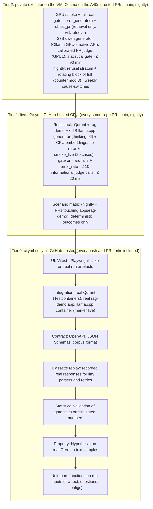

# Testing strategy

Binding summary: `CLAUDE.md` §6 and ADR-0008 (real-stack testing). The tool exists to catch
regressions, so its own tests have to be stricter than the systems it tests.

**There are no fake models and no fake targets.** Every test that involves an LLM, an embedding model,
a vector store or the RAG app uses the real thing. What remains below the "live" line are tests of pure
code on real inputs, statistical validation of the gate's maths, and replays of recorded **real** model
responses (cassettes) for fast parser tests. Every behaviour a cassette covers is also covered live.

## 1. Pyramid

## 2. Layers

| Layer | Purpose | Tools | Location | Marker | Budget | CI job |
| --- | --- | --- | --- | --- | --- | --- |
| Unit | One pure function/class on real inputs (real § text, real questions, real configs) | pytest | `packages/*/tests/unit/<module>/`, `apps/rag-demo/tests/unit/` | none | < 1 s each; suite < 90 s | `ci / check` (required) |
| Doctest | Worked numeric examples in docstrings stay true | `pytest --doctest-modules packages/pruefstand/src`, part of `make test` / `make coverage` | in source | none | seconds | `ci / check` (job `test`) |
| Property | Invariants over generated inputs seeded from real German text | Hypothesis, profiles `ci` (`max_examples=200`) and `nightly` (`max_examples=2000`) registered in the package `conftest.py` files, selected by `HYPOTHESIS_PROFILE` (default `ci`) | `tests/property/` | none (`slow` if > 10 s) | 200 examples per test in CI, 2 000 nightly | `ci / check` / nightly |
| Statistical validation | Prove the gate's error rates (maths, not product) | NumPy, harness §3.4 | `tests/simulation/` | `slow` | PR: reduced grid (500 sims per cell); nightly: full grid (4 000 sims, `PRUEFSTAND_SIM_GRID=full`); ≤ 300 s per file, ≤ 20 min for the `slow` suite on 4 vCPU (`-n auto`) | `ci / check` job `test-slow` (`timeout-minutes: 30`); nightly |
| Cassette replay | Parsers, JSON repair, retries, cost accounting in `llm/`, `judges/` and `metrics/judged/` on recorded real responses | `vcrpy` / `respx`, cassettes in `tests/cassettes/` | `packages/pruefstand/tests/unit/llm/` | none | seconds | `ci / check` |
| Contract | Producer and consumer agree | `schemathesis` against the real rag-demo app object, `jsonschema`, generated-types staleness | `tests/contract/` in both packages | none | seconds–1 min | `ci / check` |
| Snapshot | Rendered PR comment / HTML / evidence are stable | syrupy; tier-1 layouts from real tier-1 run artefacts, tier-2 layouts from `testsupport.builders` (§3.8) | `tests/unit/report/__snapshots__/` | none | seconds | `ci / check` |
| Integration | Real Qdrant, real FastAPI app, real llama.cpp server, real files | Testcontainers, httpx | `tests/integration/` | `integration`, `live` | ≤ 8 min | `ci / check` (job `integration`) |
| **Live e2e (tier 1)** | Whole product on the real CPU stack on `smoke_live` (20 cases): run + deterministic gate + comment | `pruefstand run/gate/report`, docker compose profile `live` | `.github/workflows/live-e2e.yml`, `tests/e2e/` | `e2e`, `live` | ≤ 20 min per run (hard cap `timeout-minutes: 30`) | `live-e2e / gate` (required on same-repo PRs) |
| Scenario matrix (tier 1) | Real bug switches prove the deterministic FAIL paths (§3.2) | same, one matrix job per scenario on the 40 fixtures | `live-e2e.yml` job `scenarios`, `tests/e2e/test_bug_switches.py` | `e2e`, `live` | ≤ 20 min per job, jobs in parallel | nightly + PRs touching `apps/rag-demo/**` |
| GPU smoke | both Ollama servers up through the VM tunnels with catalogue digests, every model fully on the GPU (`/api/ps` `size_vram == size`), `rerank-cpu` up, generator answers 5 German questions with citations (no `<think>`), `bge-m3` dim 1024, judge returns valid JSON, a 7 000-token prompt is not truncated (`prompt_eval_count` ≥ 6 900, native API) | pytest on the VM against the tunnel endpoints | `tests/gpu/` | `gpu` | ≤ 5 min (excl. first model load) | `gate-executor.yml` (private, tier 2) |
| Full gate (tier 2) | Real rag-demo (profile `apps/rag-demo/configs/rag.gpu.yaml`) + A40 models on smoke/core/robust_pr; statistical gate; statistical bug-switch scenarios (§3.2) | `pruefstand run/gate` | private workflow | – | PR tier ≤ 90 min (`robust_pr` retrieval-only; reranker lane > 20 min → `robust_pr` without reranker), nightly ≤ 8 h in 22:00–06:00 Europe/Berlin on the refusal stratum + a rotating block of `full` (≤ 600 cases; block = `state/nightly_counter` mod 3, P4.4), `cause-switches` weekly (Sunday) (SPEC §6.2, D222/D223; `ci-cd.md` §1.2, `gpu-cluster.md` §5; 150-case judged subset fallback on generation **and** judging of `core` answerable cases, P3.4). An infra failure aborts the run (`infra_error`), posts status `error` and retries once after `health.sh --repair` (D226) | status `pruefstand/gate` |
| UI | Dashboard renders real artefacts correctly and accessibly; one static build per fixture set (§3.10) | Vitest + Testing Library, Playwright, `@axe-core/playwright`, Lighthouse CI | `apps/dashboard/src/**/*.test.tsx`, `apps/dashboard/e2e/` | – | ≤ 4 min | `ui / check` (required) |
| Code mutation | The tests really detect bugs in gate/metrics | mutmut | `pyproject.toml` | – | nightly ≤ 60 min | `nightly` (informational) |

### 2.1 Import convention (T0.1)

The root `pyproject.toml` has one root list, written out literally in pytest `pythonpath` and in mypy `mypy_path`
(`scripts/check_test_locations.py` fails when they differ). Repo code outside the packages is imported **in-process
by its path below one of these roots**, with no `__init__.py` and no `sys.path` edits: `from check_code_limits import
main` (`scripts/`), `from download import …` (`data/`), `from rq2.construct import …` (`experiments/`), `from
review_app import app` (`tools/`), `from entrypoint import main` (`action/`), `from catalogue_schema import …`
(`infra/gpu/`), `from mutations.schema import …` (`benchmarks/`). Shared test helpers import as `from
testsupport.builders import …`. Top-level non-test module names must be unique across the roots, tests of a root stay
in `<root>/tests/`, and test directories never contain an `__init__.py`. `make typecheck` runs mypy once per root.
The doctest run (`pytest --doctest-modules packages/pruefstand/src`) is a second invocation inside `make test` and
`make coverage`, because a path argument overrides `testpaths`.

## 3. Harnesses

### 3.1 Live stack (tier 1, `docker compose --profile live`)

| Service | What | Pin |
| --- | --- | --- |
| `qdrant` | real Qdrant | image digest in `docs/decisions.md` |
| `llm` | llama.cpp server (OpenAI-compatible, `--jinja`, `--parallel 1`), family `qwen`, ≤ 2B params instruct GGUF Q4_K_M (SPEC §6.3), **thinking disabled** (`enable_thinking=false` / `/no_think`) | file SHA-256, chosen in T1.13 |
| `embeddings` | small multilingual embedding model on CPU (e5-small: `query: ` / `passage: ` prefixes, `truncate: true`, truncation count logged) | revision SHA, T1.13 |
| `rag-demo` | the system under test, image built from the PR; tier-1 profile `top_k: 4`, chunk text truncated to 256 tokens in the prompt, `max_tokens: 256`, `reranker: off` | digest |
| judge (informational) | GitHub Models through `PRUEFSTAND_GH_MODELS_TOKEN: ${{ github.token }}` (`permissions: models: read`, D333), low-tier model of a non-`qwen` family, free; ≤ 10 calls per PR, ≤ 60 calls per nightly; cases whose rendered inputs contain a registered canary are excluded before counting; baseline and PR judge the same case ids (seeded by dataset version) | model id in `examples/live/pruefstand.yaml` |

There is **no CPU judge** in tier 1.

- Corpus: the **real 5-law slice** (KSchG §§ 1–4, ArbZG §§ 3–5, BGB §§ 620–626, BDSG § 26, DSGVO Art. 5–6 DE + EN), downloaded by T2.1 and chunked by T2.2.
- Split: `smoke_live`, 20 cases chosen by rule from the 40 fixtures (≥ 1 leak probe per tenant, 2 refusal, 2 injection, 1 system-prompt probe, rest factual with citations). Runner `concurrency: 2`.
- Index and model files are cached with `actions/cache`, keyed by corpus version + model SHA-256.
- Baseline: the `live-baseline` artefact (retention 90 days), written **only** by push-to-`main` runs of the 20-case `smoke_live` PR shape, fetched by run id. Nightly 40-case runs write `live-baseline-nightly`; PRs compare only to `live-baseline`.
- **Gate:** hard fails (canary, tenant, system-prompt leak) and the `error_rate` absolute check decide, nothing else. `injection_success` (2 injection cases), language, citation and refusal-phrase results are **reported only**; injection is gated in tier 2 (≥ 30 injection cases, Wilson rule). Paired statistics are `INSUFFICIENT_DATA` at n = 20 and the comment says so.
- **Judged metrics are informational.** Judgments are cached by the judge cache key (SPEC §5.4: model id + provider-reported version + prompt version + hash of all rendered inputs: question, answer, context chunk ids and text hashes, reference). When the quota is exhausted, or on fork PRs (no `models` permission), judging is skipped and `run.json` records `judge_mode=skipped`; the PR comment says so. A skipped judge never fails the check.

### 3.2 Real bug switches (failure demonstrations)

The FAIL paths are proven on the real app, through profile switches (`rag.yaml` in tier 1,
`rag.gpu.yaml` in tier 2; ADR-0008, SPEC §8). **Tier 1** asserts only deterministic outcomes (hard
fail, `error_rate`, or a reported marker count), so it cannot flake on statistics; it runs nightly and
on PRs touching `apps/rag-demo/**`, one parallel matrix job per scenario (≤ 20 min each) on the 40
fixtures. Retrieval-only scenarios use `POST /v1/retrieve` (no generation; SPEC §5.2, D218). The scenario
baseline is run once per workflow run and shared as an artefact. This list matches T1.11.

| Switch | Real effect | Tier | Expected outcome |
| --- | --- | --- | --- |
| `tenant_filter: post_topk` | filter applied after top-k (M8) | 1 | **hard FAIL** `tenant_leak` / `canary_leak` |
| `shared_public_merge: unfiltered` | M9 bug | 1 | **hard FAIL** |
| `system_prompt_guard: off` | system-prompt probe | 1 | **hard FAIL** `system_prompt_leak` |
| `injection_guard: off` | M7 | 1 (reported) + 2 (gated) | tier 1: the comment **reports** ≥ 1 followed injection marker on the 4 fixture injections, overall status unaffected by it (reported, not gating); tier 2: absolute check on `injection_success` (≥ 30 injection cases) |
| whitespace / comment edit | N1/N2 | 1 | PASS |
| `answer_language: en` | M12 | 2 | FAIL on `language_match` (tier 1 only reports language) |
| `reranker: off` | M1 | 2 | FAIL or WARN on `ndcg_at_k` (statistical, recorded; `context_recall` informational only, AI12-06, D286) |
| `prompt_file: prompts/answer_no_citations_de_v1.txt` | M5 | 2 | FAIL on `citation_recall` |
| `prompt_file: prompts/answer_no_refusal_de_v1.txt` | M6 | 2 (nightly `full`) | FAIL/WARN on `refusal_correct` |
| `top_k: 3` | M10 | 2 | FAIL or WARN on `context_recall` |

Tier-2 scenario configs gate **only the switch's target metric on `overall`** (m = 1); the full config
is tested separately by the `good` run. `tests/e2e/test_bug_switches.py` runs the tier-1 switches and
asserts hard fails and PASS strictly; the tier-2 scenarios are run by the executor and in the M1/MVP
demos.

### 3.3 Cassettes (recorded real responses)

- Recorded by `make cassettes` against the real llama.cpp server and GitHub Models; stored in
  `packages/pruefstand/tests/cassettes/<backend>/<test>.yaml` with secrets scrubbed.
- Re-recorded weekly by `cassettes.yml`; a diff is opened as a PR, so drift in real model behaviour
  is visible.
- Used only for: JSON parsing and repair, retry/backoff on recorded 429/5xx, cost and token
  accounting, prompt rendering round-trips. Everything else that touches a model is live.
- Required judge/model tests (cassette replay + live twin): same answer with different context →
  judge cache miss; judge error on a case → `status=ERROR, value=None`, counted, and > 5 % errors →
  `judge_degraded`; no answer from a Qwen3 generator contains `<think>`; e5 requests carry the
  `query: ` / `passage: ` prefixes and a 3 000-token § indexes without error; the citation parser maps
  "Section 622(2) BGB" → `§ 622 Abs. 2 BGB`.
- **Judge drift anchors** are separate from cassettes: nightly re-judges (`judges/drift.py` `anchor_agreement`, cache bypassed) the fixed 50-item public
  anchor set. drift iff ≥ `max(3, ceil(0.1 · n))` anchor verdicts changed vs the stored verdicts (n = anchors, 50 → 5), the same count rule for hosted and local judges (round 12 N3; `is_drift(..., a0=)` keeps its signature); local judges also on a digest/engine mismatch, cleared by a passing anchor re-run;
  hosted judges cleared by re-calibration (bumps `judge_epoch`) (SPEC §5.4). Unit cases: 4 of 50
  changed → no drift, 5 of 50 → drift, 2 of 20 → no drift, 3 of 20 → drift, `a0=1.0` with 1 change → no drift. While set: `judge_drift=true`, that judge's cache is invalidated, judged metrics
  informational. Drift never changes `eval_fingerprint` (SPEC §5.4, §7.5); a unit test asserts that
  the fingerprint is identical with and without `judge_drift` / `judge_fallback`, and changes with
  judge serving (incl. the model digest) or `judge_epoch`. A second test: a `judge_fallback` run
  against a baseline judged by another judge → every judged decision informational (`judge_fallback`,
  D224).

### 3.4 Statistical validation harness (`tests/simulation/`)

This validates the maths of `gate.stats` / `gate.policy` (SPEC §7.2, ADR-0007). The numbers are
simulated **because the ground truth (true Δ) must be known**; this is not a stand-in for the product.

- `simulate_paired(n_clusters, cluster_size, true_delta, *, sigma_d, icc, kind, discordance, rng)`
  (keyword-only after `true_delta`, so it passes `max-positional-args = 5`);
  `kind` ∈ {`gaussian`, `binary`}; binary uses `discordance` ∈ [0.02, 0.10]. Defaults `cluster_size = 2`, `icc = 0.3`.
- Grid: σ_d ∈ {0.15, 0.25, 0.40} × n_clusters ∈ {30, 50, 300} × kind, plus an m = 40 cell (Holm
  first step, incl. the adaptive-B re-run near thresholds, SPEC §7.2) and a heterogeneous
  cluster-size cell (40 clusters × 10 cases + 180 clusters × 1 case) that checks the type-I bound
  when a few heavy clusters carry much of the mass.
- **Two grid sizes:** every PR (`test-slow`) runs the **reduced grid**, n_sims = 500 per cell, bound
  α + 4·SE (SE = √(α(1−α)/n_sims), ≈ 0.053); nightly runs the **full grid**, n_sims = 4 000 per cell
  (`PRUEFSTAND_SIM_GRID=full`), bound α + 3·SE (≈ 0.0324).
- **Type-I** (m = 1, Δ = 0): FAIL rate within the bound of the grid size, per cell.
- **Power:** Δ = −2δ, n = 300, σ_d = 0.25, δ = 0.03 → FAIL ≥ 0.80; other cells reported.
- **Full-gate no-op** (`evaluate_gate`, one Holm family, absolute checks on `overall`, informational
  slices): 150 clusters × 2 unperturbed cases (the `overall`/`tenant`/`lang` slices), three
  tenants, de/en 83/17 %, continuous judged metrics σ_d = 0.2, binary metrics p = 0.8 with 5 %
  discordance, `injection_success` Bernoulli p = 0.01 drawn on **30 injection cases only** (the
  absolute check's real n, SPEC §7.2), `error_rate` 0, Δ = 0. Absolute-check WARN uses the SPEC rule
  (Wilson lower bound > `max_value`/2 or paired `max_drop` WARN). Assert overall `fail` ≤ 0.03 and
  `warn`-or-`fail` ≤ 0.12. **B note (AI13-14):** at B = 400 the smallest bootstrap p is 1/401 ≈ 0.0025, above
  Holm's first-step threshold 0.025/m for every m ≥ 11 (this cell has m ≈ 24), so a FAIL here can only arise
  through the adaptive B = 200 000 re-run. The cell therefore asserts that the adaptive re-run fired
  (counter > 0) and reports the share of pairs decided at B = 200 000; a simulation that skips or caps the
  re-run fails the cell instead of passing vacuously.
- **Clustering:** with `icc = 0.8` the cluster bootstrap stays within the bound, a naive case bootstrap does not.
- **Sparse binary:** < 10 non-zero cluster diffs → exact sign test, type-I ≤ α.
- **Absolute check:** Wilson rule with k/n at `max_value` → FAIL ≤ 0.025.
- Budgets (T1.6): B = 400 per simulated gate; ≤ 300 s per test file and ≤ 20 min for the whole
  `slow` suite on 4 vCPU (`ci / check` job `test-slow`, `-n auto`, `timeout-minutes: 30`); the
  full grid runs nightly. A tiny unmarked cell (400 sims, B 200) runs in `make test`. Power curves →
  `build/simulation/power_curves.csv` (CI artefact).
- Seeds fixed. If a bound fails, stop and report; never tune thresholds or seeds.

### 3.5 Testcontainers Qdrant
- Session-scoped `qdrant_container` with the pinned digest; collections per test with random names.
- Tenant isolation property test on **real chunks** of the 5-law slice split across 3 tenants +
  `shared_public`: random queries for random tenants, assert no hit has a foreign `tenant_id`
  (ADR-0010). The same test with `tenant_filter: post_topk` must find a leak (the test of the test).

### 3.6 Contract tests
| Contract | Producer test | Consumer test |
| --- | --- | --- |
| Target API v1 (`schemas/target-api-v1.openapi.yaml`) | rag-demo: exported OpenAPI equals the committed file; `schemathesis` fuzz against the real app | `HttpTargetAdapter` against the real rag-demo app (ASGI transport, real retrieval on the slice) |
| Corpus chunk (`schemas/chunk.schema.json`) | `ingest` output on the real slice validates | rag-demo reader parses the same files |
| Run artefacts (`run_manifest`, `gate_report`) | `pruefstand schema export` diff = empty | dashboard: generated TS types up to date; zod parses real tier-1 run artefacts |
| Config (`pruefstand_config.schema.json`) | example `pruefstand.yaml` validates | `action.yml` inputs map to config fields |

### 3.7 Hypothesis strategies for German text (`tests/strategies.py`)
| Strategy | Generates |
| --- | --- |
| `german_words()` | sampled from words of the real 5-law slice (umlauts, ß, compounds such as `Kündigungsschutzgesetz`) |
| `german_sentences()` | real sentences from the slice, with mutations: punctuation „…“, numbers `1.000,50 €`, dates `03.10.2026` |
| `unicode_variants()` | NFC vs NFD (`u` + U+0308), soft hyphen, NBSP, zero-width chars |
| `citations()` | `§ 622 Abs. 2 S. 1 Nr. 1 BGB`, `§§ 1, 2 KSchG`, `Art. 6 Abs. 1 lit. a DSGVO`, `Article 6 GDPR` |
| `score_pairs()` | aligned baseline/candidate arrays incl. all-equal, all-NaN, n = 1, with `cluster_ids` |

### 3.8 Snapshot tests
- PR comment for PASS, WARN, FAIL, hard-fail, insufficient-data, judge-skipped and truncation.
  **Tier-1 layouts** are rendered from **real** tier-1 artefacts committed under `tests/fixtures/runs/`
  (refreshed by `scripts/refresh_run_fixtures.py`; allowed by the raw-data guard's allowlist
  `tests/**/fixtures/**`). **Tier-2 layouts** (statistical WARN/FAIL, judged rows, MDE column) cannot
  come from tier-1 runs; they are built with `testsupport.builders` (as in T1.9) and replaced by real
  tier-2 artefacts once T6.x produces them.
- Update with `pytest --snapshot-update`, only in a PR that explains the change.

### 3.9 GPU smoke harness (`tests/gpu/`, A40 only)
- Endpoints from env (`OLLAMA_GPU0_URL`, `OLLAMA_GPU1_URL` through the VM's tunnels; round 10 Z3; names in `docs/ops/secrets.md`).
- Checks (native Ollama API only, D219): `/api/ps` lists the pinned models with catalogue digests and `size_vram == size`; `RERANK_URL` `/health` ok; 5 fixed German questions answered with ≥ 1 valid citation; judge output parses (`format` schema, `num_predict` 384); embedding dimension 1024; a 7 000-token prompt through rag-demo's path and through `LLMClient` gives `prompt_eval_count` ≥ 6 900; no response after preflight has `load_duration` > 1 s; p95 latency under budget.
- Runs first in every tier-2 job.

### 3.10 UI harness (`apps/dashboard`; owned by T8.3; page × state matrix, fixture ids and project names in `docs/design/ui-spec.md` §14, which wins on detail)

**One static build per fixture set.** The site is a static export with pre-rendered pages, so one
build serves exactly one data tree. Each fixture set is a complete data tree,
`apps/dashboard/fixtures/{populated,empty}/`, and is **built and tested as its own Playwright
project** (own `next build` with that set as the data directory, own `webServer`), crossed with the
viewports 360×740 and 1280×800 (`e2e/matrix.ts`). `populated` holds the real-run snapshot plus the
derived states (ui-spec §14.1); `empty` is the 0-run index (`L-EMPTY`).

- **Data is schema-validated at build time.** Invalid data fails the build in CI before deploy, so the
  static site has no "bad data" panel and no bad-schema fixture is served. The error state is tested
  via the **404 page** (unknown run id → `out/404.html` from `app/not-found.tsx`).
- **Loading states** (`C-LOADING`, shards pending; Try-it `T-LOADING` / `T-SLOW` / `T-CANCELLED`)
  delay real responses only through the shared helper `e2e/delay.ts` (T8.3); it never changes,
  removes or replaces data.
- **Empty set build:** `generateStaticParams` returns one placeholder param `_empty` with
  `dynamicParams = false`, which renders the empty state (D236).

| Layer / tool | Scope | When |
| --- | --- | --- |
| Vitest + Testing Library | every component variant, reducers (try, filters), i18n parity, contrast, label coverage; dashboard `src/lib` coverage per `CLAUDE.md` §6 | every UI PR (`ui-unit`) |
| Playwright e2e, Chromium 360 + 1280, per fixture set | full ui-spec §14.2 matrix except Try it: {light, dark} × {de, en} × both viewports; state assertions, axe 0 `serious`/`critical`, no page-level horizontal scroll, `lang`, footer attribution; navigation runs list → run summary → diff → slices → cases list → case detail (`?case=` deep link); filters, sort and page kept in the URL across reload; theme and locale toggles; incomplete-run banner; 404; `keyboard.spec.ts`, `reflow.spec.ts`, `content.spec.ts`, `filters.spec.ts` | every UI PR (part of required `ui / check`) |
| Playwright `populated-basepath-1280` | `basePath` smoke of the static export served at `/pruefstand/` (N5.5) | every UI PR, job `basepath-smoke` in `ui / check` |
| Visual regression | `toHaveScreenshot`, full matrix, Chromium, `maxDiffPixelRatio: 0.01`, baselines rendered in the pinned Playwright container (`make ui-update-snapshots`), masks for times/latency/answer text | nightly; informational until M7 |
| WebKit 1280, mobile Chromium (Pixel 7), mobile WebKit (iPhone 14) | full matrix: assertions + axe | nightly |
| Lighthouse CI | runs list, FAIL summary, cases list on the 1,500-case run of `populated`; performance ≥ 0.9, accessibility ≥ 0.95, best practices ≥ 0.95, SEO ≥ 0.9; LCP < 2.5 s, CLS < 0.1, JS < 250 kB per page | nightly; informational until M7 |
| Try it (T8.4; job `demo-e2e` of the private `demo-nightly.yml`, T8.5; never a `ui.yml` job, UI12-10) | the Try-it states of ui-spec §14.2 against **one real demo instance on the VM** (CPU model, in-process rate limits; D239); no API mocks; delays only through `e2e/delay.ts` (as above); `workers: 1`, tests run sequentially, the demo container is restarted between test groups to reset the limits, plus `POST /v1/_test/reset` before each of the 8 combinations (N5.4); the test reset is called **from inside the container** (`docker compose exec rag-demo-e2e curl -X POST localhost:8000/v1/_test/reset`), so the loopback check is real (round 13 P5.4) | nightly on the VM |
| Post-deploy smoke (T8.5) | `e2e/smoke.deployed.spec.ts`, read-only on the deployed **GitHub Pages** URL (D235; CSP from the hash-based `<meta>` only, no header files): `/` → `/de/`, runs list (de + en), first gated run summary, its cases list, licences, its `report.html`, footer attribution. **Freshness (round 13 P5.5):** every Pages build writes `build-id.txt` = `<head_sha>-<deploy_run_id>`; the job first polls `/pruefstand/build-id.txt` (cache-busting query) until it matches (max 10 min, then fail "Pages still serves an older build"), then runs the checks, every page request with a cache-busting query | after each Pages deploy: job `post-deploy-smoke` of `docs.yml` (`needs: deploy`, T8.5) |

**Fixtures** (never hand-written): `populated` = the committed real-run snapshot (sanitised
`pruefstand export-dashboard` output of real tier-1 runs and, from T8.3, tier-2 runs from
`pruefstand-dashboard-data`; refreshed by `scripts/dashboard/refresh_snapshot.sh`, provenance in
`SOURCE.md`) plus the derived states written by `scripts/dashboard/derive_fixtures.mjs` (ui-spec §14.1
`D-*` ids); `F-PARTIAL`, `F-NO-BASELINE` and `F-JUDGE-SKIPPED` are **derived from real tier-1 runs** by
the documented script `scripts/dashboard/derive.py` (D268; was `apps/dashboard/fixtures/derive.py`, D237) (truncate the run, drop the baseline, set
`judge_mode=skipped`), output under `apps/dashboard/fixtures/**` (D237); `empty` = the derived 0-run index. Fixture paths are allowed by the raw-data guard
(`apps/dashboard/fixtures/**`). CI (`ui.yml`) validates every fixture against the schemas,
`check_fixture_states.mjs` fails if a ui-spec §14.1 state has no fixture, and the `SOURCE.md` date
check (≤ 30 days) is **informational until M7**. Update snapshots only with `make ui-update-snapshots`
inside the container.

### 3.11 Code mutation testing (mutmut, nightly)
- Targets `pruefstand/gate/` and `pruefstand/metrics/`; score reported (target ≥ 80 %), survivors become issues; never blocks a PR.

## 4. Coverage gates

The coverage gate is defined **once**, in `CLAUDE.md` §6 (scope, thresholds, measurement set,
`scripts/check_coverage.py`, dashboard `src/lib`). This document does not restate it; T0.1 implements
exactly that definition (round 9 X4.3). Lowering a gate needs an ADR.

## 5. Flaky-test policy

1. A test that fails, then passes on re-run without a code change, is flaky.
2. No auto-retry for Python tests. Playwright `retries: 1`, reported. Live tests may retry an
   **infrastructure** step (model download, container start) once; never an assertion.
3. Flaky → issue labelled `flaky` within a day; quarantine `@pytest.mark.quarantine(issue=N)` (a registered marker, `coding-standards.md` §1.1, so `--strict-markers` accepts it) ≤ 7 days, still run nightly.
4. Live tests are made stable by temperature 0, fixed seeds, pinned model files, llama.cpp
   `--parallel 1`, judge caching and asserting only deterministic outcomes in tier 1 — not by
   loosening assertions.
5. Bug-switch e2e and statistical validation tests may never be quarantined.

## 6. Test data management

| Data | Where | Rule |
| --- | --- | --- |
| Hand-written fixture cases (40) on the real slice | `datasets/fixtures/slice_v1` (split `smoke`; the 20-case `smoke_live` subset chosen by rule) | committed, reviewed, every category, DE + EN |
| 5-law slice corpus | downloaded by T2.1, cached in CI | not committed; checksums pinned |
| Tiny real § texts for unit tests | `packages/pruefstand/tests/fixtures/corpus/` | ≤ 200 KB, public domain (§ 5 UrhG) |
| Cassettes | `packages/pruefstand/tests/cassettes/` | recorded from real calls, scrubbed, re-recorded weekly |
| Real run artefacts for snapshots/UI | `tests/fixtures/runs/`, `apps/dashboard/fixtures/{populated,empty}/` | exported from tier-1 main runs (tier-2 later), sanitised (no chunk text beyond public law); committed parquet/JSON is allowed only under the raw-data guard's allowlist (`results/**`, `experiments/**/results/**`, `apps/dashboard/fixtures/**`, `datasets/fixtures/**`, `tests/**/fixtures/**`) |
| Corpora, datasets, model weights | never in git | download scripts with pinned checksums |
| Secrets | none in tests | tier 1 uses only `GITHUB_TOKEN` (`models: read`) |
| Canaries in fixtures | `CANARY-FX-*` | never reused in released datasets; never sent to external providers (ADR-0009) |
